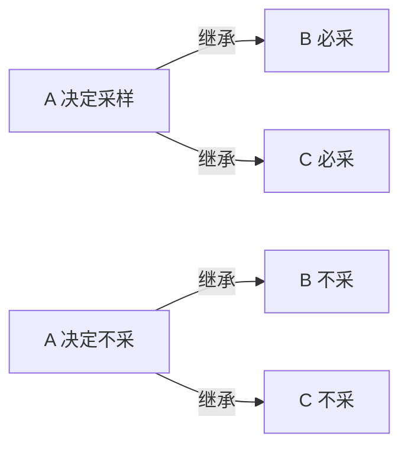
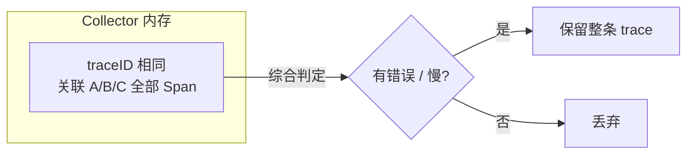
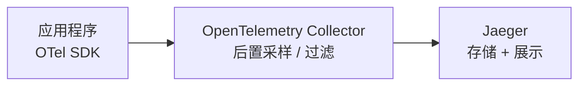

# 27. Go APM 监控系统实战: 链路追踪系统落地过程中的挑战

## 纲要

- 落地链路追踪会撞上两个现实问题：**链路数据量太大**、**研发改造成本高**
- 数据量问题靠「采样」解决，采样分两类：**前置采样**与**后置采样**
- 前置采样：在链路第一个节点决定整条是否采集，下游继承；无法针对「错误 / 慢」做决策
- 后置采样：收集齐整条 trace 后再综合判定，可按错误、慢查询、慢 gRPC 筛选；靠 OTel Collector 在内存按 `traceID` 关联实现
- Jaeger 本身只有前置采样，要后置采样必须搭配 **OpenTelemetry Collector**
- 改造成本问题：Go 没有 Java 探针机制，只能**手动埋点**改造基础组件；可关注社区零侵入方案（eBPF）

## 挑战一：链路数据量太大，怎么存、怎么查

要让链路追踪在出问题时真正还原现场，就必须记录大量执行链路数据。但如果不加控制，这些数据绝大部分是无意义的正常请求，会瞬间把存储和查询成本推高。

解决办法是**采样（Sampling）**：只保留有价值的那部分链路，让整体数据量降到可控量级。业界把采样分成两大类。

### 前置采样（Head Sampling）

在采集请求链路时，**由链路的第一个节点**决定是否采集整条 trace。如果节点 A 决定采样，那么 A、B、C 三个节点的 Span 都会被采集下来——B、C 的采样策略**继承**自 A。

实现逻辑很简单：只需要在整条链路最开始的节点做一次判定即可。

**致命缺陷**：因为「采不采」在入口（A）就定死了，它无法根据整条链路的完整情况来决策。举例：你希望「只要链路里发生了错误就采集」，但错误发生在 C 节点，而采不采由 A 决定——前置采样就无能为力。线上环境为了不漏掉异常链路，只能把采样率关到 100%，结果又回到「数据量巨大」的老路。

### 后置采样（Tail Sampling）

后置采样**先收齐整条 trace 的所有 Span，再综合判定**是否保留。实现上（以 OpenTelemetry Collector 为例）：它把这些 span 数据在内存里**缓存一段时间**，利用相同的 `traceID` 把属于同一条请求的 Span 关联起来，再统一决定这条 trace 该不该留。只要其中任一子 Span 命中策略，整条 trace 都会被保留。

有了后置采样，就能定义真正有意义的策略：

- 采集**发生了错误**的链路
- 采集存在**慢查询**的链路
- 采集**慢 gRPC 请求**的链路

这样保证采集到的数据每条都有价值，海量无用数据被丢弃，存储与查询成本大幅下降。

### Jaeger 与 OpenTelemetry Collector 的分工

- **Jaeger** 具备采集和展示链路数据的能力，但**只支持前置采样**，没有后置采样。
- 想要后置采样，必须**搭配 OpenTelemetry Collector**：应用通过 OTel SDK 把 trace 数据发往 Collector，由 Collector 做后置采样的筛选，再把筛选后的有效数据发往 Jaeger 存储与展示。

这正是前面反复强调「用 OpenTelemetry 落地」的原因。其标准采集架构（Jaeger 官方推荐部署模式）如下：

如果后置采样之后数据量依然庞大，就需要对采集架构进一步扩展（这部分放到后续 APM 系统升级优化的内容里），本章先以「采用后置采样」作为落地方案。

## 挑战二：研发改造成本高

要用好链路追踪，往往要对很多基础组件做改造、加自定义埋点。不同语言已有的解法不同：

- **Java** 可以通过**探针（agent）**机制，几乎零成本接入链路追踪；
- **Go** 没有探针模式，只能**手动埋点**，逐个改造基础组件（HTTP Client/Server、gRPC、Redis、MySQL 等）。因此 Go 项目接入链路追踪的**研发改造成本比较大**。

社区有开源项目 aimed at 让 Go 零侵入接入链路追踪（例如基于 eBPF 的自动监控方案），但目前支持零侵入的组件还不多。所以在整个链路追踪落地过程中，本课程会采用**手动埋点**方式，涉及大量基础组件的改造，并讲解改造时用到的技巧与部分 Go 基础组件源码。

| 语言 | 接入方式 | 改造成本 |
| --- | --- | --- |
| Java | 探针（agent）自动注入 | 低 |
| Go | 手动埋点改造基础组件 | 高 |

## 小结：两个挑战的应对

- **数据量** → 前置采样（简单但盲区大）或后置采样（OTel Collector，按需保留错误 / 慢链路）
- **改造成本** → Go 只能手动埋点，本章随后逐组件改造 HTTP / gRPC / Redis / MySQL

