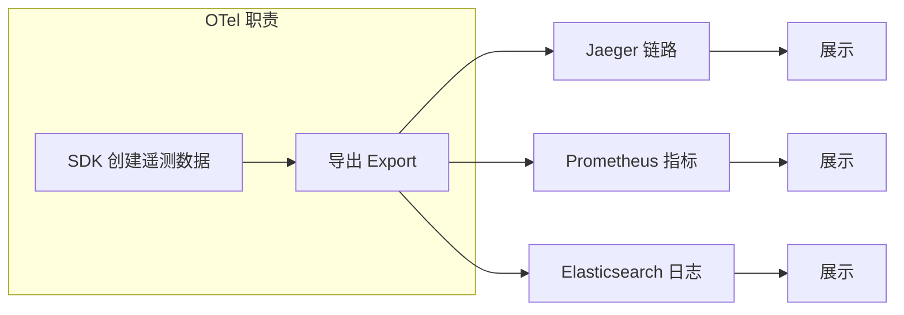

# 28. Go APM 监控系统实战: OpenTelemetry 项目组成与定位

## 纲要

- OpenTelemetry（OTel）不是单个软件，而是一套**工具集**，目标是统一客户端遥测数据的规范
- 三类遥测数据：**日志（Logs）、指标（Metrics）、链路追踪（Traces）**，统称 `Telemetry Data`
- OTel 只负责**创建、管理、导出**遥测数据；存储与可视化交给 Jaeger / Prometheus / ES 等
- 核心组成：多语言 **SDK**、**OpenTelemetry Collector**、**自动注入**机制、K8s 部署工具、Ecosystem
- Collector 是落地的核心：提供强大的预处理（如链路追踪的后置采样）并转发到后端
- 成熟度：链路追踪已成熟；指标与日志仍不完善（指标导出尚处实验阶段）
- 本课程用法：用 OTel 导出 **trace** 数据，指标展示仍用 Prometheus 原生 SDK

## OpenTelemetry 到底是什么

构建可观测体系（也就是构建 APM 系统）通常靠日志、指标、链路追踪三门技术，它们是服务可观测性的三大基石。在 OpenTelemetry 里，这三类数据被统一称为**遥测数据（Telemetry Data）**。

OTel 要完成的核心功能，是**规范客户端在创建和使用遥测数据时的行为，且与具体的监控后端解耦**。也就是说，你用 OTel 生成和导出的数据，可以发往 Jaeger（链路）、Prometheus（指标）或 Elasticsearch（日志）——存哪里、怎么展示，由其他开源或商业监控组件决定。

一句话总结：**OpenTelemetry 是一套为统一客户端规范而生的主线，具体的存储与展示由其他监控软件完成。**

## OpenTelemetry 的组成

OTel 是一个大的工具集合，包含以下关键部分：

- **多语言客户端 SDK**：为各种编程语言提供 SDK。因为大家都用同一套 SDK，所以生成和导出遥测数据的逻辑是统一的，只是实现语言不同。这也是本课程在 Go 里接入链路追踪的基础。
- **OpenTelemetry Collector**：一个代理（agent）软件，能把遥测数据发往 Jaeger、Prometheus 等后端。它的核心价值在于对数据做**强大的预处理**——例如对链路追踪数据做**后置采样**、过滤、批处理。它是使用 OpenTelemetry 时**毫无疑问的核心组件**。
- **自动注入 / 零侵入监控机制**：提供不改动业务代码就能监控系统的能力。例如 Java 客户端 SDK 已有成熟的**探针（agent）**机制；Go 方向则有基于 **eBPF** 的自动监控开源项目。
- **K8s 部署工具**：如 `opentelemetry-operator`、`opentelemetry-helm-charts`，方便在 Kubernetes 中部署 OTel 相关组件。
- **Ecosystem 系统**：OTel 官方维护的一个检索系统，方便快速查找各语言库、插件及其用法，定位对应的集成组件。

## 成熟度现状

虽然 OTel 涵盖日志、指标、链路追踪三门技术，但三者的完成度并不均衡：

| 遥测数据类型 | 成熟度 | 说明 |
| --- | --- | --- |
| 链路追踪（Traces） | **成熟** | 可放心用于生产落地 |
| 指标（Metrics） | 实验性 | 高级导出能力仍处实验阶段 |
| 日志（Logs） | 不完善 | 相对滞后 |

从 OTel 官网可以看到：在 *Language* → 对应语言 SDK 下能找到 trace 与 metric 的导出示例，但 **metric 部分的高级特性目前仍是实验性的**。

正因如此，本课程的策略是：

- **链路追踪**：直接使用 OpenTelemetry 的 trace 数据导出能力（成熟、可靠）；
- **指标**：仍使用 **Prometheus 原生 Go SDK** 来实现指标展示逻辑，不依赖 OTel 尚不完善的 metric 部分。

这也是为什么前面讲采样架构时，要让 OTel Collector 把 trace 发往 Jaeger，而指标面板走 Prometheus——各取所长。

## 与「OpenTracing 到 OpenTelemetry 演进」的关系

前面聊过 OpenTracing 与 OpenTelemetry 的历史演进与定位差异；本节聚焦的是 **OpenTelemetry 项目自身的组成结构**。简单区分：

- **演进视角**回答「为什么 OpenTracing 被 OTel 收编、OTel 站在什么历史位置」；
- **组成视角**（本节）回答「OTel 这套工具箱里到底有哪些零件、各自干什么」。

两者互补：理解了历史，才知道为什么我们选 OTel；理解了组成，才知道落地时要装哪些组件、Collector 为什么是核心。

## API 速览（概念层）

| 组件 / 概念 | 角色 |
| --- | --- |
| 多语言 SDK | 在客户端统一创建、导出遥测数据 |
| OpenTelemetry Collector | 代理 + 预处理（后置采样 / 过滤 / 批处理），转发明细到后端 |
| 自动注入（Java agent / eBPF） | 零侵入采集遥测数据 |
| operator / helm-charts | K8s 内部署 OTel 组件 |
| Ecosystem | 检索 OTel 库与插件用法的官方系统 |
| Telemetry Data | 日志 + 指标 + 链路的统称 |

