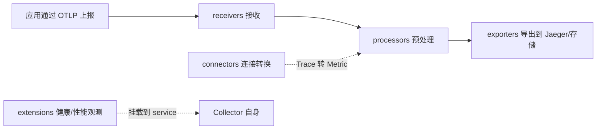

# 29. Go APM 监控系统实战: OpenTelemetry Collector 安装与配置详解

## 纲要

- OpenTelemetry Collector 的多种安装方式：Docker、docker-compose、Kubernetes、二进制直装；本实战统一用 docker-compose 与其他监控组件一起编排
- 配置文件的两大职责：声明 Collector 需要暴露的端口，定义遥测数据的导入 / 导出规则
- 配置文件的四大组件类型：`receivers`（接收）、`processors`（预处理）、`exporters`（导出）、`connectors`（连接 / 转换，如把 Trace 转成 Metric）
- `service.pipelines` 把上述组件按遥测类型（traces / metrics / logs）串成流水线；未在 pipeline 中声明的组件不生效
- `service.extensions` 用于挂载观测 Collector 自身的辅助插件：`health_check`、`pprof`、`zpages`
- 每个插件的具体配置要去 OpenTelemetry 官方注册表（registry）查对应 README，而不是凭记忆写

## 安装 Collector

Collector 是一个与语言、厂商无关的独立进程，官网的 install collector 页面给出了多种部署形态：

- 直接拉取二进制运行
- 使用容器镜像在 Docker 中运行
- 用 docker-compose 编排（适合把 Collector 和 Jaeger、数据库等一起拉起）
- 在 Kubernetes 中通过 Helm 或 Operator 部署

本实战采用 docker-compose 方式：把官方给出的 compose 片段复制进我们的 `docker-compose.yaml`，就可以随其他监控组件一起 `docker compose up -d` 启动。这样 Collector、Jaeger 共享同一张网络，端口与依赖关系集中管理。

## 配置文件的结构

Collector 启动时必须带一份配置文件（通常以 `--config` 指定）。这份文件解决两件事：**暴露哪些端口**、以及**遥测数据进来之后怎么处理、往哪发**。

整体数据流遵循固定的三段式：



逐块说明：

| 配置块 | 角色 | 说明 |
| --- | --- | --- |
| `receivers` | 接收端 | 声明"怎么收数据"，常用 `otlp`（同时支持 gRPC/HTTP） |
| `processors` | 预处理器 | 声明"收到后怎么处理"，如 `batch` 批处理、`filter` 过滤 |
| `exporters` | 导出端 | 声明"处理完往哪发"，如 `debug`、`otlp`、`jaeger` |
| `connectors` | 连接 / 转换器 | 把一种遥测数据转换成另一种，例如把 Span 聚合成指标 |
| `service.pipelines` | 流水线 | 把上面四类按 traces/metrics/logs 串起来才真正生效 |
| `service.extensions` | 扩展插件 | 挂载观测 Collector 自身的辅助组件 |

注意一个高频误区：**在 `receivers` / `processors` / `exporters` 下只是"声明"了组件，真正让它们工作的是 `service.pipelines` 里的引用**。例如下面这段，只有被 `traces` 流水线引用的 `otlp`、`batch`、`debug` 才会参与处理；声明了却没挂进 pipeline 的组件会被忽略。

相对前述侧重于客户端 SDK 与最小配置打通，本节能补充的是 `extensions` 与"如何查配置"这两块。

## extensions：观测 Collector 本身

`extensions` 是给运维 / 开发提供的"观察 Collector 是否健康"的手段，常见三个：

- `health_check`：提供健康检查端点，判断 Collector 是否在正常接收数据
- `pprof`：暴露 pprof 性能分析接口，定位 Collector 自身的 CPU / 内存瓶颈
- `zpages`：提供实时处理遥测数据的可视化页面，能看到各组件的实时吞吐

一个带 extensions 的最小配置示例（根据讲稿逻辑补充，突出 extensions 与 pipeline 引用）：

```yaml
receivers:
  otlp:
    protocols:
      grpc:
        endpoint: 0.0.0.0:4317
      http:
        endpoint: 0.0.0.0:4318

processors:
  batch:
    timeout: 5s

exporters:
  debug:
    verbosity: detailed

extensions:
  health_check:
    endpoint: 0.0.0.0:13133
  pprof:
    endpoint: 0.0.0.0:1777
  zpages:
    endpoint: 0.0.0.0:55679

service:
  extensions: [health_check, pprof, zpages]
  pipelines:
    traces:
      receivers: [otlp]
      processors: [batch]
      exporters: [debug]
```

`health_check`、`pprof`、`zpages` 必须同时出现在 `service.extensions` 里才会被启动，否则只是被声明、不会生效。

## 如何查找每个插件的具体配置

读懂配置骨架很容易，难点是"每一种 receiver / processor / exporter 到底支持哪些字段"。不要凭记忆硬写，正确做法是去 OpenTelemetry 官方注册表（registry）按组件类型检索。

例如想确认 `otlp` receiver 的配置项，就在注册表里选 `receiver` 类型，找到 `otlp` 这一项，点开它的 README，里面有完整的字段说明与示例。换用 `jaeger`、`kafka` 等其它 receiver 时，同样用注册表检索即可。

## 技术点总结

- 安装方式很多，实战统一用 docker-compose 与其它组件编排
- 配置文件的本质是"接收 → 处理 → 导出"三段流水线，外加 connectors 做类型转换、extensions 做自身观测
- 组件必须被 `service.pipelines` 引用才会生效，否则只是声明
- `extensions` 提供了 health_check / pprof / zpages 三种观测 Collector 自身的手段
- 插件的具体字段以官方注册表 README 为准，不要凭记忆写

