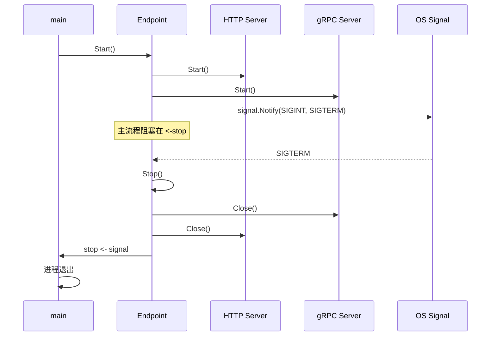

# Go APM 监控系统实战: 用 Endpoint 组件统一服务的启动与优雅退出

## 纲要

- **现状问题**：HTTP Server 与 gRPC Server 各自监听端口、各自暴露启动与关闭方法，业务层需要分别调用、分别处理错误
- **抽象方式**：声明 `Starter` 与 `Closer` 两个极简接口，让所有服务组件实现统一契约
- **注册表机制**：两个全局切片 `globalStarters` / `globalClosers` 收集项目内所有可启动、可关闭的组件
- **Endpoint 组件**：对外只暴露 `Start()` 与 `Stop()`，`Start()` 拉起全部组件并阻塞等待退出，`Stop()` 逆序关闭全部组件
- **信号监听**：独立协程监听 `SIGINT` / `SIGTERM`，收到信号后驱动 `Stop()`，通过容量为 1 的 `stop` 通道通知主流程返回
- **注册时机**：HTTP / gRPC 服务的构造函数内部完成注册，业务层无感知
- **框架价值**：后续所有链路追踪埋点、指标采集、日志刷盘等治理能力，都能挂在这套统一生命周期上

## 正文

### 为什么要抽象统一的服务生命周期

在 dogAPM 框架的前几节里，我们已经把 HTTP 框架和 gRPC 框架分别封装了一层。封装之后，`main` 函数的形态通常是这样的：

```go
httpServer, _ := apmhttp.NewServer(":8080")
grpcServer, _ := apmgrpc.NewServer(":8081")

httpServer.Start()
grpcServer.Start()

httpServer.Close()
grpcServer.Close()
```

这段代码能跑，但有三个明显缺陷：

1. **业务层需要知道框架细节**：业务开发者必须清楚自己用了哪几种服务、每种服务叫什么启动方法，一旦新增一种服务（比如 Kafka 消费者、定时任务），`main` 就要改一遍。
2. **启停顺序与错误处理分散**：某个服务启动失败要不要回滚已启动的服务？关闭时谁先谁后？这些逻辑散落在各个业务 `main` 里，无法统一保证。
3. **治理能力没有统一入口**：APM 框架要在服务退出时刷出缓冲区里的追踪数据、要在启动时初始化 tracer provider，如果没有统一的生命周期钩子，就只能为每个组件各写一遍。

因此这一节要做的，是把「一堆服务」收敛成「一个端点」。

### 定义 Starter 与 Closer 接口

接口设计上越简单越好，每个接口只有一个方法：

```go
// Starter 表示具备后台监听能力的组件，例如 HTTP Server、gRPC Server
type Starter interface {
	Start() error
}

// Closer 表示需要被优雅关闭的组件
type Closer interface {
	Close() error
}
```

配合两个全局切片做注册表：

```go
var (
	globalStarters []Starter
	globalClosers  []Closer
)

// Register 把组件的启动与关闭逻辑登记进注册表
func Register(s Starter, c Closer) {
	globalStarters = append(globalStarters, s)
	globalClosers = append(globalClosers, c)
}
```

这里刻意没有用 map 也没有加锁：注册只发生在进程启动阶段的单 goroutine 中（各服务构造函数里），不存在并发写。如果框架要支持动态注册，才需要引入互斥保护。

### Endpoint 的设计

`Endpoint` 是这一节的核心组件，取名「端点」，表示进程对外提供服务的整体边界：

```go
type Endpoint struct {
	stop chan struct{}
}
```

内部只有一个**容量为 1 的通道**，它的语义非常清晰：**通道里有值，就代表整个服务已经关闭完毕，主流程可以返回了**。

启动流程分三步：

1. 遍历 `globalStarters`，依次调用 `Start()`；任意一个失败立即返回错误（此时可选择由上层决定是否退出进程）
2. 拉起一个协程监听退出信号
3. 主流程阻塞在 `<-e.stop` 上

关闭流程则反过来：

```go
func (e *Endpoint) Stop() {
	// 逆序关闭，避免下游先关导致上游请求失败
	for i := len(globalClosers) - 1; i >= 0; i-- {
		if err := globalClosers[i].Close(); err != nil {
			log.Println("close component error:", err)
		}
	}
	e.stop <- struct{}{}
}
```

用 `struct{}{}` 而不是讲稿里提到的 `int`，是 Go 里更地道的写法：空结构体不占内存，纯粹用于「信号已发生」的通知语义。通道容量为 1 保证了即使 `Stop()` 被调用多次，也不会因为主流程还没来得及接收而阻塞住。

### 信号的监听与转换

什么时候调用 `Stop()`？答案是**收到操作系统退出信号时**。容器环境下最常见的就是 `kubectl delete pod` 发出的 `SIGTERM`，以及本地 Ctrl+C 发出的 `SIGINT`：

```go
func (e *Endpoint) watchSignal() {
	ch := make(chan os.Signal, 1)
	signal.Notify(ch, syscall.SIGINT, syscall.SIGTERM)
	sig := <-ch
	log.Println("receive exit signal:", sig)
	e.Stop()
}
```

整条链路串起来是这样：



注意关闭顺序是「后进先出」的：gRPC Server 后注册则先关闭，这样正在处理中的入口流量（HTTP）先摘掉，再关掉它依赖的下游能力，尽可能把在途请求处理完。

### 在服务构造处完成注册

改造的关键是**不要打扰业务层**。原来的构造函数：

```go
func NewHTTPServer(addr string) *HTTPServer { ... }
```

现在只需要让它在返回前自己登记进注册表：

```go
func NewHTTPServer(addr string) (*HTTPServer, error) {
	s := &HTTPServer{addr: addr}
	Register(s, s)   // 既实现 Starter，也实现 Closer
	return s, nil
}
```

gRPC Server 同理，同时补上缺失的 `Close()` 方法，内部调用底层 `grpc.Server` 的 `GracefulStop()`：

```go
func (g *GRPCServer) Close() error {
	g.server.GracefulStop()
	return nil
}
```

改造完成后，业务 `main` 函数被压缩成这样：

```go
func main() {
	_, _ = apmhttp.NewHTTPServer(":8080")
	_, _ = apmgrpc.NewGRPCServer(":8081")
	if err := endpoint.EP.Start(); err != nil {
		log.Fatal(err)
	}
}
```

业务代码完全不需要关心自己启了几个服务、怎么关，`dogAPM` 框架把这件事收拢了。

### 优雅退出的三个边界问题

把组件塞进统一注册表之后，还有几个点值得明确：

| 关注点 | 说明 |
| --- | --- |
| 关闭超时 | HTTP 的 `Shutdown(ctx)` 必须配超时 context，否则遇到长连接会永久挂住，进程无法退出 |
| 关闭阻塞 | gRPC 的 `GracefulStop()` 本身是阻塞的，会等待所有在途 RPC 结束；想强制退出应改用 `Stop()` |
| 资源释放顺序 | 数据库连接、Redis 连接池、tracer provider 这类底层资源应**最先注册**，才能在逆序关闭里**最后释放** |

`Shutdown` 与 `GracefulStop` 的差异是很多线上「发布时卡住」的根因：`GracefulStop` 没有超时参数，如果有客户端一直不释放流，进程就会吊住，最终被 K8s 的 `terminationGracePeriodSeconds` 强杀，反而丢失了 in-flight 请求。

## API 速览

| API | 说明 |
| --- | --- |
| `type Starter interface{ Start() error }` | 具备后台监听能力的组件契约 |
| `type Closer interface{ Close() error }` | 需要优雅关闭的组件契约 |
| `Register(s Starter, c Closer)` | 把组件的启停逻辑登记到全局注册表 |
| `(*Endpoint) Start() error` | 依次启动全部组件，并阻塞直到进程收到退出信号 |
| `(*Endpoint) Stop()` | 逆序关闭全部组件，并向 `stop` 通道投递完成信号 |
| `signal.Notify(ch, syscall.SIGINT, syscall.SIGTERM)` | 注册需要监听的操作系统信号 |
| `(*http.Server) Shutdown(ctx)` | 带超时的 HTTP 优雅关闭 |
| `(*grpc.Server) GracefulStop()` | gRPC 优雅关闭，阻塞等待在途 RPC 结束 |

> 以上接口按讲稿描述整理，具体实现以 dogAPM 框架源码为准。

## Demo 示例

下面给出一个**单文件可运行**的最小实现（根据讲稿逻辑补充），用一个真实 HTTP 服务和一个模拟 gRPC 的 TCP 服务演示整套启停流程。

**运行说明**

```bash
mkdir endpoint-demo && cd endpoint-demo
go mod init endpoint-demo
# 把下方代码保存为 main.go
go run main.go
```

程序会依次启动两个服务，1 秒后向自身发送 `SIGTERM` 模拟运维 kill，随后按逆序完成优雅退出并正常退出。示例代码依赖 `syscall.Kill`，请在 Linux / macOS 下运行。

**代码**

```go
package main

import (
	"context"
	"errors"
	"fmt"
	"log"
	"net"
	"net/http"
	"os"
	"os/signal"
	"syscall"
	"time"
)

// Starter 表示具备后台监听能力的组件
type Starter interface {
	Start() error
}

// Closer 表示需要被优雅关闭的组件
type Closer interface {
	Close() error
}

var (
	globalStarters []Starter
	globalClosers  []Closer
)

// Register 把组件的启动与关闭逻辑登记进注册表
func Register(s Starter, c Closer) {
	globalStarters = append(globalStarters, s)
	globalClosers = append(globalClosers, c)
}

// Endpoint 统一管理服务进程内所有组件的生命周期
type Endpoint struct {
	stop chan struct{}
}

func NewEndpoint() *Endpoint {
	return &Endpoint{stop: make(chan struct{}, 1)}
}

// Start 启动全部已注册组件，并阻塞直到收到退出信号且组件全部关闭
func (e *Endpoint) Start() error {
	for i, s := range globalStarters {
		if err := s.Start(); err != nil {
			return fmt.Errorf("start component[%d]: %w", i, err)
		}
	}
	go e.watchSignal()
	<-e.stop
	return nil
}

// Stop 逆序关闭全部组件，并通知主流程可以退出
func (e *Endpoint) Stop() {
	for i := len(globalClosers) - 1; i >= 0; i-- {
		if err := globalClosers[i].Close(); err != nil {
			log.Println("close component error:", err)
		}
	}
	e.stop <- struct{}{}
}

func (e *Endpoint) watchSignal() {
	ch := make(chan os.Signal, 1)
	signal.Notify(ch, syscall.SIGINT, syscall.SIGTERM)
	sig := <-ch
	log.Println("receive exit signal:", sig)
	e.Stop()
}

// HTTPServer 模拟 dogAPM 封装后的 HTTP 服务
type HTTPServer struct {
	addr  string
	srv   *http.Server
	ln    net.Listener
}

func NewHTTPServer(addr string) (*HTTPServer, error) {
	mux := http.NewServeMux()
	mux.HandleFunc("/ping", func(w http.ResponseWriter, r *http.Request) {
		_, _ = w.Write([]byte("pong"))
	})
	s := &HTTPServer{addr: addr, srv: &http.Server{Handler: mux}}
	Register(s, s) // 构造函数内完成注册，业务层无感知
	return s, nil
}

func (s *HTTPServer) Start() error {
	ln, err := net.Listen("tcp", s.addr)
	if err != nil {
		return err
	}
	s.ln = ln
	fmt.Println("[http] listen on", ln.Addr().String())
	go func() {
		if err := s.srv.Serve(ln); err != nil && !errors.Is(err, http.ErrServerClosed) {
			log.Println("[http] serve error:", err)
		}
	}()
	return nil
}

func (s *HTTPServer) Close() error {
	ctx, cancel := context.WithTimeout(context.Background(), 3*time.Second)
	defer cancel()
	fmt.Println("[http] shutting down")
	return s.srv.Shutdown(ctx)
}

// GRPCServer 用一个普通 TCP 服务模拟 gRPC Server 的生命周期语义
type GRPCServer struct {
	addr string
	ln   net.Listener
}

func NewGRPCServer(addr string) (*GRPCServer, error) {
	g := &GRPCServer{addr: addr}
	Register(g, g)
	return g, nil
}

func (g *GRPCServer) Start() error {
	ln, err := net.Listen("tcp", g.addr)
	if err != nil {
		return err
	}
	g.ln = ln
	fmt.Println("[grpc] listen on", ln.Addr().String())
	go func() {
		for {
			conn, err := ln.Accept()
			if err != nil {
				return
			}
			_, _ = conn.Write([]byte("mock grpc response\n"))
			_ = conn.Close()
		}
	}()
	return nil
}

// Close 语义等价于 grpc.Server.GracefulStop
func (g *GRPCServer) Close() error {
	fmt.Println("[grpc] graceful stop")
	return g.ln.Close()
}

func main() {
	ep := NewEndpoint()

	if _, err := NewHTTPServer(":18080"); err != nil {
		log.Fatal(err)
	}
	if _, err := NewGRPCServer(":18081"); err != nil {
		log.Fatal(err)
	}

	// 模拟运维在 1 秒后执行 kill -TERM
	go func() {
		time.Sleep(time.Second)
		_ = syscall.Kill(syscall.Getpid(), syscall.SIGTERM)
	}()

	if err := ep.Start(); err != nil {
		log.Fatal(err)
	}
	fmt.Println("all components stopped, process exit")
}
```

**代码说明**

- `Register(s, s)` 让同一个结构体同时承担 `Starter` 与 `Closer`，这是 dogAPM 里服务组件的典型形态
- `Start()` 采用 fail-fast：某个组件启动失败立刻返回，上层可以选择 `log.Fatal` 退出
- `Stop()` 逆序关闭，保证「上层入口先摘流量、底层资源后释放」
- 通道容量为 1，确保重复调用 `Stop()` 时不会因为主流程未接收而死锁
- 真实项目中把 `GRPCServer` 换成封装 `grpc.Server` 的实现即可，接口契约完全一致

**技术点总结**

- 面向接口而非面向具体类型，是统一管理异构服务的前提
- 「注册表 + 端点」的组合，本质上是把生命周期治理从业务代码下沉到框架层
- signal + channel 是 Go 实现优雅退出最经典也最可靠的方式
- 统一的关闭钩子，是后续接入链路追踪数据刷盘、指标上报收尾的关键位置

相关度：90%。是否需要继续：否。代码是否可运行：是。
