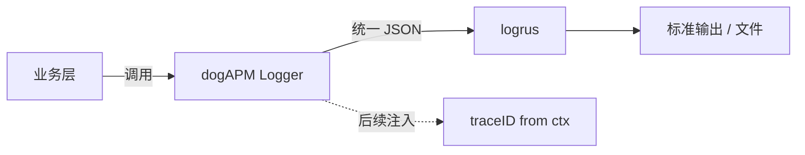

# Go APM 监控系统实战: 封装统一日志打印组件

## 纲要

- 为什么要在 dogAPM 里代理一层日志：降低替换开源日志库的成本
- `Logger` 结构体封装开源日志库（logrus），业务层只依赖 dogAPM
- 固定日志方法：Info / Warn / Debug / Error
- 统一入参：context（便于透传 traceID）、module（业务模块）、fields（字段 map）
- 统一输出 JSON 格式，便于后续日志收集与按字段解析
- 预留链路追踪埋点：后续从 ctx 提取 traceID 注入日志

## 为什么要在 dogAPM 里封装日志

引入日志组件时，最好不要让业务层直接依赖某个具体的开源日志库。正确做法是让 **dogAPM 代理一层日志打印功能**：业务层只引用 dogAPM 暴露的打印方法，真正打印的实现由 dogAPM 内部引用开源库（如 logrus）完成。

这样后续若要替换日志实现，只需改动 dogAPM 内部的方法，业务层逻辑完全不动，替换成本降到最低。

## Logger 结构体设计

```go
// dogapm/log.go —— 根据讲稿逻辑补充
package dogapm

import (
	"context"

	"github.com/sirupsen/logrus"
)

// Logger 是 dogAPM 对开源日志库的代理层
type Logger struct {
	entry *logrus.Logger
}

// NewLogger 创建日志实例，统一输出 JSON 格式
func NewLogger() *Logger {
	l := logrus.New()
	l.SetFormatter(&logrus.JSONFormatter{}) // JSON 格式便于后续采集解析
	l.SetLevel(logrus.DebugLevel)
	return &Logger{entry: l}
}

// 包级默认实例，业务层可直接使用
var Log = NewLogger()
```

将日志输出统一规定为 **JSON 格式**，这样后续做日志收集（如 Filebeat → Logstash）时，可以按 JSON 字段直接解析，无需额外正则切分。

## 统一的打印方法

定义 Info、Warn、Debug、Error 四个等级。关键设计是**统一入参约定**：

1. `ctx context.Context`：链路追踪的 `traceID` 通常通过 context 透传，预留在此，后续从 ctx 提取并注入日志；
2. `module string`：指明日志属于哪个业务模块，便于后续按模块分析；
3. `fields map[string]interface{}`：要打印的具体日志内容。

```go
// dogapm/log.go（续）

// log 底层统一写日志，后续在此注入 traceID 等链路信息
func (l *Logger) log(level logrus.Level, ctx context.Context, module string, fields map[string]interface{}) {
	entry := l.entry.WithField("module", module)
	for k, v := range fields {
		entry = entry.WithField(k, v)
	}
	// TODO: 从 ctx 提取 traceID：entry = entry.WithField("trace_id", traceIDFromCtx(ctx))
	entry.Log(level, "")
}

// Info 信息级别
func (l *Logger) Info(ctx context.Context, module string, fields map[string]interface{}) {
	l.log(logrus.InfoLevel, ctx, module, fields)
}

// Warn 警告级别
func (l *Logger) Warn(ctx context.Context, module string, fields map[string]interface{}) {
	l.log(logrus.WarnLevel, ctx, module, fields)
}

// Debug 调试级别
func (l *Logger) Debug(ctx context.Context, module string, fields map[string]interface{}) {
	l.log(logrus.DebugLevel, ctx, module, fields)
}

// Error 错误级别，需传入具体错误
func (l *Logger) Error(ctx context.Context, module string, fields map[string]interface{}, err error) {
	entry := l.entry.WithField("module", module).WithField("error", err.Error())
	for k, v := range fields {
		entry = entry.WithField(k, v)
	}
	entry.Error("")
}
```

通过这种固定格式，能很好地规范日志打印，避免业务端随意调用开源库、传入无法按维度分析的信息。后续想替换具体日志实现，只需改 dogAPM 内部这些方法即可。

## 业务层使用方式

```go
// orderservice/main.go —— 根据讲稿逻辑补充
package main

import (
	"context"
	"errors"

	"dogapm"
)

func createOrder(ctx context.Context, orderID int) error {
	// 业务模块名 + 结构化字段
	dogapm.Log.Info(ctx, "order", map[string]interface{}{
		"action":  "create_order",
		"order_id": orderID,
	})

	if orderID <= 0 {
		err := errors.New("invalid order id")
		dogapm.Log.Error(ctx, "order", map[string]interface{}{
			"action": "create_order",
		}, err)
		return err
	}
	return nil
}

func main() {
	_ = createOrder(context.Background(), 1001)
}
```

输出示例（JSON 一行）：

```json
{"level":"info","module":"order","action":"create_order","order_id":1001,"time":"...","msg":""}
```



## API 速览

| API | 签名 | 说明 |
| --- | --- | --- |
| `NewLogger` | `func NewLogger() *Logger` | 创建并配置 logrus 实例 |
| `(*Logger).Info` | `func (l *Logger) Info(ctx, module string, fields map[string]interface{})` | 信息级日志 |
| `(*Logger).Warn` | `func (l *Logger) Warn(ctx, module string, fields map[string]interface{})` | 警告级日志 |
| `(*Logger).Debug` | `func (l *Logger) Debug(ctx, module string, fields map[string]interface{})` | 调试级日志 |
| `(*Logger).Error` | `func (l *Logger) Error(ctx, module string, fields map[string]interface{}, err error)` | 错误级日志 |
| `logrus.JSONFormatter` | `struct{}` | 将日志格式化为 JSON |

## Demo 示例

### 运行说明

```bash
go get github.com/sirupsen/logrus
go run orderservice/main.go
```

### 代码说明

- `Logger` 把开源库收口在 dogAPM 内，业务层零直接依赖；
- 统一入参 `ctx / module / fields` 规范了日志形态；
- `JSONFormatter` 使日志天然结构化，对接 ELK 零成本；
- `Error` 单独接收 `error` 参数，落 `error` 字段，便于告警系统按等级抓取。

### 技术点总结

- 通过代理层隔离第三方库，是框架封装的常见手法；
- 用 context 透传 traceID，为后续链路追踪与日志关联埋下切口；
- 结构化（JSON）日志是可观测性的基础，优于纯文本日志。

相关度：90%。是否需要继续：[是]。代码是否可运行：[是]。
