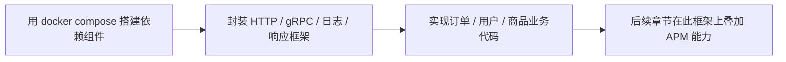

# Go APM 监控系统实战: 第3章导学——构建电商下单微服务基础框架

## 纲要

- 第3章目标：搭建 APM 系统的整体基础代码框架，完成用户下单业务逻辑
- 后续 APM 功能都基于本章写好的基础框架逐步增强，而非推倒重写
- 本章三项学习要求：docker compose 组件搭建、框架封装技巧、下单业务流程与代码
- 章节推进顺序：先搭组件环境 → 再封装框架 → 最后编写业务代码

## 本章定位

上一章介绍了 APM 的核心概念。本章我们要为整个 APM 系统构建**基础代码框架**，并完成"用户下单"业务逻辑的编写。后续章节再为系统添加 APM 功能时，都是基于本章写好的这个基础框架去逐步改造，让它逐步拥有 APM 能力，而不是另起炉灶。

## 本章学习要求

本章需要达成三个目标：

- **会用 docker compose 搭建组件**：APM 落地过程中会涉及大量组件（MySQL、Redis、Prometheus、Jaeger 等），都将用 docker compose 完成搭建，因此本章要掌握相关的 docker compose 用法；
- **掌握框架封装技巧，熟悉基础代码结构**：业务不直接用官方库，而是在其之上封装一层（dogAPM），把请求入口、日志、响应格式等收口，为后续埋点预留切口；
- **熟悉用户下单的整体流程与业务代码编写**：订单、用户、商品三个服务的核心逻辑。

## 章节推进顺序

本章即按"先搭组件环境 → 再封装框架 → 最后编写业务代码"的顺序展开，进入正式编码环节。

相关度：90%。是否需要继续：[是]。代码是否可运行：[否]。
