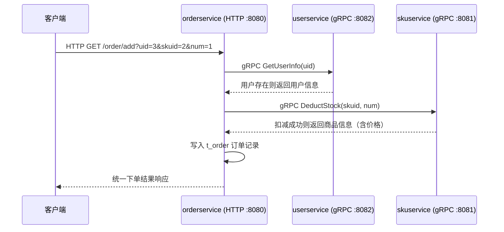
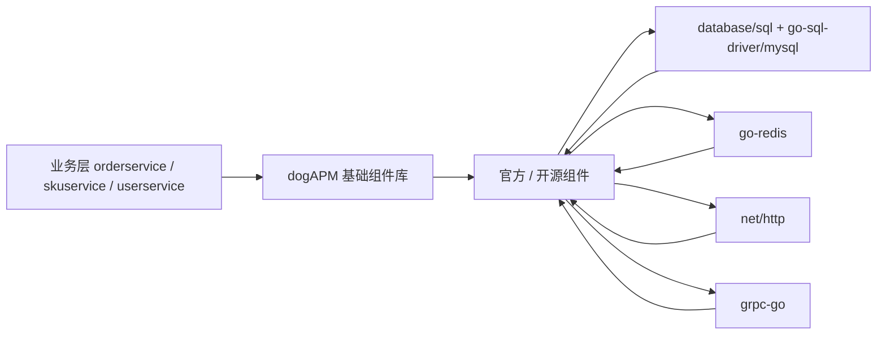
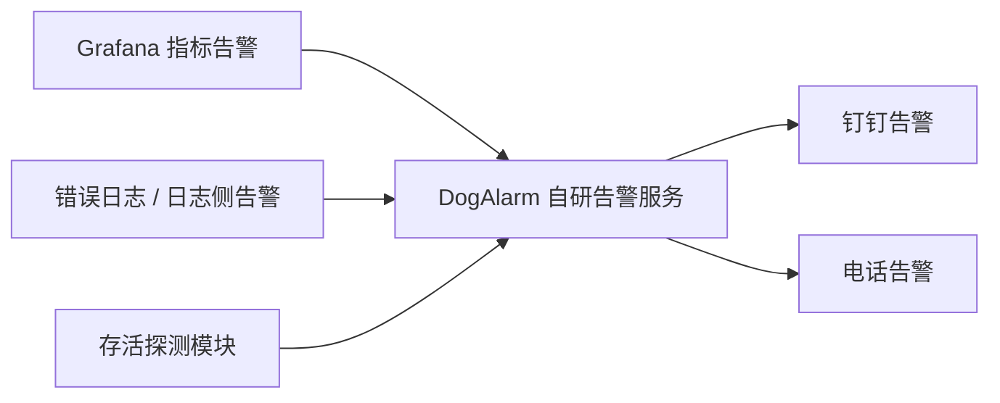

# Go APM 监控系统实战: 被监控对象的构建目标与项目需求拆解

## 纲要

- 为什么 APM 课程必须先有一个"被监控的业务系统"
- 电商下单微服务的业务形态：订单、用户、商品三个服务与它们的调用关系
- 自研基础组件库 dogAPM 的定位：官方组件之上的一层中间代理层
- 自研告警系统 DogAlarm 的需求：告警来源、通知渠道、存活探测
- 落地一套 APM 系统需要的两类能力：运维搭建能力 + 基础库开发能力
- 从"业务代码"到"可观测代码"的演进路径

## 为什么需要先造一个被监控的系统

APM（Application Performance Monitoring，应用性能监控）不是空中楼阁。链路追踪、指标、日志这三板斧，最终都要落到具体的进程、具体的接口、具体的 SQL 上。如果手头没有一套真实的分布式服务，那么做出来的一切都只是"能跑起来的 demo"，无法验证下面这些真正有价值的问题：

- 一个跨三个服务的下单请求，链路能不能串起来，耗时花在哪一跳；
- 一条慢 SQL 能不能被自动识别，并且反查到是哪个接口触发的；
- 一个 Redis 报错能不能带上业务上下文，直接推到告警群里；
- 应用自身 runtime 指标（goroutine 数、GC、内存）抖动时，能不能快速定位到具体代码。

所以课程的第一步，是先构建一个**电商下单的微服务项目**。它既充当后续所有监控能力的"被观测对象"，也会沉淀出一套可复用的基础代码框架，后续所有 APM 改造都在这个框架上做增量。

## 电商下单微服务的业务形态

下单流程刻意做得足够简单，目的是不让复杂的业务规则干扰监控组件的讲解：

三个服务各有分工，也各有自己的存储：

| 服务 | 对外协议 | 端口 | 职责 | 存储 |
| --- | --- | --- | --- | --- |
| orderservice | HTTP | 8080 | 编排下单流程、创建订单 | MySQL（order schema） |
| skuservice | gRPC | 8081 | 查询商品、扣减库存 | MySQL（sku schema） |
| userservice | gRPC | 8082 | 校验用户合法性 | MySQL（user schema）+ Redis 缓存 |

刻意让三个服务使用不同的数据库（本课程用一个 MySQL 实例下的三个 schema 来模拟），是为了贴近真实的微服务部署形态，也让后续"按应用维度统计 MySQL 指标"这一需求有意义。

用户校验直接用 uid 查库判断存在性，而不是走 token 体系，目的只有一个：让业务逻辑尽可能短，把篇幅留给监控本身。

## dogAPM：自研基础组件库的定位

课程真正的核心产出不是电商项目，而是一套名为 **dogAPM** 的自研基础组件库。它的定位非常明确：**业务层不直接调用官方组件，而是调用 dogAPM 封装后的组件**。

举一个最直观的例子：业务层当然可以直接写 `sql.Open("mysql", dsn)` 建立数据库连接，但一旦这么做，未来要给所有 MySQL 调用加埋点、加慢查询统计、加长事务识别，就必须去改动每一个业务项目的代码。

而在 dogAPM 这层封装之后，改造只需要发生在 dogAPM 内部：

- 想给 MySQL 加装饰器模式的驱动埋点？改 dogAPM 的 DB 初始化即可；
- 想给 HTTP 接口统计 QPS 和错误数？改 dogAPM 的 `Handle` / `HandleFunc` 包装即可；
- 想给 gRPC 加链路埋点？改 dogAPM 的客户端/服务端拦截器即可。

这就是计算机领域最朴素也最有效的手段：**加一层中间代理层**。业务层感知不到变化，能力却在统一升级。大厂内部的自研框架基本都是这个思路——框架团队在基础库里把可观测性、熔断、限流一次性做掉，业务团队只管写业务。

## 自研告警系统 DogAlarm

监控和告警是分不开的：指标画得再漂亮，没人收到通知等于没有。课程的另一个自研产出是告警服务 **DogAlarm**，它的需求边界如下：

- **告警来源**：接收来自 Grafana 的指标告警、来自日志侧的 Error 级别日志告警；
- **通知渠道**：钉钉告警用于常规通知，电话告警用于高优先级故障的强触达；
- **存活探测**：主动探测线上服务是否存活，对探测失败的服务发起告警，并在后续演进中加入自动重启机制；
- **限流排重**：同一类日志/告警在短时间内重复触发时需要抑制，避免告警风暴把人淹掉。

告警服务自身也需要被监控——它会暴露自己的运行指标，形成"监控系统的自监控"闭环。

## 落地 APM 需要的两类能力

从这一节的需求拆解可以看出，完整落地一套 APM 系统不是单点技能：

| 能力维度 | 具体内容 |
| --- | --- |
| 运维能力 | 搭建 OpenTelemetry Collector、Jaeger、Prometheus、Grafana、Elasticsearch、Filebeat、Logstash、Kibana 等组件，并处理它们的配置与容量 |
| 开发能力 | 自研 dogAPM 基础组件库，改造官方组件的引用方式，让业务快速接入；自研 DogAlarm 告警服务 |

两类能力缺一不可：只有运维搭建，数据进不来；只有开发封装，数据没地方存和展示。

## 从业务代码到可观测代码的演进路径

整个项目的改造节奏是渐进式的，每一阶段的产出都会沉淀进 dogAPM：

1. 先搭出能跑通下单流程的三服务骨架；
2. 引入链路追踪：HTTP、gRPC、MySQL、Redis 四个维度逐个埋点；
3. 引入指标：接口 QPS / 错误数、MySQL 维度、runtime 维度、业务维度（下单成功数）；
4. 引入日志：统一 JSON 格式、Filebeat + Logstash 采集、ES 存储、Kibana 展示；
5. 引入告警：Grafana 规则、错误日志告警、电话/钉钉渠道、存活探测；
6. 引入 pprof 与自动化的性能排查机制。

第 6 步之后还有一个容易被忽略的部分：**APM 系统自身的健康与容量**。监控系统如果自己先崩了，那它提供的所有结论都不可信。

## 小结

这一节明确了整个编码项目的目标：构建一个电商下单微服务作为被监控对象，沉淀一套 dogAPM 基础组件库作为所有监控能力的载体，并自研 DogAlarm 完成告警闭环。理解了"为什么要在官方组件之上再包一层"，后面每一处封装的动机就都不言自明了。

相关度：75%。是否需要继续：[是]。代码是否可运行：[否]。
