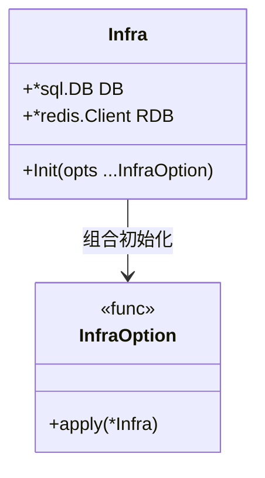
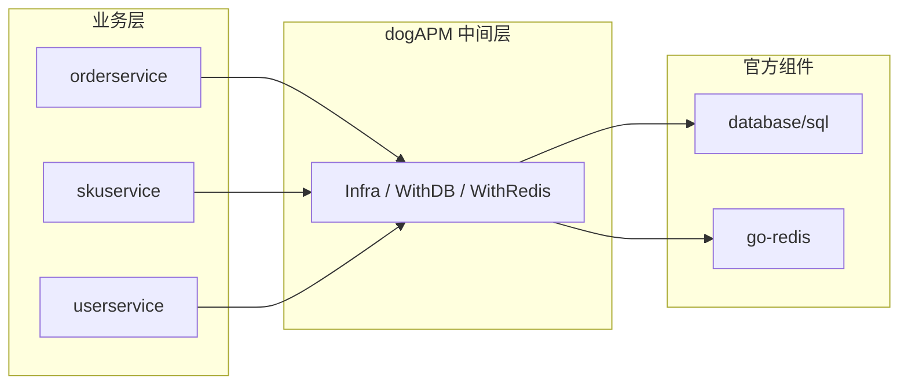

# Go APM 监控系统实战: 用函数选项模式统一管理 DB 与 Redis 连接

## 纲要

- 为什么基础设施组件需要一个统一的管理结构体
- `Infra` 结构体与全局实例的设计
- Go 函数选项模式（Functional Options）如何保证向后兼容
- MySQL 连接的建立：`database/sql` + `go-sql-driver/mysql` 的匿名引入
- Redis 连接的建立：`go-redis` 的 `NewClient` 与 `Ping` 校验
- fail-fast 原则：初始化失败直接 panic
- 中间代理层思想的落地：业务层永远不直接调官方组件

## 为什么要统一管理基础设施

后续要监控的维度不止 MySQL 和 Redis，还可能扩展 MongoDB、Kafka、Elasticsearch 等。如果每种组件都散落在业务代码里各自初始化，那么"给所有组件统一加埋点"这件事就会变成一场灾难。

所以第一步是建立一个统一的管理结构体，命名为 `Infra`（infrastructure 的简称，意为基础设施），把所有技术组件的连接都挂在它身上：



业务层（orderservice / skuservice / userservice）统一通过一个全局实例访问这些连接，dogAPM 则独占所有初始化细节。

## 函数选项模式

先明确一个工程约束：**后续新增组件时，业务层已有代码不允许发生变动**。

如果用普通的多参数函数，签名会随组件增加不断膨胀；如果传一个配置结构体，新增字段时又要到处补零值。Go 里更地道的做法是**函数选项模式**（Functional Options）：

```go
// dogapm/infra.go —— 根据讲稿逻辑补充
package dogapm

import (
	"context"
	"database/sql"
	"time"

	_ "github.com/go-sql-driver/mysql" // 匿名引入：注册 mysql 驱动
	"github.com/redis/go-redis/v9"
)

// Infra 统一管理项目中所有基础设施组件的连接
type Infra struct {
	DB  *sql.DB
	RDB *redis.Client
}

// InfraOption 是一个"接收 Infra 指针"的函数类型
type InfraOption func(*Infra)

// Infra 全局实例，供业务层直接引用
var infra = &Infra{}

// GetInfra 业务层通过该方法拿到基础设施实例
func GetInfra() *Infra { return infra }

// Init 是统一的初始化入口，接收任意个选项函数
func Init(opts ...InfraOption) {
	for _, opt := range opts {
		opt(infra)
	}
}
```

关键点是 `InfraOption` 这个类型定义：

```go
type InfraOption func(*Infra)
```

它把"对 Infra 做一件事"抽象成了一个函数。以后要加 MongoDB，只要新增一个返回 `InfraOption` 的函数即可，`Init` 的签名和所有业务层的调用点都不用动——这正是可变参数 + 函数选项带来的扩展性。

## MySQL 连接的建立

建立一个 MySQL 连接需要连接地址（DSN），所以对应的选项函数接收 DSN 参数：

```go
// WithDB 初始化 MySQL 连接（根据讲稿逻辑补充）
func WithDB(dsn string) InfraOption {
	return func(i *Infra) {
		db, err := sql.Open("mysql", dsn)
		if err != nil {
			panic(err)
		}
		db.SetMaxOpenConns(50)
		db.SetMaxIdleConns(10)
		db.SetConnMaxLifetime(time.Minute * 5)
		i.DB = db
	}
}
```

这里有两个必须讲清楚的点：

- `database/sql` 只是**接口层**，真正能连上 MySQL 的是驱动实现。所以必须引入 `github.com/go-sql-driver/mysql`。
- 这个包用的是**匿名引入**（`_`），目的是触发它的 `init` 方法——`init` 里会向 `database/sql` 注册一个名为 `mysql` 的驱动。只有注册过了，`sql.Open("mysql", dsn)` 才能按名字找到驱动；少写这个下划线，运行时会报 `unknown driver "mysql"`。

`sql.Open` 是惰性连接，真正验证连通性要主动 `Ping`。

## Redis 连接的建立

Redis 侧使用 `github.com/redis/go-redis`（v9）。依赖拉取前同样确认 `GOPROXY` 有值：

```bash
go get github.com/redis/go-redis/v9
go get github.com/go-sql-driver/mysql
```

```go
// WithRedis 初始化 Redis 连接（根据讲稿逻辑补充）
func WithRedis(addr string) InfraOption {
	return func(i *Infra) {
		rdb := redis.NewClient(&redis.Options{
			Addr:     addr,
			Password: "", // 本地容器未设置密码
			DB:       0,
		})

		// 主动 Ping，确认连接真的可用
		pong, err := rdb.Ping(context.Background()).Result()
		if err != nil {
			panic(err)
		}
		if pong != "PONG" {
			panic("redis ping response is not PONG")
		}

		i.RDB = rdb
	}
}
```

## fail-fast：初始化失败直接 panic

DB 和 Redis 都属于进程启动的**强依赖**——连接不上，这个服务起来也没有意义。所以对初始化错误一律 `panic`，让进程在启动阶段就失败并被编排系统捕获，而不是带着一个坏连接跑起来，然后在线上以"所有接口都超时"的形式暴露问题。

这个原则可以概括成一句：**基础设施初始化失败，不要降级，要崩溃**。

## 业务层的使用方式

业务层在 `main` 里只需要一行链式调用：

```go
// orderservice/main.go —— 根据讲稿逻辑补充
package main

import "dogapm"

func main() {
	dogapm.Init(
		dogapm.WithDB("root:1234567@tcp(127.0.0.1:3306)/orderservice?charset=utf8mb4&parseTime=true"),
		dogapm.WithRedis("127.0.0.1:6379"),
	)

	// 后续使用
	db := dogapm.GetInfra().DB
	if err := db.Ping(); err != nil {
		panic(err)
	}
	rdb := dogapm.GetInfra().RDB
	_ = rdb
}
```

验证连通性的最小测试（根据讲稿逻辑补充）：

```go
// dogapm/infra_test.go
package dogapm

import "testing"

func TestInit(t *testing.T) {
	Init(
		WithDB("root:1234567@tcp(127.0.0.1:3306)/orderservice?charset=utf8mb4&parseTime=true"),
		WithRedis("127.0.0.1:6379"),
	)

	if err := infra.DB.Ping(); err != nil {
		t.Fatalf("mysql ping failed: %v", err)
	}
	t.Log("mysql and redis connected")
}
```

Redis 的 `Ping` 已经在 `WithRedis` 内部做过，所以只要测试没 panic，就说明两个组件都初始化成功了。

## 中间代理层的意义

讲稿里反复强调的一点值得单独拿出来：

> 业务层当然可以直接调用 `sql.Open` 建连接，之所以要用 dogAPM 包一层，是为了以后对 DB 连接做监控时，只改 dogAPM 下面的代码，不需要动每个业务项目的逻辑。

用一张图表达这种依赖关系：



后续要做的事情，比如"用装饰器模式包装 MySQL 驱动以统计慢查询"、"在 Redis 调用出错时往当前链路里打一个 error 事件"，全部收敛在 dogAPM 这一层。业务代码一行不改，就自动获得了这些能力。

## API 速览

| API | 签名 | 说明 |
| --- | --- | --- |
| `Infra` | `struct { DB *sql.DB; RDB *redis.Client }` | 基础设施管理结构体 |
| `InfraOption` | `type InfraOption func(*Infra)` | 选项函数类型，用于扩展初始化项 |
| `Init` | `func Init(opts ...InfraOption)` | 遍历执行所有选项，完成组件初始化 |
| `WithDB` | `func WithDB(dsn string) InfraOption` | 建立 MySQL 连接，失败 panic |
| `WithRedis` | `func WithRedis(addr string) InfraOption` | 建立 Redis 连接并 Ping 校验，失败 panic |
| `GetInfra` | `func GetInfra() *Infra` | 获取全局基础设施实例 |
| `sql.Open` | `func Open(driverName, dataSourceName string) (*DB, error)` | 惰性建立数据库连接池 |
| `redis.NewClient` | `func NewClient(opt *Options) *Client` | 创建 Redis 客户端 |

## Demo 示例

### 运行说明

```bash
# 1. 启动依赖中间件
cd deploy && docker compose up -d

# 2. 初始化工作区
go work sync

# 3. 运行连通性测试
cd dogapm && go test -run TestInit -v
```

### 代码说明

- `Infra` 把所有技术组件收敛到一个结构体，业务层只依赖这个抽象；
- `InfraOption` 是函数选项模式的核心类型，新增组件时只需新增一个返回该类型的函数；
- MySQL 驱动采用匿名引入，靠包的 `init` 完成驱动注册；
- Redis 在初始化时主动 `Ping`，把"配置错误"在启动阶段就暴露出来。

### 技术点总结

- 可变参数 + 函数选项 = 可扩展且向后兼容的初始化接口；
- `database/sql` 是接口，驱动是实现，匿名引入完成注册；
- 强依赖组件的初始化失败应当 fail-fast；
- 加中间代理层，是可观测性改造对业务零侵入的前提。

相关度：80%。是否需要继续：[是]。代码是否可运行：[是]。
