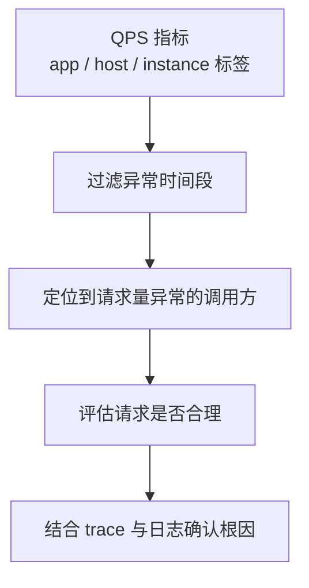
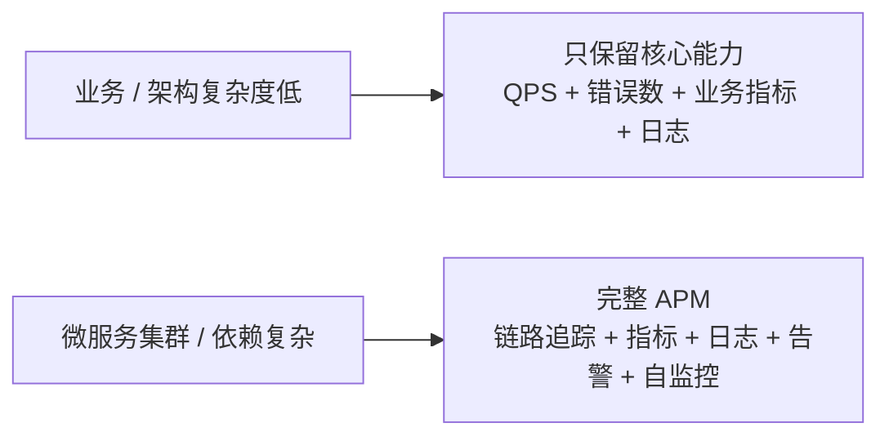

# 3. Go APM 监控系统实战: 企业为什么需要自建 APM 监控系统

## 纲要

- 传统资源监控是**结果导向**的，只能看到"某台机器 CPU 高了"，无法回答"为什么高"
- APM 通过应用维度的指标（尤其是带调用方标识的 QPS）把定位范围收敛到具体调用方
- 建设 APM 的两大收益
 - 缩短故障定位时间，并支撑自动化告警
 - 让性能优化"有理有据"，用数据说话
- 小公司不必照搬全套方案：**按问题复杂度选择部分能力**，切忌为了"全"而"全"
- 设计监控系统的第一原则是站在解决问题的角度，而不是覆盖面的角度

## 传统资源监控的困境

举一个典型的微服务场景：集群中某台服务器 CPU 使用率突增，而这台服务器同时向多台服务器提供内部服务接口。仅靠 CPU、内存这类资源监控，你能快速找出 CPU 突增的原因吗？

很难。原因是资源监控看到的是**结果**：

假设 CPU 增高确实是因为某个内部应用在这段时间内发生了程序性 Bug，导致疯狂请求这台机器。传统监控维度下，你**没有办法知道这段时间内到底是哪台应用服务在疯狂请求**——因为资源指标里不包含"调用方"这个信息。

## APM 如何改变这一局面

引入 APM 后，情形完全不同。关键在于：**应用维度的 QPS 指标上会携带调用方信息**，例如发出请求的应用名称、主机 IP。于是在 CPU 突增的时间窗口内：

- 查询带 `app` / `host` 标签的 QPS 指标，立刻能看到哪台主机、哪个服务在这段时间的请求量异常
- 进而评估"这么短时间内发出大量内部请求是否合理"，把问题范围从整个集群缩小到一台机器、一个服务
- 最终可以结合链路追踪与日志，确认是不是程序 Bug 导致的重复调用

这就是从"结果导向"走向"因果导向"。

## 建设 APM 的两大收益

### 缩短故障定位时间，并支撑自动化告警

更全面的监控维度可以直接建立告警机制。特别是从用户角度出发，建立一系列与体验相关的告警规则——只要不触发告警，就说明应用服务处于正常运行状态。这带来两个直接好处：

- 开发人员不需要一直担心"服务是不是异常了但没被发现"
- 也不需要担心"异常时是否容易定位"，因为借助 APM 的监控面板和链路追踪，定位范围可以缩小到具体的某一行代码

### 让性能优化有理有据

优化一个功能时，必须回答"优化后性能提升了多少"。没有数据支撑，汇报时很难令人信服。

一个具体的例子：优化前订阅页需要 2 秒渲染完毕，优化后只需 1 秒，并且带来了订阅人数的增长。当这两组数据都来自监控系统时，性能优化在绩效考核和向上汇报中就具备了完整证据链。

推而广之，后续的容量规划、资源申请、架构调整，都可以基于监控数据而不是经验直觉。

## 小公司到底需不需要 APM

这是很常见的疑问：业务并不复杂，也要搭建一整套 APM 吗？

答案是**按需取舍**。设计原则和其他架构设计一样：在满足功能与扩展性的前提下，尽量简洁。

- 服务依赖关系不强、服务器只有一两台时，为了分析服务调用过程而引入完整的链路追踪，收益很低——直接打日志就能满足排查需求，没必要把架构搞复杂。
- 但**应用服务的监控指标**（接口 QPS、错误数）和**业务监控指标**（下单成功数）无论公司大小都很有必要，因为它们直接反映应用运行的健康度，并且是告警的基础数据源。

## 一个必须警惕的误区

初学者建设监控系统时最容易犯的错误是：**把整个系统的方方面面都监控一遍**。

这种做法的问题在于：

- 维护成本高，大量面板长期无人关注
- 真正发生故障时，过多的面板和指标反而形成干扰
- "大而全"并不等价于"能快速定位问题"

正确的做法是站在解决问题的角度去设计。每加一个监控面板之前先问一句：这个数据异常时，我会做什么动作？如果答案是"不知道"或者"不会看"，那这个面板大概率是多余的。

