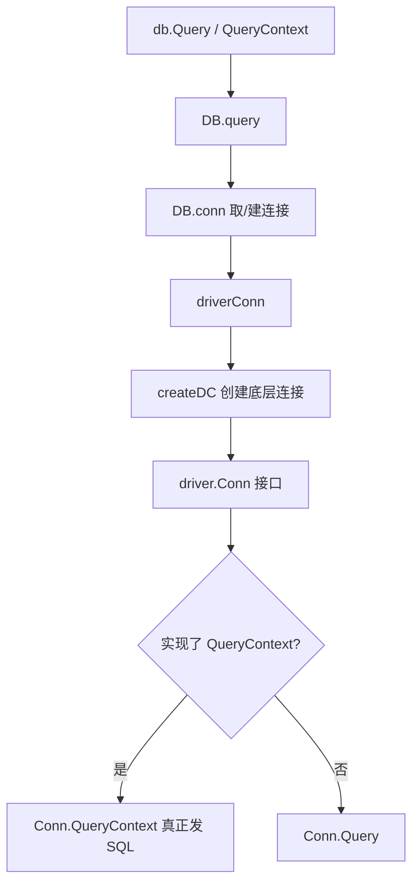

# Go APM 监控系统实战: 数据库 SQL 驱动源码剖析

## 纲要

- 想在 SQL 执行前后插桩，前提是搞懂 `database/sql` 是怎么把一条查询送进 MySQL 的
- `sql.Open(driverName, dsn)` 的 `driverName` 由第三方库 `init()` 通过 `sql.Register` 注册；`go-sql-driver/mysql` 就是这么注册 `mysql` 驱动的
- 调用链：`DB.Query` → `DB.query` → `DB.conn` → `driverConn` → `createDC` → `driver.Conn`（接口）→ `QueryContext` / `Query`
- 标准库只定义接口，真正的网络收发由第三方驱动实现；因此"包装第三方驱动"就能在调用前后插入逻辑
- 连接从哪来：`DB` 里的 `Connector` 决定，`OpenConnector`（driver.DriverContext）或兜底的 `DSNConnector` → `driver.Open`
- 结论：要实现自定义 Driver（实现 `Open` 或 `OpenConnector`），返回自定义 Conn（实现 `QueryContext` / `ExecContext`），才能在不改业务代码的前提下统计每条 SQL 的耗时

## 为什么必须读源码才能动手

要给 MySQL 做链路追踪 / 慢查询统计，本质是在"SQL 执行前后"加计时逻辑。但 `database/sql` 是抽象层，它本身不暴露任何 hook（不像 `go-redis` 自带 `AddHook`）。想插桩，只能自己实现一套驱动接口，把真实驱动包一层。

要包得对，就得先搞清楚：一条 `db.Query(...)` 最终是怎么落到 MySQL 连接的。

## 驱动的注册：`sql.Register` 与 `init()`

我们写 `sql.Open("mysql", dsn)` 时传的 `"mysql"` 这个名字，并不是凭空存在的。第三方库 `go-sql-driver/mysql` 在被引入（哪怕是匿名引入）时，会执行它的 `init()`，在里面调用 `sql.Register("mysql", &MySQLDriver{})`，把一个驱动实例注册进全局 map。

```go
// go-sql-driver/mysql 中的注册（示意，标准库 database/sql 提供 Register）
func init() {
	sql.Register("mysql", &MySQLDriver{})
}
```

注册之后，`sql.Open` 才能按名字找到对应驱动，并把它封装进 `DB` 结构体。

## 查询的调用链：从 DB.Query 到 driver.Conn

顺着 `DB.QueryContext` 往下看，调用关系是这样的：



关键事实是：标准库在这一层只定义了**接口**，真正和 MySQL 握手、收发协议包的是第三方驱动里的实现。官方 `database/sql` 在调用前会判断你的连接是否实现了 `QueryerContext`（有就走 `QueryContext`，没有再退到 `Query`）。

## 连接是怎么被创建出来的：Connector 才是入口

光知道"连接在 `driver.Conn` 接口上执行查询"还不够，还得知道这个连接对象从哪来——这才是我们包装的切入点。

`DB` 结构体内部持有一个 `Connector`。`sql.Open` 时：

1. 先尝试把驱动断言成 `driver.DriverContext`，若实现则调用其 `OpenConnector(dsn)` 拿到 `Connector`；
2. 若没实现 `DriverContext`，则用兜底的 `DSNConnector`，它内部调用驱动的 `Open(dsn)` 来创建连接。

无论哪条路径，最终都通过 `Connector.Connect(ctx)` 创建出一个 `driver.Conn`。

```go
// database/sql/driver 中的关键接口（节选，均为标准库事实定义）
type Driver interface {
	Open(name string) (Conn, error)
}

type DriverContext interface {
	OpenConnector(name string) (Connector, error)
}

type Connector interface {
	Connect(context.Context) (Conn, error)
	Driver() Driver
}

type Conn interface {
	Prepare(query string) (Stmt, error)
	Close() error
	Begin() (Tx, error)
}

// 这两个是"可选"接口，标准库在运行时判断是否实现
type QueryerContext interface {
	QueryContext(ctx context.Context, query string, args []NamedValue) (Rows, error)
}

type ExecerContext interface {
	ExecContext(ctx context.Context, query string, args []NamedValue) (Result, error)
}
```

## 第三方驱动做了什么

`go-sql-driver/mysql` 的 `MySQLDriver` 既实现了标准库的 `driver.Driver`（提供 `Open`），也实现了 `driver.DriverContext`（提供 `OpenConnector`），返回的 `Connector` 又实现了 `driver.Connector`，其 `Connect` 方法里完成真正的 MySQL 建连（握手、认证、协议初始化）。

所以标准库与第三方库的职责要分清：

- **标准库 `database/sql`**：定义全部接口，负责连接池、生命周期管理
- **第三方 `go-sql-driver/mysql`**：实现接口，负责具体的 MySQL 协议收发

## 我们的切入点：实现自定义 Driver 与 Conn

理清链路后，插桩思路就清晰了：

1. 实现一个**自定义 Driver**，包装 `mysql.MySQLDriver`；
2. 让这个 Driver 的 `Open` / `OpenConnector` 返回**自定义 Connector / Conn**；
3. 自定义 Conn 实现 `QueryContext` / `ExecContext`（以及 `PrepareContext`、`Begin` 等相关接口），在其内部先调用 hooks 的"前"逻辑、再委托真实连接执行、最后调用 hooks 的"后"逻辑。

只要连接是我们自己的类型，就能在每次 SQL 执行前后无侵入地加上统计代码。下一节（4-13）给出这套装饰器的完整架构蓝图。

## 技术点总结

- `sql.Open` 的驱动名来自第三方库 `init()` 里的 `sql.Register`，不是凭空出现
- 查询链路：`DB.Query` → `DB.conn` → `driverConn` → `driver.Conn.QueryContext`
- 标准库只定义接口，具体实现在第三方驱动；这正好给我们"包装第三方驱动"留了口子
- 连接的真正创建入口是 `Connector.Connect`，而 `Connector` 来自 `OpenConnector` 或兜底的 `DSNConnector`
- 插桩的正确做法是实现自定义 Driver + 自定义 Conn，而非改动业务代码

相关度：90%。是否需要继续：是。代码是否可运行：否。
