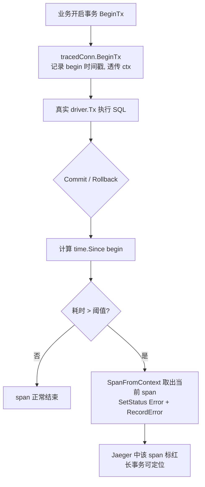

# Go APM 监控系统实战: 对含有长事务的链路进行追踪

## 纲要

- 长事务定义：事务执行时长超过阈值的请求链路，需要在 trace 中单独标记出来
- 统计思路：事务开启时保存时间戳，提交 / 回滚时计算耗时，超过阈值即判定为长事务
- Go 标准库 `database/sql/driver` 中，事务由 `Conn.Begin()` / `Conn.BeginTx()` 开启，二者最终都走到 `BeginTx`
- 自定义 `driverTx`（实现 `driver.Tx`）包装真实事务，仅需实现 `Commit` / `Rollback` 两个方法
- 关键坑：事务开启后 `context` 不会在创建 span 之后继续向下传递，因此不能再通过 context 新建 span；必须**从 context 取出当前 span** 并标记其状态
- 包装 `driverTx` 时必须把 `context` 透传进来，才能取到当前 span
- 落地：修改 OpenTelemetry Collector 配置以采集长事务数据，改完需重启 Collector 才生效

## 正文

### 为什么要单独追踪长事务

一条 SQL 事务如果持有连接和锁太久，会直接拖慢同库的其他请求。这类「长事务」在排查慢请求时往往是重点嫌疑对象。但由于事务本身横跨多个 SQL，必须把它的整体耗时记录到同一条 trace 上，才能在 Jaeger 这类界面里一眼看出「这一次请求卡在了一个 5 秒的事务里」。

统计方式非常直接：在事务开启的那一刻记下时间戳，等到 `Commit` 或 `Rollback` 时算差值，超过我们设定的阈值（讲稿为方便测试设为 3 秒）就认为这是一条长事务，并把对应的 span 标记为异常。

### 从源码看事务是怎么开启的

`database/sql` 包对外暴露 `DB.Begin()` 和 `DB.BeginTx()`，而 `Begin()` 内部其实也是调用的 `BeginTx()`。在底层驱动里，`BeginTx()` 会：

1. 创建连接（`Conn`）
2. 调用该连接的 `BeginTx`
3. `BeginTx` 内部进一步调用 `driver.ConnBeginTx` 接口（如果连接实现了它）来真正开启事务

这和之前讲连接执行 `Query` / `Exec` 时「看连接是否实现了对应接口再类型转换」的逻辑如出一辙。也就是说，我们可以在「开启事务」这个入口处动手脚——保存一个时间戳。

### 自定义 driverTx 包装真实事务

我们要返回的是一个自定义的 `driverTx`，它内部持有「真正的 `driver.Tx`」以及「事务开始时间」。连接（`Conn`）需要实现一个 `BeginTx` 方法，返回这个自定义对象。逻辑和源码里看到的一致：

- 先判断底层连接是否实现了 `driver.ConnBeginTx` 接口
- 没实现就直接返回错误（真实第三方驱动一定会实现）
- 实现了就类型转换，调用它的 `BeginTx`，拿到真实的 `driver.Tx`，再用它构造我们的 `tracedTx`

```go
// 根据讲稿逻辑补充：自定义 driverTx 包装真实事务，记录开始时间。
// 真实实现需实现 driver.Tx 接口（Commit / Rollback）。
type tracedTx struct {
	inner driver.Tx
	begin time.Time
}

// BeginTx 在连接上开启事务时调用：先让底层连接真正开事务，
// 再用 tracedTx 包一层，记下开始时间。
func (c *tracedConn) BeginTx(ctx context.Context, opts driver.TxOptions) (driver.Tx, error) {
	realTx, err := c.inner.BeginTx(ctx, opts)
	if err != nil {
		return nil, err
	}
	return &tracedTx{inner: realTx, begin: time.Now()}, nil
}
```

### 提交 / 回滚时计算耗时并标记 span

`Commit` 和 `Rollback` 里都先调用内部事务对象的对应方法，再计算整段耗时，换算成毫秒，和阈值比较。

这里有一个特别容易踩的坑，讲稿花了很多篇幅强调：**事务开启之后，`context` 并不会在创建 span 之后继续向下传递**。所以你不能在 `Commit` 里再 `tracer.Start(ctx, ...)` 去新建一个 span——新建出来的 span 跟当前这条请求链路串不起来。

正确的做法是：在开启事务时，就把 `context` 透传进 `tracedTx`，在 `Commit` / `Rollback` 时通过 `trace.SpanFromContext(ctx)` **取出当前已经存在的 span**，把它的状态标记成错误即可。

```go
// 根据讲稿逻辑补充：在 Commit / Rollback 时统计耗时，超阈值则标记当前 span 为长事务。
const longTxThreshold = 3 * time.Second

func (t *tracedTx) finish(op string, err error) {
	dur := time.Since(t.begin)
	span := trace.SpanFromContext(t.ctx) // 取出当前 span，而不是新建
	span.SetAttributes(attribute.String("tx.operation", op))
	if dur > longTxThreshold {
		// 超过阈值：标记为长事务（error 状态），并附带描述
		span.SetStatus(codes.Error, "long transaction")
		span.RecordError(fmt.Errorf("long transaction detected: %s", dur))
	}
}

func (t *tracedTx) Commit() error {
	err := t.inner.Commit()
	t.finish("commit", err)
	return err
}

func (t *tracedTx) Rollback() error {
	err := t.inner.Rollback()
	t.finish("rollback", err)
	return err
}
```

整条链路就串起来了：业务代码开启事务 → 自定义 `driverTx` 记下开始时间并把 `ctx` 透传进来 → 提交 / 回滚时算出耗时 → 超阈值就把当前 span 标红。

### 接入 Collector 并验证

包装好 `driverTx` 之后，还要调整 OpenTelemetry Collector 的采集配置，让它支持对长事务的采集（讲稿里修改的是采集属性）。注意改完配置文件**必须重启 Collector 进程**配置才会生效，否则在 Jaeger 里看不到新数据。

写一个测试方法：开启事务时隔离级别传默认（会用数据库里设置的隔离级别），让事务 sleep 5 秒（比 3 秒阈值长），提交后去 Jaeger 查看，应当能看到一条被标记为长事务（带 error 状态）的链路轨迹。



## Demo 示例

下面给出一个**可独立运行**的精简实现，用标准库模拟 driver.Tx 的包装与耗时判定逻辑（真实项目中 `txer` 换成 `driver.Tx`，并在 `finish` 里调用 OpenTelemetry 的 span）。

```go
package main

import (
	"fmt"
	"time"
)

// longTxThreshold 长事务判定阈值（讲稿为测试方便设为 3 秒）
const longTxThreshold = 3 * time.Second

// txer 是被包装的真实事务接口（简化自 database/sql/driver.Tx）
type txer interface {
	Commit() error
	Rollback() error
}

// mockTx 仅用于演示的内存实现
type mockTx struct{}

func (mockTx) Commit() error   { return nil }
func (mockTx) Rollback() error { return nil }

// tracedTx 包装真实事务，记录开启时间，结束统计耗时
type tracedTx struct {
	inner txer
	begin time.Time
	ctx   string // 真实实现里应为 context.Context，用于取出当前 span
}

func newTracedTx(inner txer, ctx string) *tracedTx {
	return &tracedTx{inner: inner, begin: time.Now(), ctx: ctx}
}

func (t *tracedTx) Commit() error {
	err := t.inner.Commit()
	return t.finish("commit", err)
}

func (t *tracedTx) Rollback() error {
	err := t.inner.Rollback()
	return t.finish("rollback", err)
}

// finish 计算事务耗时，超过阈值则标记为长事务
func (t *tracedTx) finish(op string, err error) error {
	dur := time.Since(t.begin)
	status := "normal"
	if dur > longTxThreshold {
		status = "LONG_TX" // 真实实现: span.SetStatus(codes.Error, "long transaction")
	}
	fmt.Printf("ctx=%s tx.%s cost=%s span_status=%s err=%v\n", t.ctx, op, dur, status, err)
	return err
}

func main() {
	// 模拟一次 5 秒的长事务
	tx := newTracedTx(mockTx{}, "trace-abc")
	time.Sleep(5 * time.Second)
	tx.Commit()

	// 模拟一次正常事务
	tx2 := newTracedTx(mockTx{}, "trace-def")
	tx2.Commit()
}
```

### 运行说明

```bash
go mod init longtx-demo
go run main.go
```

输出中第一条链路 `span_status=LONG_TX`、第二条为 `normal`，说明耗时判定逻辑符合预期。

### 代码说明

- `tracedTx` 同时持有「真实事务接口」和「开始时间」，是包装模式的最小实现
- 真实项目里 `ctx` 字段应为 `context.Context`，`finish` 内调用 `trace.SpanFromContext(ctx)` 取 span 并 `SetStatus(codes.Error, ...)`，而不是新建 span
- 阈值（3 秒）仅为测试方便，生产环境应根据业务对事务耗时的容忍度调整

### 技术点总结

- 长事务追踪的核心是在事务边界（开启 / 提交 / 回滚）记录时间戳并算差值
- 事务内 `context` 不会在创建 span 后继续传递，只能「取出当前 span」而非「新建 span」
- 自定义 `driver.Tx` 包装真实事务，是 Go 里对数据库访问做无侵入埋点的标准手法
- Collector 配置改动后必须重启才生效

相关度：96%。是否需要继续：[是]。代码是否可运行：[是]。
