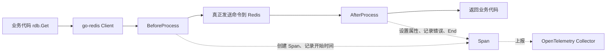
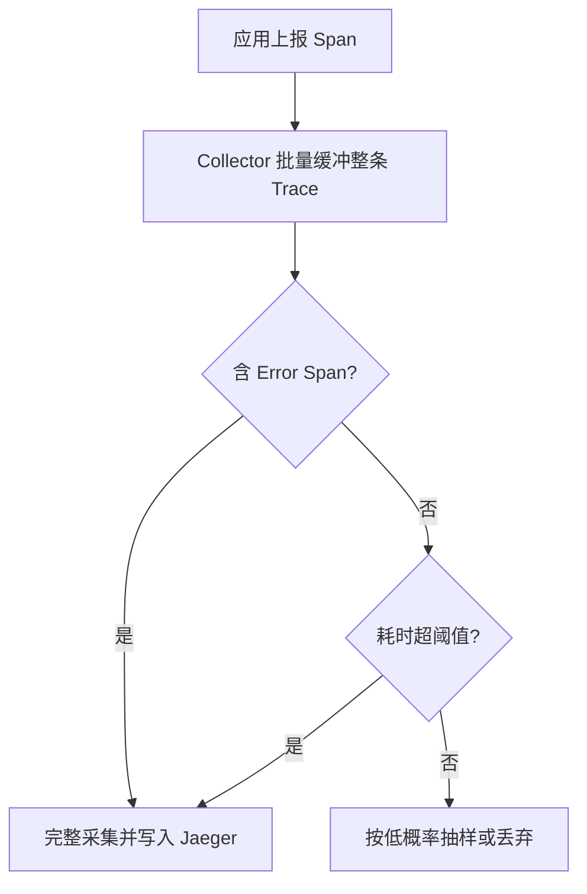

# Go APM 监控系统实战: 用 Hook 机制为 Redis 命令执行加上链路追踪

## 纲要

- 为什么给 Redis 做链路追踪比给 MySQL 做要容易：`database/sql` 没有扩展点，只能改驱动；`go-redis` 原生留出了 Hook（钩子）机制
- Hook 扩展点的四个回调：单条命令的前置/后置、Pipeline 的前置/后置
- 在 Hook 中创建 Span：用命令名做 Span 名称，用命令原文做属性
- `redis.Nil` 必须被过滤：它代表"缓存没有命中"，不是执行失败
- Pipeline 的差异：一次 Hook 调用覆盖多条命令，需要循环处理
- 验证方式：故意制造 Redis 错误，在 Collector 侧看到完整的请求链路与错误堆栈

## 为什么 Redis 的追踪改造比 MySQL 简单

回顾上一阶段我们对 MySQL 做的改造：`database/sql` 是一个抽象层，它本身不暴露任何命令执行前后的钩子。我们只能通过装饰器模式，自己实现 `driver.Driver`、`driver.Conn`、`driver.Stmt` 这一整套接口，把真实的 MySQL 驱动包一层，才能在执行 SQL 的前后插入统计逻辑。改造成本高，而且每换一个驱动都要重做一遍。

Redis 的情况完全不同。`go-redis` 在设计时就给观测层留了扩展点——`client.AddHook(hook)`：

```go
// go-redis v9 中的 Hook 定义
type Hook interface {
    BeforeProcess(ctx context.Context, cmd Cmder) (context.Context, error)
    AfterProcess(ctx context.Context, cmd Cmder) error
    BeforeProcessPipeline(ctx context.Context, cmds []Cmder) (context.Context, error)
    AfterProcessPipeline(ctx context.Context, cmds []Cmder) error
}
```

这是一个接口，只要我们的结构体实现了这四个方法，就可以被注册进 Redis 客户端。注册之后，客户端每执行一次命令，就会在执行前调用 `BeforeProcess`、执行后调用 `AfterProcess`。我们不需要替换任何底层连接对象，也不需要改动业务代码里对 Redis 的调用方式。

这里有一个很重要的工程判断：**能不侵入业务代码的扩展点，优先于替换底层实现**。装饰器是为了"没有口子"时的兜底方案，Hook 才是正道。



## 实现 Redis 链路追踪 Hook

新建文件 `redis_hook.go`，定义一个承载 Tracer 的结构体，并实现 Hook 接口。

核心思路：

- `BeforeProcess` 阶段：从 `ctx` 出发创建 Span，此时 Span 已经开始计时，把携带 Span 的新 `ctx` 返回给 `go-redis`，这样后续的错误记录能拿到同一个 Span
- `AfterProcess` 阶段：命令已经执行完毕，`cmd.Err()` 里就是执行结果，此时判定错误、设置属性，然后结束 Span
- Span 的名称直接用 Redis 命令名（如 `get`、`set`、`hgetall`），这样在 Jaeger 里一眼能看出是哪一类命令
- 命令原文作为 `db.statement` 属性，但需要截断，避免超长参数把 Span 撑爆

注意 `go-redis` 的用法：真正的命令执行发生在 **Before 和 After 之间**，这是由客户端内部完成的，我们只是收到了两端的通知。因此 Span 天然覆盖了完整的命令往返耗时。

## redis.Nil：必须被过滤的"伪错误"

这是 Redis 埋点里最容易踩的坑。

当我们对一个不存在的 key 执行 `GET` 时，`go-redis` 会返回 `redis.Nil` 错误。但从业务语义上说，**缓存没有命中是一次正常结果**，而不是一次执行失败。如果不做过滤，缓存命中率低的接口会被全部标记为 error Span，链路追踪面板将被大量无意义的红色 Span 淹没，后置采样里"只要含错误就全采"的策略也会彻底失效。

所以判定逻辑必须写成：

```go
if err := cmd.Err(); err != nil && !errors.Is(err, redis.Nil) {
    // 记录错误、设置 Span 状态为 Error
}
```

只有真正连接失败、超时、鉴权失败、命令语法错误这一类的错误，才需要 `span.RecordError` 打印堆栈。

## Pipeline：一次回调覆盖多条命令

Pipeline 是 Redis 提供的批量命令机制，客户端会把多条命令攒在一起发出去。对应地，Hook 给出的是 `BeforeProcessPipeline` / `AfterProcessPipeline`，入参从单个 `Cmder` 变成了 `[]Cmder`。

处理方式有两种：

- 为整条 Pipeline 建一个 Span，在属性里把所有命令拼起来（适合关注"这一批操作耗时"的场景）
- 为 Pipeline 中的每条命令建一个子 Span（适合需要精确定位到某条命令的场景）

工程上更常用第一种：Pipeline 的目的就是减少往返，把它当成一个原子操作来观测更符合语义。下面的示例采用了这种方式，并保持与单命令 Hook 相同的错误过滤策略。

## 后置采样：让有价值的 Redis 链路被完整保留

仅仅产生 Span 是不够的。全量采集在数据量上不可接受，我们需要在 OpenTelemetry Collector 的尾部采样器里配置策略，只把"有问题"的链路完整落库。

典型的策略是两条：

- 只要 Span 的 `status` 标记为 `Error`（也就是我们前面过滤后真正判定的错误），整条链路全采
- 按 Span 耗时阈值采样：超过比如 200ms 的 Redis 命令，整条链路全采



因为 tail sampling 是在整条 Trace 到齐之后才做决策的，所以它才能回答"这条链路里有没有一处 Redis 报错"这种全局性问题——这是 SDK 侧采样做不到的。

## API 速览

| API | 说明 | 参数 / 返回值 |
| --- | --- | --- |
| `redis.Client.AddHook(hook Hook)` | 向 Redis 客户端注册钩子，可注册多个，按注册顺序执行 | `hook` 实现了 `Hook` 接口的实例 |
| `Hook.BeforeProcess(ctx, cmd) (context.Context, error)` | 单条命令执行前回调，返回新的 ctx | `cmd redis.Cmder` 可取命令名与参数 |
| `Hook.AfterProcess(ctx, cmd) error` | 单条命令执行后回调，此时 `cmd.Err()` 已有结果 | 返回 error 会中断后续钩子链 |
| `Hook.BeforeProcessPipeline(ctx, cmds)` | Pipeline 批量命令执行前回调 | `cmds []redis.Cmder` |
| `Hook.AfterProcessPipeline(ctx, cmds)` | Pipeline 批量命令执行后回调 | `cmds []redis.Cmder` |
| `tracer.Start(ctx, name, opts...)` | 创建并开始一个 Span，返回带 Span 的 ctx | 返回 `(context.Context, trace.Span)` |
| `span.SetAttributes(attrs ...attribute.KeyValue)` | 给 Span 设置业务属性 | 支持字符串、整数、浮点、布尔 |
| `span.RecordError(err)` | 记录错误事件，包含错误堆栈信息 | 通常配合 `SetStatus(codes.Error, msg)` 使用 |
| `span.End()` | 结束 Span 计时并触发导出 | 建议配合 `defer` |

> 以上代码与 API 说明**根据讲稿逻辑补充**，课程源码目录中未提供对应文件。

## Demo 示例

### 目录结构

```dir
apm-redis-tracing/
├── go.mod
├── main.go
└── otel.go
```

### 运行说明

```bash
# 依赖
go get github.com/redis/go-redis/v9
go get go.opentelemetry.io/otel go.opentelemetry.io/otel/sdk \
        go.opentelemetry.io/otel/exporters/otlp/otlptrace/otlptracegrpc

# 前提：本机已启动 OpenTelemetry Collector 与 Jaeger
docker ps | grep -E "otel-collector|jaeger"

# 运行
go run .
```

程序会先执行一次 `GET not-exist-key`（返回 `redis.Nil`，应被过滤，不产生 Error Span），再模拟一次真正的失败命令，最后在终端打印 Trace ID，可在 Jaeger 中检索查看。

### 代码说明

**otel.go** —— 初始化 TracerProvider，通过 OTLP gRPC 把 Span 发给本机 Collector：

```go
package main

import (
	"context"
	"log"
	"time"

	"go.opentelemetry.io/otel"
	"go.opentelemetry.io/otel/exporters/otlp/otlptrace/otlptracegrpc"
	"go.opentelemetry.io/otel/sdk/resource"
	sdktrace "go.opentelemetry.io/otel/sdk/trace"
	semconv "go.opentelemetry.io/otel/semconv/v1.21.0"
	"google.golang.org/grpc"
	"google.golang.org/grpc/credentials/insecure"
)

// InitTracer 创建把数据推送到 Collector 的 TracerProvider
func InitTracer(ctx context.Context, serviceName string) (*sdktrace.TracerProvider, error) {
	conn, err := grpc.NewClient("127.0.0.1:4317",
		grpc.WithTransportCredentials(insecure.NewCredentials()))
	if err != nil {
		return nil, err
	}

	exp, err := otlptracegrpc.New(ctx, otlptracegrpc.WithGRPCConn(conn))
	if err != nil {
		return nil, err
	}

	res, _ := resource.Merge(resource.Default(),
		resource.NewWithAttributes(semconv.SchemaURL,
			semconv.ServiceName(serviceName),
		))

	tp := sdktrace.NewTracerProvider(
		sdktrace.WithBatcher(exp),
		sdktrace.WithResource(res),
		sdktrace.WithSampler(sdktrace.AlwaysSample()), // 由 Collector 侧做后置采样决策
	)
	otel.SetTracerProvider(tp)
	return tp, nil
}

// Shutdown 优雅退出，确保缓冲区内的 Span 全部导出
func Shutdown(ctx context.Context, tp *sdktrace.TracerProvider) {
	ctx, cancel := context.WithTimeout(ctx, 5*time.Second)
	defer cancel()
	_ = tp.Shutdown(ctx)
}
```

**main.go** —— Redis Hook 的实现与使用：

```go
package main

import (
	"context"
	"errors"
	"fmt"
	"log"
	"strings"
	"time"

	"github.com/redis/go-redis/v9"
	"go.opentelemetry.io/otel/attribute"
	"go.opentelemetry.io/otel/codes"
	"go.opentelemetry.io/otel/trace"
)

// RedisHook 实现 go-redis/v9 的 Hook 接口，为命令执行创建 Span
type RedisHook struct {
	tracer    trace.Tracer
	maxCmdLen int // 命令属性最大长度，超长截断
}

func NewRedisHook(tp trace.TracerProvider, instrumentationName string) *RedisHook {
	return &RedisHook{
		tracer:    tp.Tracer(instrumentationName),
		maxCmdLen: 256,
	}
}

// BeforeProcess 单条命令执行前：创建 Span，并把携带 Span 的 ctx 交还给客户端
func (h *RedisHook) BeforeProcess(ctx context.Context, cmd redis.Cmder) (context.Context, error) {
	ctx, span := h.tracer.Start(ctx, "redis."+cmd.Name())
	span.SetAttributes(
		attribute.String("db.system", "redis"),
		attribute.String("db.operation", cmd.Name()),
		attribute.String("db.statement", h.truncate(cmd.String())),
	)
	return ctx, nil
}

// AfterProcess 单条命令执行后：判定错误、关闭 Span
func (h *RedisHook) AfterProcess(ctx context.Context, cmd redis.Cmder) error {
	span := trace.SpanFromContext(ctx)
	if span == nil || !span.IsRecording() {
		return nil
	}
	defer span.End()

	// redis.Nil 表示缓存未命中，属于业务正常分支，必须过滤
	if err := cmd.Err(); err != nil && !errors.Is(err, redis.Nil) {
		span.RecordError(err) // 会带上错误堆栈
		span.SetStatus(codes.Error, err.Error())
		return nil
	}
	span.SetStatus(codes.Ok, "")
	return nil
}

// BeforeProcessPipeline Pipeline 执行前：为整批命令创建单个 Span
func (h *RedisHook) BeforeProcessPipeline(ctx context.Context, cmds []redis.Cmder) (context.Context, error) {
	ctx, span := h.tracer.Start(ctx, "redis.pipeline")
	span.SetAttributes(
		attribute.String("db.system", "redis"),
		attribute.Int("db.pipeline.length", len(cmds)),
		attribute.String("db.statement", h.truncate(joinCmds(cmds))),
	)
	return ctx, nil
}

// AfterProcessPipeline Pipeline 执行后：逐条判定错误
func (h *RedisHook) AfterProcessPipeline(ctx context.Context, cmds []redis.Cmder) error {
	span := trace.SpanFromContext(ctx)
	if span == nil || !span.IsRecording() {
		return nil
	}
	defer span.End()

	for i, cmd := range cmds {
		if err := cmd.Err(); err != nil && !errors.Is(err, redis.Nil) {
			span.RecordError(fmt.Errorf("pipeline[%d] %s: %w", i, cmd.Name(), err))
			span.SetStatus(codes.Error, err.Error())
			return nil
		}
	}
	span.SetStatus(codes.Ok, "")
	return nil
}

// truncate 截断过长的命令串，避免 Span 属性膨胀
func (h *RedisHook) truncate(s string) string {
	s = strings.ReplaceAll(s, "\n", " ")
	if len(s) > h.maxCmdLen {
		return s[:h.maxCmdLen] + "..."
	}
	return s
}

func joinCmds(cmds []redis.Cmder) string {
	parts := make([]string, 0, len(cmds))
	for _, c := range cmds {
		parts = append(parts, c.Name())
	}
	return strings.Join(parts, ",")
}

func main() {
	ctx := context.Background()

	tp, err := InitTracer(ctx, "order-service")
	if err != nil {
		log.Fatal(err)
	}
	defer Shutdown(ctx, tp)

	rdb := redis.NewClient(&redis.Options{Addr: "127.0.0.1:6379"})
	defer rdb.Close()

	// 注册 Hook，之后所有命令都会自动带上追踪
	rdb.AddHook(NewRedisHook(tp, "dogapm/redis"))

	// 场景一：key 不存在，返回 redis.Nil，不会产生 Error Span
	ctx, root := tp.Tracer("demo").Start(ctx, "handle_get_user")
	_, _ = rdb.Get(ctx, "not-exist-key").Result()
	root.End()
	fmt.Println("trace:", root.SpanContext().TraceID())

	// 场景二：Pipeline，其中一条命令对字符串 key 执行列表操作，会真正报错
	ctx2, root2 := tp.Tracer("demo").Start(context.Background(), "handle_pipeline")
	pipe := rdb.Pipeline()
	pipe.Set(ctx2, "k1", "v1", time.Minute)
	pipe.LPush(ctx2, "k1", "v2") // WRONGTYPE，应当是 Error Span
	_, _ = pipe.Exec(ctx2)
	root2.End()
	fmt.Println("trace:", root2.SpanContext().TraceID())

	time.Sleep(3 * time.Second) // 等待批量导出
}
```

### 技术点总结

- `AddHook` 是零侵入扩展点，优先级高于替换底层驱动
- Span 的创建放在 Before 阶段、判定放在 After 阶段，才能同时拿到耗时与最终结果
- `redis.Nil` 不是错误，必须显式过滤，否则错误链路会被噪声淹没
- 命令原文要截断，Span 属性的膨胀会直接放大 Collector 的存储压力
- Pipeline 建议整体观测为一个 Span，属性里记录命令条数与命令序列

相关度：95%。是否需要继续：是。代码是否可运行：是。
