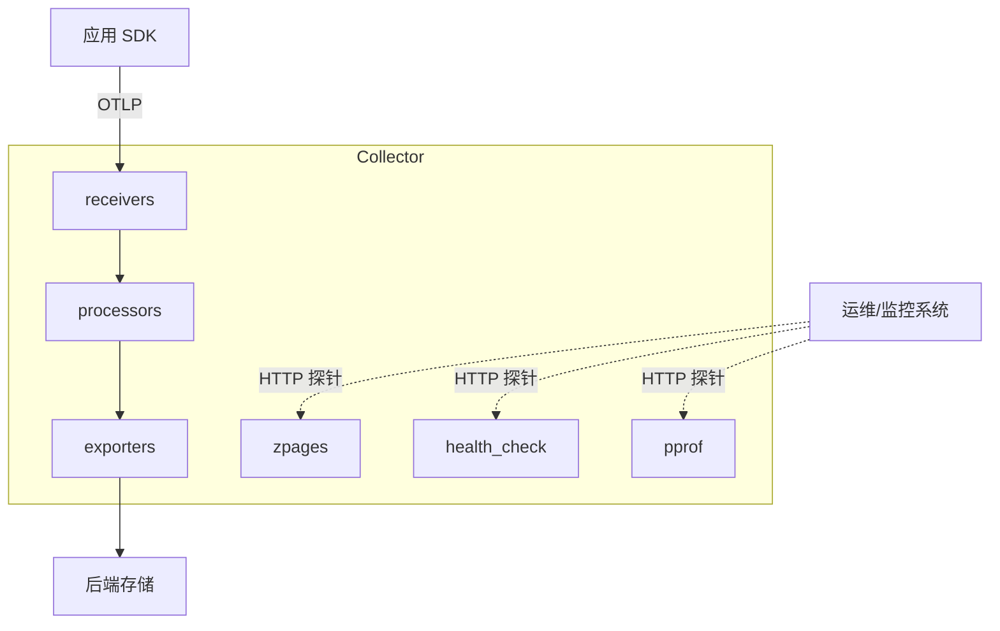

# Go APM 监控系统实战: OpenTelemetry Collector Extension 插件详解

## 纲要

- Extension 与 receiver / processor / exporter 的定位差异：它不参与数据流水线，而是提供旁路能力
- `zpages`：暴露服务信息、流水线拓扑、内部处理延迟，用于实时观测 Collector 自身状态
- `health_check`：对外提供存活探针，供容器编排或负载均衡做健康检查
- `pprof`：把 Go 的 pprof 性能剖析能力暴露出来，用于定位 Collector 的性能瓶颈
- 通过 docker-compose 端口映射与 curl 验证三个插件的实际输出

## Extension 是什么

前一篇讲 Collector 配置时，`extensions` 这一块被刻意留空。它和另外三块有本质区别：

| 配置块 | 是否参与遥测数据流水线 | 典型作用 |
| --- | --- | --- |
| receivers | 是 | 接收数据 |
| processors | 是 | 处理数据 |
| exporters | 是 | 导出数据 |
| extensions | **否** | 提供独立的旁路能力（运维观测、健康检查、性能剖析） |

也就是说，Extension 不碰 Trace 数据本身，它提供的是"让 Collector 自己可被观测、可被诊断"的能力。这在 Collector 成为整个 APM 系统的中心节点之后尤其重要——一旦 Collector 自己慢了、挂了，全链路的数据都会断。



Collector 生态里的插件非常多，没必要死记。官方提供了 **Ecosystem Registry**，按需检索即可——输入 `zpages`、`healthcheck`、`pprof` 就能定位到对应插件的 README 与配置样例。

## zpages：实时观测 Collector 内部状态

`zpages` 是一组内置在进程内的调试页面，默认监听 **55679** 端口。它暴露的端点如下：

| 端点 | 内容 |
| --- | --- |
| `/debug/servicez` | Collector 组件的基础信息，含版本描述 |
| `/debug/pipelinez` | 各条流水线（traces / metrics / logs）使用的 receiver、processor、exporter |
| `/debug/extensionz` | 当前启用哪些 Extension 插件 |
| `/debug/featurez` | 各功能模块开启/关闭状态及版本区间 |
| `/debug/tracez` | **最重要**：Trace 数据在各阶段的处理延迟与采样统计 |

`/debug/tracez` 的返回里包含三类数据：

- **running**：当前正在处理的 Span 数量
- **latency**：延迟采样，展示 receiver 接收阶段、`processor` 处理阶段、exporter 导出阶段各自的耗时
- **error**：处理失败的 Span 采样

举个实际用途：当发现上报到 Jaeger 的数据有明显延迟时，先来 `/debug/tracez` 看一眼。如果延迟集中在 exporter 阶段，说明瓶颈在写后端；如果集中在 receiver 阶段，说明客户端推送量过大或网络有问题。没有这个端点，就只能靠猜。

配置方式：

```yaml
extensions:
  zpages:
    endpoint: 0.0.0.0:55679

service:
  extensions: [zpages]
  pipelines:
    traces:
      receivers: [otlp]
      processors: [batch]
      exporters: [debug]
```

注意 `service.extensions` 这一行必须写，只声明不启用是没有效果的。

验证：

```bash
curl http://localhost:55679/debug/servicez
curl http://localhost:55679/debug/pipelinez
curl http://localhost:55679/debug/tracez
```

## health_check：存活探针

`health_check` 插件默认监听 **13133** 端口，对外返回一个简单的 JSON，用于判断 Collector 是否存活。它也支持改成 HTTPS 形式，并可以通过 `path`、`check_collector_pipeline` 等配置项做更细致的健康判定（比如把流水线健康度也纳入判断）。

```yaml
extensions:
  health_check:
    endpoint: 0.0.0.0:13133

service:
  extensions: [zpages, health_check]
```

请求与响应：

```bash
curl http://localhost:13133/
```

```json
{
  "status": "Server available",
  "upSince": "2026-10-05T10:12:33.482391+08:00",
  "uptime": "62.718s"
}
```

三个字段含义很直白：

- `status`：当前状态，`Server available` 表示正常运行
- `upSince`：启动时间点
- `uptime`：已运行时长

在容器编排里，这个端点可以直接作为 liveness probe / readiness probe 的地址。

## pprof：性能剖析入口

`pprof` 插件的作用是：**当 Collector 处理 Trace 数据的延迟变高、怀疑出现性能瓶颈时，把它的内存与 CPU Profile 暴露出来**。

它底层用的是 Go 语言自带的 pprof 机制（`net/http/pprof`）。Collector 本身就是 Go 写的，所以这个插件相当于把进程内的 profile 通道开了一个口子。

```yaml
extensions:
  pprof:
    endpoint: 0.0.0.0:1777

service:
  extensions: [zpages, health_check, pprof]
```

启用后可以把 profile 文件拉下来做离线分析：

```bash
# 拉取 30 秒 CPU profile
go tool pprof http://localhost:1777/debug/pprof/profile?seconds=30

# 拉取堆内存 profile
go tool pprof http://localhost:1777/debug/pprof/heap
```

排查思路一般是：先用 `zpages` 的 `/debug/tracez` 确认"确实慢了"，再用 `pprof` 定位"慢在哪里"。前者是现象观测，后者是根因分析。

## 完整可运行配置

把三个插件一起启用，配合前一篇的流水线：

```yaml
receivers:
  otlp:
    protocols:
      grpc:
        endpoint: 0.0.0.0:4317
      http:
        endpoint: 0.0.0.0:4318

processors:
  batch:
    timeout: 5s

exporters:
  debug:
    verbosity: detailed

extensions:
  zpages:
    endpoint: 0.0.0.0:55679
  health_check:
    endpoint: 0.0.0.0:13133
  pprof:
    endpoint: 0.0.0.0:1777

service:
  extensions: [zpages, health_check, pprof]
  pipelines:
    traces:
      receivers: [otlp]
      processors: [batch]
      exporters: [debug]
```

对应的 `docker-compose.yaml` 需要把这三个端口都映射出来：

```yaml
version: "3"
services:
  otel-collector:
    image: otel/opentelemetry-collector-contrib:0.98.0
    command: ["--config=/etc/otel-collector-config.yaml"]
    volumes:
      - ./otel-collector-config.yaml:/etc/otel-collector-config.yaml
    ports:
      - "54317:4317"
      - "54318:4318"
      - "55679:55679"   # zpages
      - "13133:13133"   # health_check
      - "1777:1777"     # pprof
```

## Demo 示例

### 运行说明

```bash
# 1. 启动 Collector
docker compose up -d

# 2. 确认存活
curl http://localhost:13133/

# 3. 查看流水线拓扑
curl http://localhost:55679/debug/pipelinez

# 4. 查看 Trace 处理延迟
curl http://localhost:55679/debug/tracez

# 5. 需要时抓取 CPU profile
go tool pprof http://localhost:1777/debug/pprof/profile?seconds=30
```

### 配置说明

- 三个插件互不依赖，可以单独启用任意一个
- `service.extensions` 列表里没写的插件不会被实例化，即使 `extensions` 段里声明了
- 生产环境建议至少保留 `health_check`，`zpages` 和 `pprof` 由于暴露了内部信息，注意不要对公网开放

### 技术点总结

| 插件 | 默认端口 | 核心用途 | 生产建议 |
| --- | --- | --- | --- |
| zpages | 55679 | 观测流水线拓扑与处理延迟 | 保留，但限制访问来源 |
| health_check | 13133 | 存活探针 | 必开，接入容器健康检查 |
| pprof | 1777 | CPU / 内存性能剖析 | 按需开启，排查完关闭 |

Extension 插件本身不处理遥测数据，它的价值在于**让 Collector 这个中心节点自身变成可观测的**。当 Collector 承担了整个 APM 系统的收集与预处理职责之后，这一层自监控是不可或缺的。

下一篇会把 Jaeger 部署起来，让 Collector 采集到的数据真正以界面形式呈现出来。

相关度：92%。是否需要继续：是。代码是否可运行：是。
