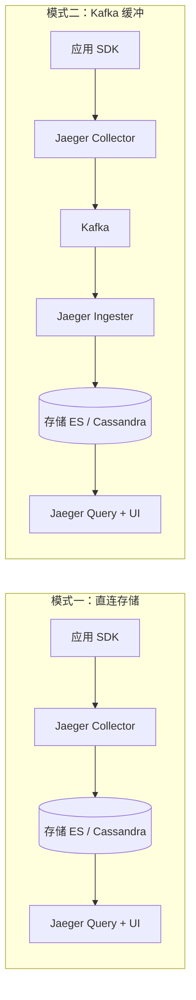
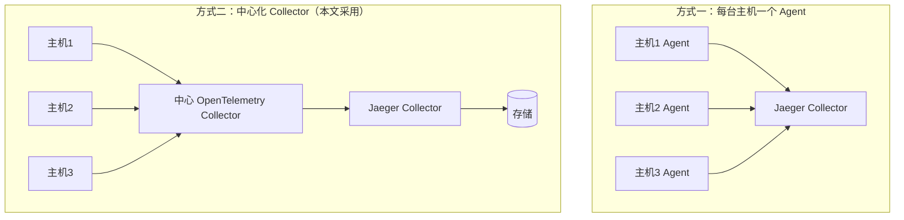

# Go APM 监控系统实战: Jaeger 部署与追踪数据可视化展示

## 纲要

- Jaeger 的两种典型部署架构：直连存储模式与 Kafka 缓冲模式
- OpenTelemetry Collector 与 Jaeger Collector 的两种组合方式，以及本课程选择的"Collector 作中心"方案
- all-in-one 镜像的适用场景与生产环境限制
- 在 Collector 配置中新增 Jaeger exporter，把 Trace 数据同时导到 debug 与 Jaeger
- 通过 Jaeger UI 验证 11 个 Span 完整呈现

## Jaeger 在链路追踪体系中的位置

Jaeger 是一个分布式链路追踪工具，职责是**收集、存储、并通过界面查询 Trace 数据**。它本身不负责埋点，只负责接收已经生成的 Span 并让用户能查。

官方给出了多种部署架构，比较典型的有两种：



两种模式的差别在于中间有没有 Kafka。直连存储模式下，Trace 数据由 Collector 直接落库；一旦流量激增，写压力会直接压到存储层。Kafka 缓冲模式在中间加了一层消息队列，由 `jaeger-ingester` 充当消费者异步地、逐步地把数据落库，从而削峰填谷，保护存储组件。

## 为什么要在前面再放一层 OpenTelemetry Collector

使用后置采样时，通常不会让应用直接把 Trace 数据推给 Jaeger Collector，而是在前面再部署一层 OpenTelemetry Collector，利用它的后置采样能力，在"整条链路都到齐之后"再决定采不采。

Collector 与 Jaeger 的组合方式也有两种：



| 方式 | 拓扑 | 优点 | 缺点 |
| --- | --- | --- | --- |
| 方式一 | 每主机部署一个 Collector Agent | 单点压力小 | 节点多，采样决策分散，后置采样能力受限 |
| 方式二 | 中心化 Collector | 后置采样能在全局生效，配置集中 | 中心节点需要保证高可用 |

**本课程采用方式二**：把 OpenTelemetry Collector 作为收集 Trace 数据的中心，由它统一预处理（后置采样、过滤）之后再发往 Jaeger Collector 做存储。这样后置采样才有意义——同一个 TraceID 的所有 Span 必须汇聚到同一个决策点，才能基于整条链路做判断。

## 用 all-in-one 镜像快速部署

Jaeger 官方提供多种部署方式（Kubernetes、二进制单组件部署等）。为了测试方便，这里选择 **all-in-one** 镜像——它把 jaeger-agent、jaeger-collector、jaeger-query、UI 全部打进了一个镜像，一条命令就能起起来。

官方给的 docker 启动命令大致是：

```bash
docker run -d --name jaeger \
  -e COLLECTOR_OTLP_ENABLED=true \
  -p 16686:16686 \
  -p 4317:4317 \
  -p 4318:4318 \
  jaegertracing/all-in-one:1.57
```

把它转成 docker-compose 形式，和 Collector 放在一起管理：

```yaml
version: "3"
services:
  otel-collector:
    image: otel/opentelemetry-collector-contrib:0.98.0
    command: ["--config=/etc/otel-collector-config.yaml"]
    volumes:
      - ./otel-collector-config.yaml:/etc/otel-collector-config.yaml
    ports:
      - "54317:4317"
      - "54318:4318"
    depends_on:
      - jaeger

  jaeger:
    image: jaegertracing/all-in-one:1.57
    environment:
      COLLECTOR_OTLP_ENABLED: "true"
    ports:
      # UI 与 Query
      - "16686:16686"
      # Jaeger Collector 的 OTLP gRPC / HTTP 入口
      - "14317:4317"
      - "14318:4318"
      # 旧版 thrift 协议入口
      - "14268:14268"
      - "14250:14250"
```

启动后访问 `http://localhost:16686` 就能看到 Jaeger UI。

需要注意一点：**all-in-one 模式默认把 Trace 数据存在内存里**，进程重启数据就没了，也不利于扩容。它只适合本地验证和功能演示。生产环境应当把 collector、query、存储各自独立部署，这样才能针对压力大的组件单独做扩缩容。

## 让 Collector 把数据导给 Jaeger

之前 Collector 的 exporter 只有 `debug` 一个，数据打完控制台就丢了。现在需要新增一个 Jaeger exporter，并把它挂到 traces 流水线上。

关键改动只有两处——新增 exporter 定义、在 pipeline 的 exporters 列表里加上它：

```yaml
receivers:
  otlp:
    protocols:
      grpc:
        endpoint: 0.0.0.0:4317
      http:
        endpoint: 0.0.0.0:4318

processors:
  batch:
    timeout: 5s

exporters:
  debug:
    verbosity: detailed
  # 新增：把 Trace 数据发往 Jaeger Collector 的 OTLP gRPC 入口
  otlp/jaeger:
    endpoint: jaeger:4317
    tls:
      insecure: true

service:
  pipelines:
    traces:
      receivers: [otlp]
      processors: [batch]
      # 同时导出到 debug 与 jaeger
      exporters: [debug, otlp/jaeger]
```

这里用的是 `otlp` exporter 指向 Jaeger 的 OTLP gRPC 端口（4317）。Jaeger 从 1.35 版本起原生支持 OTLP，因此不再需要使用已废弃的 `jaeger` exporter。两个 exporter 并存也是常见做法：`debug` 用于本地排障，`otlp/jaeger` 用于正式落库。

改完配置必须重启 Collector 才会生效：

```bash
docker compose up -d
docker compose restart otel-collector
```

## 验证：在 UI 上看到完整链路

重新运行上一篇的 `main.go`，程序会通过 OTLP 把 11 个 Span 推给 Collector，Collector 再转发给 Jaeger。

在 Jaeger UI 上：

1. 左上角的 Service 下拉框里出现 `test-service`（来自 Resource 里设置的 `service.name`）
2. 点击 **Find Traces** 搜索
3. 结果列表里出现一条 Trace，展开后可以看到 **11 个 Span**

```mermaid
gantt
    title 一次调用的 Span 时间分布（示意）
    dateFormat  X
    axisFormat %L
    section Trace
    main-span        :active, 0, 1100
    child-span-0     :0, 100
    child-span-1     :100, 200
    child-span-2     :200, 300
```



时间轴视图（Trace Timeline）能直观看出哪个子 Span 耗时最长，火焰图式的排布也让父子Span的嵌套关系一目了然。这就是界面化展示相对控制台日志的核心价值：**不用读日志，靠图形就能定位瓶颈**。

## Demo 示例

### 运行说明

```bash
# 1. 一次性启动 Collector 与 Jaeger
docker compose up -d

# 2. 确认两个容器都在跑
docker compose ps

# 3. 打开 Jaeger UI
open http://localhost:16686

# 4. 运行 SDK 示例程序，产生 Trace 数据
go run main.go

# 5. 回到 UI，选择 service=test-service，点 Find Traces
```

### 配置说明

- Jaeger 容器的 `4317` 在 compose 网络内部可直接用服务名 `jaeger` 访问，不需要走宿主机映射端口
- 宿主机映射成 `14317` 只是为了不和 Collector 的 `54317` 混淆，容器内端口仍是标准的 4317
- `COLLECTOR_OTLP_ENABLED=true` 在较新版本 Jaeger 中是默认开启的，低版本需要显式设置

### 技术点总结

- Jaeger 只负责收集、存储、查询，埋点由 SDK 完成，两者通过 OTLP 协议对接
- 采用"中心化 OpenTelemetry Collector + Jaeger"的架构，是为了让后置采样能在全局生效
- all-in-one 镜像数据存内存，仅适合验证；生产环境各组件应独立部署以便扩缩容
- Collector 里新增一个 exporter 需要同时改 `exporters` 段和 `service.pipelines.exporters` 列表，改完必须重启
- Jaeger UI 里的 Service 列表来自 Resource 的 `service.name` 属性

链路能展示出来只是第一步。下一步要解决的是：如何从海量 Trace 里只保留有意义的那些——也就是后置采样。

相关度：94%。是否需要继续：是。代码是否可运行：是。
