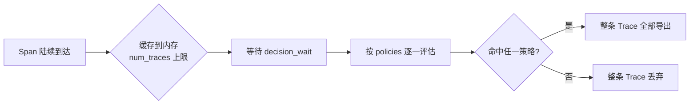
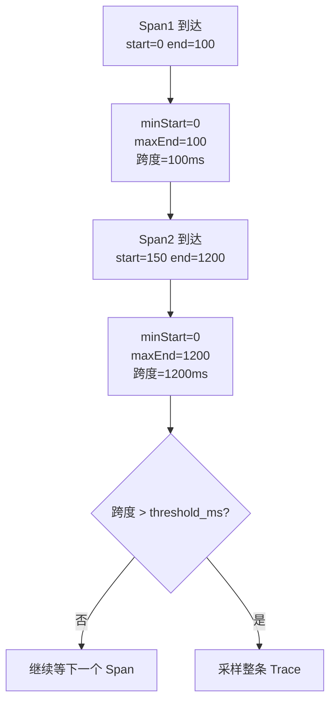

# Go APM 监控系统实战: OpenTelemetry Collector 后置采样配置与实战

## 纲要

- 前置采样（Head Sampling）与后置采样（Tail Sampling）的本质区别，以及 Collector 侧对应的两个 processor
- `tail_sampling` processor 的核心配置项：`decision_wait`、`num_traces`、`expected_new_traces_per_sec`
- 九种采样策略的适用场景，重点剖析 `latency` 策略的真实判定语义
- 如何在 Go 代码里为 Span 打布尔属性，驱动后置采样决策
- 动手验证：让同一份代码分别"命中"与"不命中"采样策略

## 前置采样与后置采样

OpenTelemetry 官方在 Concepts 栏目下明确区分了两种采样：

| 维度 | 前置采样 Head Sampling | 后置采样 Tail Sampling |
| --- | --- | --- |
| 决策时机 | Span 生成的瞬间 | 整条 Trace 的 Span 基本到齐之后 |
| 决策依据 | 只看单个 Span 自身 | 可以看整条链路的全部 Span |
| 决策位置 | 客户端 SDK | Collector（需要一个汇聚点） |
| 典型实现 | SDK 的 `TraceIDRatioBased` | Collector 的 `tail_sampling` processor |
| 优点 | 开销极小，几乎无内存占用 | 能精准抓到慢请求、错误请求 |
| 缺点 | 无法保证抓到有价值的链路 | 需要在内存里缓存 Trace，开销较大 |

前置采样最大的问题是"盲采"：它在请求刚开始时就决定要不要采，此时根本不知道这个请求会不会变慢、会不会报错。结果就是大量正常请求被采上来，而真正想看的慢请求可能被丢掉。

后置采样反过来：**先全收，等一等，再决定**。因为它能看全整条链路，所以可以制定"只要链路里有一个 Span 报错就采"、"只要链路总耗时超过 5 秒就采"这类有意义的规则。

Collector 里这两个能力分别对应两个 processor：

```yaml
processors:
  # 前置采样：概率型，对单个 Span 独立决策
  probabilistic_sampler:
    sampling_percentage: 10

  # 后置采样：基于整条 Trace 决策
  tail_sampling:
    decision_wait: 30s
    policies: [...]
```

本文关注后者。

## 后置采样 processor 的三个核心参数



### decision_wait

**Span 到达 Collector 后不会立刻被决策**，默认要等 **30 秒**。

原因是后置采样要衡量整条请求轨迹，必须等同一 TraceID 的 Span 陆续到齐。如果来一个就判一个，那就退化成前置采样了。`decision_wait` 就是那个"等一等"的窗口。

这个值需要权衡：

- 设太短：链路还没走完就决策了，后半段的慢 Span / 错误 Span 看不到
- 设太长：内存里积压的 Trace 多，且 Jaeger 上看到数据的延迟变大

### num_traces

**内存中保存的完整请求轨迹的最大容量**，默认 **50000**。

后置采样要在内存里保管一段时间的数据，这个保管不能无限增长。超过上限后会驱逐最早的那些 Trace。压测或流量突增时如果发现有链路莫名丢失，可以检查一下这个值。

### expected_new_traces_per_sec

**每秒预计新产生的 Trace 数量**，默认 0。

这个参数和 `tail_sampling` 的源码实现有关——processor 在分配内部数据结构（尤其是用于传递待决策 Trace 的 channel）时会用到它来做容量预估。如果吞吐量很高却用默认值，可能导致 channel 缓冲不足。后文讲 processor 源码时会再展开。

## 采样策略一览

`tail_sampling` 的 `policies` 是一个列表，**只要命中其中任意一个策略，整条 Trace 就会被采集**。

| 策略类型 | 判定依据 | 典型用途 |
| --- | --- | --- |
| `always_sample` | 无条件 | 调试期全采 |
| `latency` | 链路总耗时超过阈值 | 抓慢请求 |
| `boolean_attribute` | 某个布尔属性等于指定值 | 抓慢查询、长事务等自定义标记 |
| `numeric_attribute` | 某个数值属性落在区间内 | 抓耗时/大小/次数异常 |
| `string_attribute` | 某个字符串属性匹配 | 按接口名、用户 ID 过滤 |
| `status_code` | Span 状态码为 ERROR / OK / UNSET | 抓错误链路 |
| `span_count` | Trace 内 Span 数量在范围内 | 抓调用深度异常的链路 |
| `rate_limiting` | 每秒最多采 N 条 | 限流保护 |
| `probabilistic` | 按概率采样 | 兜底抽样 |
| `and` / `composite` | 组合多个子策略 | 复合条件 |

注意 `status_code` 判定的是 **Span 的 Status**，而下一章要用的"错误信息链路"实际是给 Span 打一个 `error=true` 的布尔属性，走的是 `boolean_attribute` 策略——两者不是一回事。

## latency 策略的判定语义（易混淆点）

这是 `latency` 策略最容易被理解错的地方，值得单独说清楚。

**错误理解**：遍历每个 Span，看某个 Span 自己的耗时是否超过阈值。

**实际语义**：把同一 TraceID 的所有 Span 取出来，维护两个变量——**最早的开始时间**和**最晚的结束时间**，用这两个值的差作为**整条链路的首尾跨度**，再和阈值比较。

关键在于这个最值不是"最后一次性遍历算出来的"，而是**增量维护**的：每到达一个 Span，就拿它的 start / end 去更新当前的最早开始时间与最晚结束时间，如果更新后的结果已经超过阈值，就可以判定采样。



由此得到两个实践结论：

1. **单个 Span 自己的耗时不决定结果**。一个耗时 200ms 的 Span，如果它所在链路的首尾跨度是 8 秒，整条链路照样会被采。
2. **想让链路不被采，必须压缩整条链路的首尾跨度**，而不是只压缩某一个 Span。

## 配置实战

在 Collector 配置文件里加入后置采样 processor，并挂到 traces 流水线上：

```yaml
receivers:
  otlp:
    protocols:
      grpc:
        endpoint: 0.0.0.0:4317

processors:
  batch:
    timeout: 5s
  tail_sampling:
    decision_wait: 10s        # 演示用，缩短等待
    num_traces: 50000
    expected_new_traces_per_sec: 100
    policies:
      # 策略一：Span 上带 slow_sql=true 就采
      - name: slow-sql-policy
        type: boolean_attribute
        boolean_attribute:
          key: slow_sql
          value: true
      # 策略二：链路首尾跨度超过 5 秒就采
      - name: latency-policy
        type: latency
        latency:
          threshold_ms: 5000

exporters:
  debug:
    verbosity: detailed
  otlp/jaeger:
    endpoint: jaeger:4317
    tls:
      insecure: true

service:
  pipelines:
    traces:
      receivers: [otlp]
      processors: [tail_sampling, batch]
      exporters: [debug, otlp/jaeger]
```

**processor 顺序很重要**：`tail_sampling` 必须放在 `batch` 前面。后置采样需要按 TraceID 聚合 Span，一旦先经过 batch 攒批，它看到的就是批次而不是单条数据，聚合逻辑会失效。

## 用 Go 代码驱动采样

采样策略要生效，前提是 Span 上真的带了对应的属性。给 Span 打属性的方式很简单：

```go
span.SetAttributes(attribute.Bool("slow_sql", true))
```

完整示例：

```go
package main

import (
	"context"
	"fmt"
	"log"
	"time"

	"go.opentelemetry.io/otel"
	"go.opentelemetry.io/otel/attribute"
	"go.opentelemetry.io/otel/exporters/otlp/otlptrace/otlptracegrpc"
	"go.opentelemetry.io/otel/sdk/resource"
	sdktrace "go.opentelemetry.io/otel/sdk/trace"
	semconv "go.opentelemetry.io/otel/semconv/v1.21.0"
	"google.golang.org/grpc"
	"google.golang.org/grpc/credentials/insecure"
)

// mode 控制本轮演示命中哪种策略
type mode int

const (
	modeSlowPerSpan mode = iota // 每个子 Span 都睡 1s，链路总跨度 > 5s，命中 latency
	modeFast                    // 只在最后睡 1s，链路总跨度 < 5s，不命中 latency
	modeSlowSQLAttr             // 显式打 slow_sql=true，命中 boolean_attribute
)

func initTracer(ctx context.Context, endpoint string) (*sdktrace.TracerProvider, error) {
	conn, err := grpc.DialContext(ctx, endpoint,
		grpc.WithTransportCredentials(insecure.NewCredentials()),
		grpc.WithBlock(),
	)
	if err != nil {
		return nil, err
	}
	exporter, err := otlptracegrpc.New(ctx, otlptracegrpc.WithGRPCConn(conn))
	if err != nil {
		return nil, err
	}
	res, err := resource.New(ctx, resource.WithAttributes(semconv.ServiceName("trace-demo")))
	if err != nil {
		return nil, err
	}
	tp := sdktrace.NewTracerProvider(
		sdktrace.WithSampler(sdktrace.AlwaysSample()),
		sdktrace.WithResource(res),
		sdktrace.WithSpanProcessor(sdktrace.NewBatchSpanProcessor(exporter)),
	)
	otel.SetTracerProvider(tp)
	return tp, nil
}

func run(ctx context.Context, m mode) {
	tracer := otel.GetTracerProvider().Tracer("trace-demo")

	ctx, parent := tracer.Start(ctx, "main-span")

	// 命中 boolean_attribute 策略：直接在父 Span 上打标记
	if m == modeSlowSQLAttr {
		parent.SetAttributes(attribute.Bool("slow_sql", true))
	}

	for i := 0; i < 10; i++ {
		_, child := tracer.Start(ctx, fmt.Sprintf("child-span-%d", i))
		if m == modeSlowPerSpan {
			// 每个子 Span 睡 1s，10 个累加后链路总跨度约 10s > 5s
			time.Sleep(time.Second)
		}
		child.End()
	}

	if m != modeSlowPerSpan {
		// 只睡 1s，链路总跨度约 1s < 5s，不会被 latency 策略命中
		time.Sleep(time.Second)
	}

	parent.End()
}

func main() {
	ctx := context.Background()
	tp, err := initTracer(ctx, "localhost:54317")
	if err != nil {
		log.Fatal(err)
	}
	defer func() {
		c, cancel := context.WithTimeout(context.Background(), 5*time.Second)
		defer cancel()
		_ = tp.Shutdown(c)
	}()

	// 依次切换三种模式运行，观察 Jaeger 上出现几条 Trace
	run(ctx, modeSlowPerSpan)   // 期望：被采集
	run(ctx, modeFast)          // 期望：不采集
	run(ctx, modeSlowSQLAttr)   // 期望：被采集
}
```

## 验证过程与结果

改完 Collector 配置要重启：

```bash
docker compose restart otel-collector
```

### 第一轮：命中 latency 策略

`modeSlowPerSpan` 下每个子 Span 睡 1 秒，10 个子 Span 累加起来，链路首尾跨度约 10 秒，超过 5000ms 阈值。运行后刷新 Jaeger UI，能看到新出现一条包含 11 个 Span 的 Trace。

### 第二轮：不命中 latency 策略

改成 `modeFast`，只在最后睡 1 秒，链路首尾跨度约 1 秒，小于阈值。运行后再刷新，**没有新的 Trace 出现**——这证明 latency 策略确实生效了。

这里正好印证了前面的结论：不是"某个 Span 睡了 1 秒"决定结果，而是整条链路的首尾跨度决定结果。

### 第三轮：命中 boolean_attribute 策略

把 latency 策略注释掉，只保留 `slow_sql` 布尔属性策略，并在父 Span 上设置 `slow_sql=true`。运行后 Jaeger 上出现新的 Trace——布尔属性策略生效。

| 轮次 | 代码改动 | 链路首尾跨度 | slow_sql 属性 | 结果 |
| --- | --- | --- | --- | --- |
| 1 | 每 Span 睡 1s | ~10s | 无 | 采集 |
| 2 | 仅最后睡 1s | ~1s | 无 | 丢弃 |
| 3 | 仅最后睡 1s | ~1s | `true` | 采集 |

## Demo 示例

### 运行说明

```bash
# 1. 修改 otel-collector-config.yaml，加入 tail_sampling（见上文）
# 2. 重启 Collector 使配置生效
docker compose restart otel-collector

# 3. 依次运行三种模式
go run main.go

# 4. 打开 Jaeger UI 观察
open http://localhost:16686
```

### 代码说明

- 根据讲稿逻辑补充：三种模式用同一个 `run` 函数切换，便于对照验证
- `decision_wait` 演示时设成 10s，所以运行完程序后需要等一小会儿才能在 Jaeger 上看到数据，不要误判为采集失败
- 生产环境 `decision_wait` 建议保持 30s 默认，或按链路平均耗时调整

### 技术点总结

- 后置采样的价值在于"先看完整条链路再决定"，能精准捕获慢请求与错误请求
- `decision_wait` 是等待窗口，`num_traces` 是内存上限，`expected_new_traces_per_sec` 影响内部数据结构容量
- 多条策略是**或**的关系，命中任意一条即采集整条 Trace
- latency 策略看的是整条链路的首尾跨度（增量维护的最早开始时间到最晚结束时间），不是单个 Span 的耗时
- `tail_sampling` 必须排在 `batch` 之前
- 改完 Collector 配置必须重启才生效

采样规则定好了，接下来的问题是：**到底该抓哪些链路才算有意义**。下一篇先明确需求，再逐个落地。

相关度：96%。是否需要继续：是。代码是否可运行：是。
