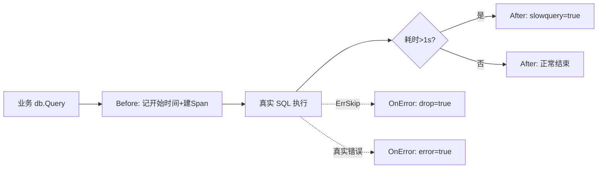

# 40. Go APM 监控系统实战: MySQL 慢查询链路追踪

## 纲要

- 把 4-13~4-15 的装饰器骨架填上真实业务：`sqlhook.go` 用 `WrapDriver` 返回自定义驱动，hooks 在 SQL 前后做链路追踪
- `Before`：把开始时间写入 `ctx`，创建 Span，记录 `db.statement` / `db.args`（超长截断）
- `After`：从 `ctx` 取开始时间，若耗时超过 1s 给 Span 打 `slowquery=true`，并结束 Span
- `OnError`：普通错误打 `error=true` 并 `RecordError`；但若错误是 `driver.ErrSkip`，说明底层走了 prepare + statement 双路径，这个中间 Span 要打 `drop=true` 让过滤器丢弃
- Collector 侧：后置采样保留 `error=true` 与 `slowquery=true`；`filter` 处理器丢弃 `drop=true` 的 Span
- 易踩的坑：返回包装类型必须是**指针**（`&wrapperConn{}`），否则接口断言失败、插桩不生效

## 从装饰器到真正的慢查询埋点

前面三节把"能在 SQL 前后插逻辑"的装饰器做好了。这一节把真实业务填进去：新建 `sqlhook.go`，提供 `WrapDriver` 返回自定义驱动；hooks 里用 Tracer 创建 Span 来记录每条 SQL 的语句、参数与耗时。



## Before：记录开始时间并建 Span

开始时间要随 `ctx` 向下传，这样 `After` 才能算耗时；同时创建 Span 并写入语句与参数属性。参数可能很长，统一截断到固定长度，避免 Span 属性膨胀放大 Collector 存储压力。

```go
// sqlhook.go —— 根据讲稿逻辑补充
package sqlhook

import (
	"context"
	"errors"
	"fmt"
	"strings"
	"time"

	"database/sql/driver"
	"go.opentelemetry.io/otel/attribute"
	"go.opentelemetry.io/otel/codes"
	"go.opentelemetry.io/otel/trace"
)

type ctxKey int

const (
	startKey ctxKey = iota
	spanKey
)

const slowThreshold = time.Second

type sqlHook struct {
	tracer trace.Tracer
}

func (h *sqlHook) Before(ctx context.Context, query string, args []driver.NamedValue) (context.Context, error) {
	ctx = context.WithValue(ctx, startKey, time.Now())

	vals := make([]interface{}, len(args))
	for i, a := range args {
		vals[i] = a.Value
	}

	_, span := h.tracer.Start(ctx, "mysql.query")
	span.SetAttributes(
		attribute.String("db.system", "mysql"),
		attribute.String("db.statement", truncate(query, 256)),
		attribute.String("db.args", truncate(fmt.Sprint(vals), 256)),
	)
	return context.WithValue(ctx, spanKey, span), nil
}

func truncate(s string, max int) string {
	s = strings.ReplaceAll(s, "\n", " ")
	if len(s) > max {
		return s[:max] + "..."
	}
	return s
}
```

## After：计算耗时并标记慢查询

`After` 从 `ctx` 取回开始时间与 Span，算出耗时；超过 1 秒就给 Span 打 `slowquery=true`，最后结束 Span。

```go
func (h *sqlHook) After(ctx context.Context, query string, args []driver.NamedValue) error {
	span, _ := ctx.Value(spanKey).(trace.Span)
	if span == nil {
		return nil
	}
	defer span.End()

	start, _ := ctx.Value(startKey).(time.Time)
	if time.Since(start) > slowThreshold {
		span.SetAttributes(attribute.Bool("slowquery", true))
	}
	return nil
}
```

## OnError：区分真实错误与 driver.ErrSkip

这是本篇最关键的处理。`go-sql-driver/mysql` 在执行带参查询时，可能先返回 `driver.ErrSkip` 表示"这一步跳过、改走 prepare + statement"；于是 `Before` 会被调用两次（一次 query、一次 statement），产生两个 Span。第一个是中间 Span，不该被采集。

处理策略：

- 若错误是 `driver.ErrSkip`：给这个 Span 打 `drop=true`，交给 Collector 的 `filter` 处理器丢弃；
- 若是真实错误：打 `error=true` 并 `RecordError`，使其被后置采样全采。

```go
func (h *sqlHook) OnError(ctx context.Context, query string, args []driver.NamedValue, err error) error {
	span, _ := ctx.Value(spanKey).(trace.Span)
	if span == nil {
		return nil
	}
	defer span.End()

	if errors.Is(err, driver.ErrSkip) {
		// 中间 Span，标记 drop，由 filter 处理器过滤
		span.SetAttributes(attribute.Bool("drop", true))
		return nil
	}
	span.RecordError(err)
	span.SetStatus(codes.Error, err.Error())
	span.SetAttributes(attribute.Bool("error", true))
	return nil
}
```

> 配合 4-11，错误链路靠 `error=true` 被后置采样保留；本篇慢查询靠 `slowquery=true` 保留；中间 Span 靠 `drop=true` 被 `filter` 处理器丢掉。

## WrapDriver：把 hooks 接进装饰器

`WrapDriver` pperDriver` 思路，把 `sqlHook` 作为 `Hooks` 注入，返回可注册的新驱动：

```go
// WrapDriver 包装 mysql 驱动，返回带链路追踪的新驱动
func WrapDriver(base driver.Driver, tracer trace.Tracer) driver.Driver {
	h := &sqlHook{tracer: tracer}
	return &wrapperDriver{
		driver: base,
		hooks: Hooks{
			Before:  h.Before,
			After:   h.After,
			OnError: h.OnError,
		},
	}
}
```

## Collector 配置：filter 处理器丢弃 drop Span

后置采样器已配置"保留 `error=true` 与 `slowquery=true`"。此外还要加一个 `filter` 处理器，把 `drop=true` 的中间 Span 丢掉——配置写法不确定时，照例去 OpenTelemetry 注册表查 `filter` processor 的示例：

```yaml
processors:
  # 先过滤掉带参查询产生的中间 Span
  filter/drop-intermediate:
    error_mode: ignore
    span:
      - attributes["drop"] == true
  batch:
    timeout: 5s

exporters:
  jaeger:
    endpoint: jaeger:14250
    tls:
      insecure: true

service:
  pipelines:
    traces:
      receivers: [otlp]
      processors: [filter/drop-intermediate, batch]
      exporters: [jaeger]
```

## 易踩的坑：返回必须是指针

实现接口时，包装类型的方法接收者用的是指针。因此返回连接 / 驱动时也必须返回**指针**，否则标准库的接口断言（如"是否实现 `QueryerContext`"）会失败，插桩完全不生效：

```go
return &wrapperConn{conn: conn, hooks: h.hooks}, nil // 正确：返回指针
// return wrapperConn{...}                            // 错误：值类型，接口断言失败
```

讲稿实测时，正是因为一开始返回了值类型导致 Span 没出来，改成指针后数据才正常上报，Jaeger 中能看到带 `slowquery=true`、并显示 SQL 与参数的链路。

## 验证效果

写一个测试：开启 APM、注册带 hook 的驱动，执行一条人为变慢的查询（查询后 `time.Sleep` 超过 1 秒），然后调用全局关闭方法把 `TracerProvider` 冲刷掉。程序运行约一秒多后，Jaeger 中即可看到这条链路，Span 上带有 `slowquery=true`、SQL 语句与参数——慢查询追踪采集完成。

> 与前述的 Redis 方案对比：Redis 的 `go-redis` 原生提供 `AddHook` 扩展点，零侵入；MySQL 的 `database/sql` 没有 hook，必须像本节这样用装饰器包一层驱动，改造成本更高，但两者最终都落到"Before/After/OnError + 属性 + 后置采样"同一套思路上。

## 技术点总结

- `Before` 记开始时间 + 建 Span + 截断写入语句 / 参数；`After` 算耗时，超 1s 打 `slowquery=true`
- `OnError` 必须识别 `driver.ErrSkip`，给中间 Span 打 `drop=true` 交过滤器丢弃
- Collector 用 `filter` 处理器丢 `drop=true`，后置采样保留 `error` / `slowquery`
- 包装类型返回**指针**，否则接口断言失败、插桩失效
- 与 Redis 的 Hook 方案相比，MySQL 只能靠装饰器驱动，思路一致、成本更高

