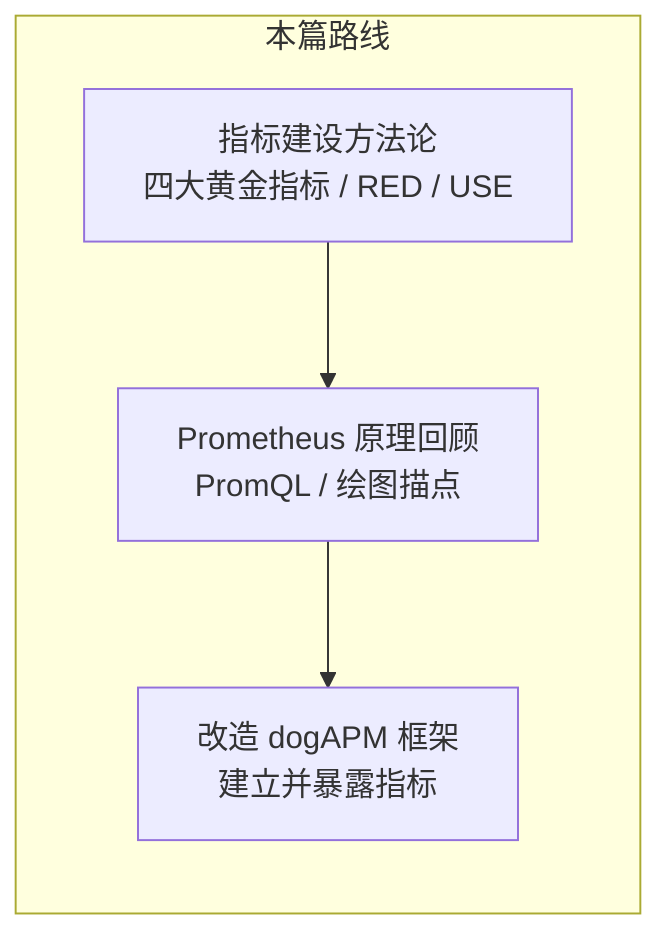

# 46. Go APM 监控系统实战: 第五章 应用性能监控指标建设导学

## 纲要

- 本篇主线：把「应用系统性能指标监控」落地到 dogAPM 框架
- 内容三段式：先讲指标建设的**方法论**，再回顾 **Prometheus 原理与架构**，最后**改造框架**建立指标
- 方法论包括：四大黄金指标原则、USE / RED 方法，用来指导「面对陌生组件时该建哪些指标」
- Prometheus 原理重点：PromQL 表达式原理、Grafana 绘制面板时的描点原理
- 本章强调：比「怎么描点绘图」「代码怎么引入」更重要的，是**想清楚应该建立什么样的指标**
- 后续建立指标的过程，就是对这些方法论的一次最佳实践

## 正文

### 本章要解决什么

前四章我们分别搭好了三个微服务骨架、打通了分布式链路追踪。但一个完整的 APM 系统，除了「链路」，还必须有「指标」——而且是体系化的、可分层的指标。

本篇就是去建设 dogAPM 的**应用性能监控指标**：让框架能自动、标准化地暴露出反映系统健康度的各类指标，并在 Grafana 上画出有意义的面板。

### 本章内容结构

按照「方法论 → 原理 → 落地」的顺序展开：

- **方法论先行**：建立监控指标不是拍脑袋的过程，背后有一套理论支撑。我们会讲清「四大黄金指标原则」是什么、USE 方法和 RED 方法怎么用。这些方法论的价值在于：当你面对一个陌生组件或系统时，能快速知道该建哪些指标来反映它的运行状态。
- **原理回顾**：在动手写指标之前，先回看 Prometheus 的相关原理与架构——包括 PromQL 二维表达式的原理，以及 Prometheus 在 Grafana 里绘制面板时「描点」到底是怎么算出来的。理解了底层原理，后面写 PromQL、调面板才不会一头雾水。
- **改造框架**：最后回到 dogAPM 基础框架，把前面讲的方法论真正用起来，建立应用系统的指标监控。这一步本身就是对前述方法论的最佳实践。

### 本章最重要的提醒

讲稿特意强调了一点，值得单独拎出来：在应用系统指标监控里，**最终描点绘图的部分反而不是最重要的，代码里的引入方式也可能不是最重要的**。

最重要的是——**你要知道应该去建立什么样的指标**，来完成对整个应用系统的监控。本章在讲解和实践时，会不断引导你思考：创建指标监控时应该考虑什么问题、侧重点是什么。带着这个问题去学，比单纯记几个 PromQL 函数收获大得多。

