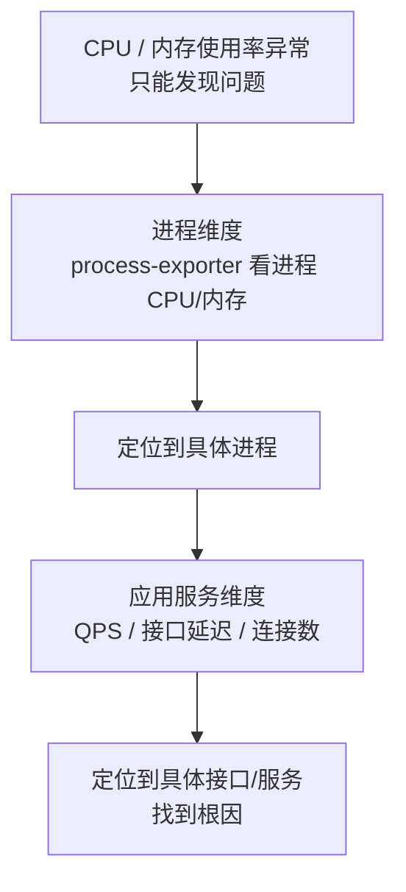

# 47. Go APM 监控系统实战: 建立性能监控指标的最佳实践原则

## 纲要

- 原则一：**避免高基数指标**。高基数指样本值重复率低、不同时间序列数量过多，会严重拖慢 Prometheus 聚合查询
- 高基数由两个因素决定：标签名数量（标签越多唯一度越高）、标签值数量（每个标签的取值越多）
- Prometheus 提供四类统计视角帮助分析高基数：`topk` 标签名、`topk` 指标名、内存占用 top 标签、标签基数对 top
- 原则二：**指标要能发现问题，更要能定位问题**。从现象指标一路下钻到根因指标
- 原则三：**分层建立指标**。机器维度、中间件维度、应用服务维度、业务维度各成面板
- 原则四：**不要追求一步到位**，先跑通采集-存储-查询流程，再逐步补全细节指标

## 正文

### 原则一：不要建立高基数指标

高基数（high cardinality）指指标的样本值基本不重复、重复率很低。一个时间序列（series）由「指标名 + 一组标签名与标签值」唯一确定；只要有一个标签值不同，就是不同的 series。因此**不同 series 的总数 = 各标签取值的排列组合**。

例如指标 `http_response_total` 带两个标签 `status_code` 和 `host`：

- `status_code` 有 10 个取值
- `host` 有 10 个取值
- 排列组合就是 `10 × 10 = 100` 条不同的时间序列

如果 `status_code` 有 100 个、`host` 有 10 个，series 数就变成 1000。可见高基数由两个因素共同决定：

1. **标签名数量**：标签越多，组合维度越多，重复率越低
2. **标签值数量**：单个标签的取值越多，排列组合越大

高基数的直接后果是：Prometheus 查询时通常需要对大量 series 做聚合运算，series 越多查询越慢，严重时会拖垮整个统计界面的响应。

Prometheus 自带一张统计表，从四个角度帮我们定位高基数问题：

| 分析视角 | 排序依据 | 作用 |
| --- | --- | --- |
| `topk` 标签名 | 标签值的个数 | 找出「取值最多」的标签（高基数的元凶） |
| `topk` 指标名 | series 数量 | 找出「序列最多」的指标 |
| 内存占用 top 标签 | 占用内存大小 | 找出最吃内存的标签 |
| 标签基数对 top | 所占 series 数 | 找出哪个标签值组合占了最多 series |

> 概念澄清：一个**样本（sample）** = 带时间戳的一个数值；一个**序列（series）** = 标签组合完全相同的一组样本。标签值哪怕有一个不同，就是不同的 series。

### 原则二：指标要能发现问题，更要能定位问题

监控的核心目的不是「看到异常」而是「找到根因」。只监控现象、不监控原因，等于只亮红灯不指路。

讲稿用「Linux 服务器 CPU / 内存异常」举例，展示了指标如何一步步下钻：



- 只监控服务器的 CPU、内存使用率，**只能发现异常，无法解释为什么异常**
- 自然会想到：是不是某个进程把资源吃满了？于是引入 `process-exporter` 监控进程级 CPU / 内存
- 但知道哪个进程异常还不够，还要顺着进程去看它对应的应用服务指标：QPS、接口延迟、连接数等
- 整个过程是**以定位问题为出发点**逐步建立指标，而不是随机堆砌

### 原则三：分层建立指标

监控天然是分层的，通常分为四层，每层侧重点不同：

| 层级 | 关注点 | 典型指标 |
| --- | --- | --- |
| 机器维度 | Linux 服务器的资源使用率 | CPU / 内存使用率 |
| 中间件维度 | 服务器上部署的 MySQL / Redis 等 | 连接数、命中率、慢查询 |
| 应用服务维度 | 业务服务自身 | 服务 CPU / 内存、QPS、响应延迟 |
| 业务维度 | 与业务直接相关 | 登录人数、下单成功数 |

分层的好处是：出问题时能一眼看出**问题落在哪一层**。同一层的指标通常放在同一个 Dashboard 里，方便在该层范围内快速定位是哪类指标出了问题。

### 原则四：不要追求一步到位

不要试图一开始就建出一套十全十美的监控。正确做法是：先把最基本的指标建起来，把「采集 → 存储 → 查询」整条链路跑通，再随着业务发展逐步补全细节指标。

这一点不仅适用于性能指标建设，也适用于任何想从零落地监控体系的团队——特别是原本没有监控基础的部门。指标监控是持续过程，即便你觉得已经比较完善，随着业务演进和线上问题排查，仍会不断补充新指标。要时刻反问：现有指标体系是否足以 cover 线上各种情况？

## Demo 示例

下面给出一个可独立运行的小程序，直观演示「标签基数爆炸」：给定各标签的取值数量，计算会产生的 series 总数。

```go
package main

import "fmt"

// seriesCount 计算指标的时间序列总数：各标签取值数量的乘积
func seriesCount(cardinalities ...int) int {
	total := 1
	for _, c := range cardinalities {
		total *= c
	}
	return total
}

func main() {
	// 低基数：2 个标签，各 10 个取值 → 100 条 series
	fmt.Println("低基数示例:", seriesCount(10, 10))

	// 高基数：status_code(100) × host(10) × user_id(10000) → 1000 万条 series
	fmt.Println("高基数示例:", seriesCount(100, 10, 10000))

	// 结论：引入 user_id 这类高散列标签会让 series 数瞬间爆炸，应避免作为指标标签
}
```

### 运行说明

```bash
go run main.go
```

### 代码说明

- series 数 = 各标签取值数量的连乘，因此**永远不要把 `user_id`、`order_id` 这类高散列字段直接作为指标标签**
- 若必须按用户维度统计，应放到日志或用预聚合 / 降采样手段，而非原始指标标签

### 技术点总结

- 高基数由两个因素决定：标签名数量 + 标签值数量；用 Prometheus 的四类统计视角定位元凶
- 指标建设要以「定位问题」为导向，从现象层层下钻到根因
- 监控分层（机器 / 中间件 / 应用 / 业务），同层指标同盘展示
- 先跑通基础监控再逐步完善，避免一开始追求完美

