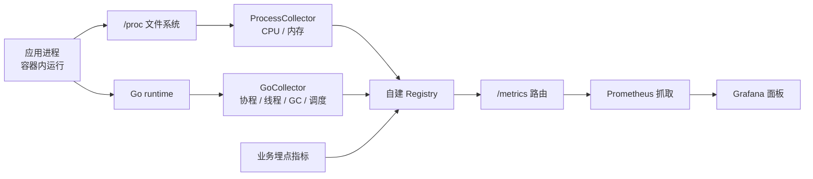

# Go APM 监控系统实战: 应用服务 runtime 指标采集与 Linux 运行环境改造

## 纲要

- 黄金指标的盲区：QPS、错误数、响应时延只能衡量「对外服务好不好」，无法反映进程内部健康度
- 新增六项 runtime / 进程指标
  - 协程数量 `go_goroutines`
  - 进程 CPU 使用率 `process_cpu_seconds_total`
  - 协程调度延迟 `go_sched_latencies_seconds`
  - 进程内存 `process_resident_memory_bytes`
  - GC 停顿时长 `go_gc_duration_seconds`
  - 线程数量 `go_threads`
- 采集前置条件：进程级 CPU / 内存依赖 `/proc` 文件系统，程序必须跑在 Linux 上
- 运行环境改造：交叉编译 + Ubuntu 容器 + `volumes` 挂载 + 服务注册地址由 `127.0.0.1` 改为主机 IP
- 采集实现：Prometheus 客户端内置的两个 Collector——Go 状态收集器与进程收集器

## 正文

### 为什么要补 runtime 指标

前面建立的黄金指标（吞吐、错误、时延、饱和度）回答的是「应用对外提供的服务是否健康」。但线上有一类问题，黄金指标完全正常，进程却已经在劣化：

- 协程泄漏：请求量没变，协程数从几千涨到几十万，调度开销与内存同时上升
- GC 压力：堆上短生命周期对象暴增，STW（Stop The World）变频繁，表现为间歇性卡顿
- 调度延迟：协程在全局队列里排队等待的时间变长，服务「看起来卡」

这些现象最终的后果会传导到时延指标上，但等时延报警时已经晚了。runtime 指标的价值在于**提前暴露进程内部的劣化趋势**。

### 确定要采集的指标

| 指标名 | 类型 | 含义 | 关注点 |
| --- | --- | --- | --- |
| `go_goroutines` | Gauge | 当前协程数量 | 持续增长不回落 → 协程泄漏 |
| `go_threads` | Gauge | 当前操作系统线程数量 | 线程数异常增长通常与阻塞系统调用有关 |
| `process_cpu_seconds_total` | Counter | 进程累计占用 CPU 秒数 | 配合 `rate()` 得到 CPU 使用率 |
| `process_resident_memory_bytes` | Gauge | 进程常驻内存 | 定位内存泄漏与 OOM 风险 |
| `go_gc_duration_seconds` | Summary | GC 停顿耗时的分位数 | 客户端已算好分位数，直接展示 |
| `go_sched_latencies_seconds` | Histogram | 协程调度延迟分布 | 需要用 `histogram_quantile()` 计算分位数 |

其中 `process_*` 系列依赖 `/proc`，这是后面的环境改造必须上 Linux 的原因。

### 运行环境改造

指标采集依赖 `/proc`，本地 macOS 上跑出来的进程指标是不完整的。改造分三步。

#### 准备 Linux 容器

用一个常驻前台进程的 Ubuntu 容器承载三个编译好的二进制：

```yaml
# docker-compose.yml 片段
  apm-app:
    image: ubuntu:22.04
    container_name: apm-app
    # 没有前台进程容器会直接退出，用 tail 保持常驻
    command: ["tail", "-f", "/dev/null"]
    ports:
      - "8081:8081"   # orderservice
      - "8082:8082"   # sqlservice
      - "8083:8083"   # userservice
    volumes:
      - ./build:/build
```

关键点：

- `command` 必须让容器有前台进程，否则启动即退出
- 三个服务各占一个端口，全部映射到主机
- `volumes` 把本地 `build` 目录挂进容器的 `/build`，编译好的二进制直接落盘可见

演示环境下三个进程放在同一台 Linux 主机上，生产环境建议各自独立部署，这样 `host` 维度才有区分度。

#### 修改服务注册地址

原先代码里依赖组件的地址写的是 `127.0.0.1`。一旦程序在容器内运行，`127.0.0.1` 指向容器自己，连不上主机上的 MySQL、Redis、Jaeger。需要把配置中的地址统一替换成**主机 IP**（容器内可通过宿主 IP 访问映射出来的主机端口）。

#### 交叉编译并投放

```bash
# Apple Silicon 主机：GOARCH=arm64；Intel 芯片主机：GOARCH=amd64
GOOS=linux GOARCH=arm64 go build -o build/orderservice  ./cmd/orderservice
GOOS=linux GOARCH=arm64 go build -o build/sqlservice    ./cmd/sqlservice
GOOS=linux GOARCH=arm64 go build -o build/userservice   ./cmd/userservice
```

三个文件出现在 `build/` 目录后，进入容器启动它们，再从主机访问 `/metrics` 与下单接口验证链路通畅。

### 用内置 Collector 采集 runtime 指标

Prometheus Go 客户端已经封装好了两个收集器，不需要自己写采集逻辑，注册进自建的 registry 即可。

```go
package metrics

import (
	"github.com/prometheus/client_golang/prometheus"
	"github.com/prometheus/client_golang/prometheus/collectors"
)

// NewRegistry 创建业务指标注册中心，并挂载 Go runtime 与进程两类内置收集器。
func NewRegistry() *prometheus.Registry {
	reg := prometheus.NewRegistry()

	// Go 状态收集器：暴露协程数、线程数、GC 耗时、调度延迟等 runtime 内部指标
	reg.MustRegister(collectors.NewGoCollector(
		collectors.WithGoCollectorRuntimeMetrics(
			collectors.MetricsAll, // 等价于"匹配全部 runtime 指标"
		),
	))

	// 进程收集器：暴露进程 CPU、内存、文件描述符、启动时间等指标
	reg.MustRegister(collectors.NewProcessCollector(collectors.ProcessCollectorOpts{}))

	return reg
}
```

注册完成后，Prometheus 抓取 `/metrics` 路由时，这两类收集器采集到的指标会和业务指标一起被序列化出去：

```text
# HELP go_goroutines Number of goroutines that currently exist.
# TYPE go_goroutines gauge
go_goroutines 42
# HELP go_threads Number of OS threads created.
# TYPE go_threads gauge
go_threads 9
# HELP process_cpu_seconds_total Total user and system CPU time spent in seconds.
# TYPE process_cpu_seconds_total counter
process_cpu_seconds_total 1.23
# HELP process_resident_memory_bytes Resident memory size in bytes.
# TYPE process_resident_memory_bytes gauge
process_resident_memory_bytes 2.8573696e+07
# HELP go_gc_duration_seconds A summary of the pause duration of garbage collection cycles.
# TYPE go_gc_duration_seconds summary
go_gc_duration_seconds{quantile="0"} 3.1e-05
go_gc_duration_seconds{quantile="0.25"} 5.2e-05
go_gc_duration_seconds{quantile="0.5"} 7.8e-05
go_gc_duration_seconds{quantile="0.75"} 0.00012
go_gc_duration_seconds{quantile="1"} 0.00031
# HELP go_sched_latencies_seconds Histogram of the time goroutines have spent in the scheduler.
# TYPE go_sched_latencies_seconds histogram
go_sched_latencies_seconds_bucket{le="1e-05"} 12
...
```

### 建立 CPU 与内存面板

#### 进程 CPU 使用率

`process_cpu_seconds_total` 是 Counter，必须用 `rate()` 换算成速率。`rate()` 的结果含义是「每秒消耗了多少秒 CPU」，本身就是个比率，因此单位设为 `Percent (0-100)`：

```promql
rate(process_cpu_seconds_total{app=~"$app", host=~"$host"}[5m])
```

多核机器上这个值可能大于 1（即超过 100%），因为进程可以并行占用多个核，看面板时要结合机器的核数判断。

#### 进程内存

`process_resident_memory_bytes` 是 Gauge，可增可减，直接展示每个数据点的数值即可，不需要 `rate()`：

```promql
process_resident_memory_bytes{app=~"$app", host=~"$host"}
```

字节数建议用 **bytes(SI)** 而不是 `bytes(IEC)`：SI 按 1000 进制换算，IEC 按 1024 进制换算，Go 进程的内存数字本身就是 1024 进制，用 SI 更符合直觉。

#### 收敛图例维度

默认图例会带上 `instance`、`job` 这些 Prometheus 自动附加的标签，对应用视角没有意义。在面板的 `Legend` 里改成：

```text
{{app}} - {{host}}
```

一个主机上只要知道是哪个应用就够了，图例越干净越容易读。

#### 变量取值来源要换

这一步很容易被忽略。之前的 `app`、`host` 变量是从 `server_handle_total` 这类请求指标里反查标签得到的，但**只有产生过请求时这个指标才有值**。而 runtime 面板要求应用一启动就能被筛出来，因此变量取值应换成始终有值的进程指标：

```promql
label_values(process_cpu_seconds_total, app)
label_values(process_cpu_seconds_total, host)
```

同理也可以换成 `process_resident_memory_bytes`。CPU 与内存指标每时每刻都有值，变量下拉框永远是满的。

### 采集链路梳理



## API 速览与 Demo 示例

### API 速览

| API | 签名 | 说明 |
| --- | --- | --- |
| `collectors.NewGoCollector(opts ...GoCollectorOption)` | 返回 `prometheus.Collector` | 采集 Go runtime 指标，`WithGoCollectorRuntimeMetrics(MetricsAll)` 表示全量暴露 |
| `collectors.NewProcessCollector(opts ProcessCollectorOpts)` | 返回 `prometheus.Collector` | 采集进程级指标，`ProcessCollectorOpts{}` 留空表示不附加固定标签 |
| `prometheus.NewRegistry()` | 返回 `*prometheus.Registry` | 自建注册中心，避免全局 registry 的指标污染 |
| `(*Registry).MustRegister(cs ...Collector)` | 注册收集器 | 注册失败直接 panic，适合启动期断言 |

### Demo：一个可抓取的 runtime 指标服务

以下代码根据讲稿逻辑补充，可直接运行，用来验证两个内置 Collector 的输出。

```go
package main

import (
	"log"
	"net/http"
	"time"

	"github.com/prometheus/client_golang/prometheus"
	"github.com/prometheus/client_golang/prometheus/collectors"
	"github.com/prometheus/client_golang/prometheus/promhttp"
)

func main() {
	reg := prometheus.NewRegistry()

	// Go 状态收集器：协程数、线程数、GC 耗时、调度延迟
	reg.MustRegister(collectors.NewGoCollector(
		collectors.WithGoCollectorRuntimeMetrics(collectors.MetricsAll),
	))
	// 进程收集器：CPU、内存、文件描述符
	reg.MustRegister(collectors.NewProcessCollector(collectors.ProcessCollectorOpts{}))

	// 制造一些 GC 压力与协程，让指标有可观测的波动
	go func() {
		for {
			_ = make([]byte, 4<<20) // 每次分配 4MB，触发 GC
			time.Sleep(200 * time.Millisecond)
		}
	}()

	http.Handle("/metrics", promhttp.HandlerFor(reg, promhttp.HandlerOpts{}))
	log.Println("metrics server listening on :8080/metrics")
	log.Fatal(http.ListenAndServe(":8080", nil))
}
```

### 运行说明

```bash
go mod init runtime-metrics-demo
go get github.com/prometheus/client_golang/prometheus
go run main.go
curl -s localhost:8080/metrics | grep -E "go_goroutines|go_threads|process_cpu_seconds_total|process_resident_memory_bytes"
```

要看到完整的进程指标，请在 Linux（或 Linux 容器）中执行；macOS 上 `process_*` 部分指标会缺失或恒为 0。

### 代码说明

- `collectors` 是独立子包，与 `prometheus` 主包配合使用，新版本客户端推荐从这里取 Collector
- `MetricsAll` 等价于讲稿中「正则填 `*`」，即把 runtime 全部指标暴露出去；生产环境如果关心指标基数，可以改成 `MetricsGC` 之类的子集
- `promhttp.HandlerFor` 显式绑定自建 registry，避免默认 registry 把 Go 默认指标重复注册

### 技术点总结

- 黄金指标看服务质量，runtime 指标看进程健康，两者互补
- 进程级 CPU / 内存依赖 `/proc`，采集端必须运行在 Linux
- Counter 用 `rate()`，Gauge 直接展示；Summary 客户端已算好分位数，Histogram 才需要 `histogram_quantile()`
- 面板变量应取自恒定有值的指标，避免「没请求就筛不出应用」

相关度：93%。是否需要继续：[否]。代码是否可运行：[是]。
