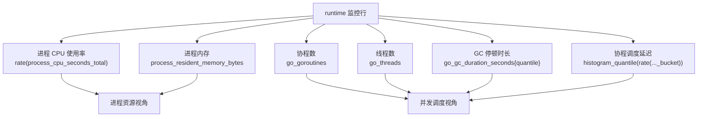

# Go APM 监控系统实战: 协程数、线程数与 GC 调度延迟监控面板

## 纲要

- 承接上一节，补齐 runtime 面板剩余的四个指标
- `go_goroutines`（Gauge）：直接展示数据点，无需速率换算
- `go_threads`（Gauge）：与协程数同类型，指标名不同
- `go_gc_duration_seconds`（Summary）：分位数在客户端已算好，直接展示并用 `quantile` 标签过滤
- `go_sched_latencies_seconds`（Histogram）：必须用 `histogram_quantile()` 服务端计算分位数
- 核心规律：**指标类型决定 PromQL 函数的选择**

## 正文

### 协程数与线程数

`go_goroutines` 是 Gauge 类型，语义就是「当前存在多少个协程」，直接用指标名即可，每个数据点的数值就是当时快照：

```promql
go_goroutines{app=~"$app", host=~"$host"}
```

面板名称改为「协程数」，单位保持 `short`，不做任何换算。

线程数同理，唯一区别是指标名换成 `go_threads`：

```promql
go_threads{app=~"$app", host=~"$host"}
```

复制协程数面板再改指标名和标题即可，注意把图例格式一并保留为 `{{app}} - {{host}}`。

协程数面板是排查**协程泄漏**的第一入口：如果曲线的基线随时间单调抬升、且在低峰期也不回落，基本可以判定有协程卡在某个阻塞点上没释放。此时就该用第 6 章的 pprof goroutine profile 去定位具体堆栈。

### GC 停顿时长：Summary 类型

`go_gc_duration_seconds` 是 Summary 类型。Summary 的特点是**分位数在客户端（应用进程内）就已计算完成**，Prometheus 拿到的样本上带着 `quantile` 标签：

```text
go_gc_duration_seconds{quantile="0"}    3.1e-05
go_gc_duration_seconds{quantile="0.25"} 5.2e-05
go_gc_duration_seconds{quantile="0.5"}  7.8e-05
go_gc_duration_seconds{quantile="0.75"} 0.00012
go_gc_duration_seconds{quantile="1"}    0.00031
```

因此它**没有跨实例聚合的意义**——把两个实例的 P75 再平均一次是错的。面板上正确的做法是：直接展示，并用 `quantile` 标签挑选关心的那一条线，例如只看 P75：

```promql
go_gc_duration_seconds{app=~"$app", host=~"$host", quantile="0.75"}
```

图例里务必把 `{{quantile}}` 带上，否则多条分位数曲线叠在一起根本分不清哪条是哪条。单位设为 `seconds`（秒）。

### 协程调度延迟：Histogram 类型

`go_sched_latencies_seconds` 是 Histogram 类型，客户端只上报各个 bucket 的累计计数，分位数必须在查询时计算：

```promql
histogram_quantile(
  0.75,
  sum by (le, app, host) (
    rate(go_sched_latencies_seconds_bucket{app=~"$app", host=~"$host"}[5m])
  )
)
```

三个要点：

- `histogram_quantile()` 的第一个参数是分位数，第二个参数必须是**区间向量**，`rate()` 的作用正是把 bucket 的 Counter 转换成区间向量
- `sum by (le, ...)` 中的 `le` 必须保留，它是 bucket 的上边界标签，丢了它算不出分位数
- 多实例聚合时按 `le` 分组求和，这是 Histogram 与 Summary 在聚合能力上的根本差异

面板名称「协程调度延迟」，单位同样是 `seconds`。

### 四种指标类型与查询函数的对应关系

| 类型 | 例子 | 客户端产物 | 查询方式 | 能否跨实例聚合 |
| --- | --- | --- | --- | --- |
| Counter | `process_cpu_seconds_total` | 单调递增累计值 | `rate()` / `increase()` | 能 |
| Gauge | `go_goroutines`、`go_threads`、`process_resident_memory_bytes` | 当前快照 | 直接展示 | 能 |
| Summary | `go_gc_duration_seconds` | 已算好的 `quantile` 序列 | 直接展示 + 过滤 quantile | 不能 |
| Histogram | `go_sched_latencies_seconds` | `le` 分桶计数 | `histogram_quantile(rate(...))` | 能 |

这张表是后续画所有面板的决策依据：先看指标类型，再决定用什么函数、能不能聚合。

### 面板归位

把这四块面板连同上一节的 CPU、内存一起拖进 `runtime` 这一行（Row），保存后 runtime 层的监控就完整了：



到这里，应用服务的监控已经覆盖了三层：黄金指标层、runtime 层、第三方组件（MySQL）层。下一节补上「内部流量分布」这一视角。

## API 速览与 Demo 示例

### PromQL 速览

| 函数 | 签名 | 说明 |
| --- | --- | --- |
| `histogram_quantile(φ, v)` | 分位数 + 区间向量 → 向量 | 对 Histogram bucket 计算分位数，`v` 必须含 `le` 标签 |
| `rate(v[d])` | 区间向量 → 向量 | bucket 计数器转区间向量，常与 `histogram_quantile` 配合使用 |
| `sum by (le, ...) (...)` | 向量 → 向量 | 多实例聚合时保留 `le` 分组 |

### Demo：对比 Summary 与 Histogram 的分位数计算位置

以下代码根据讲稿逻辑补充，用两个自定义指标演示「客户端算好」与「服务端计算」的差异。

```go
package main

import (
	"log"
	"math/rand"
	"net/http"
	"time"

	"github.com/prometheus/client_golang/prometheus"
	"github.com/prometheus/client_golang/prometheus/promhttp"
)

func main() {
	reg := prometheus.NewRegistry()

	// Summary：分位数在客户端按滑动窗口计算，暴露出来即带 quantile 标签
	summary := prometheus.NewSummary(prometheus.SummaryOpts{
		Name:       "demo_gc_duration_seconds",
		Help:       "模拟 go_gc_duration_seconds 的客户端分位数",
		Objectives: map[float64]float64{0.5: 0.05, 0.75: 0.02, 0.9: 0.01},
	})
	// Histogram：只上报 bucket 计数，分位数由 PromQL 的 histogram_quantile 计算
	histogram := prometheus.NewHistogram(prometheus.HistogramOpts{
		Name:    "demo_sched_latencies_seconds",
		Help:    "模拟 go_sched_latencies_seconds 的直方图",
		Buckets: prometheus.ExponentialBuckets(0.00001, 2, 12),
	})
	reg.MustRegister(summary, histogram)

	go func() {
		for {
			// 模拟耗时：大部分在 10~500 微秒，偶尔出现长尾
			v := time.Duration(rand.Intn(500)+10) * time.Microsecond
			if rand.Intn(50) == 0 {
				v = 20 * time.Millisecond
			}
			summary.Observe(v.Seconds())
			histogram.Observe(v.Seconds())
			time.Sleep(10 * time.Millisecond)
		}
	}()

	http.Handle("/metrics", promhttp.HandlerFor(reg, promhttp.HandlerOpts{}))
	log.Println("curl localhost:8080/metrics | grep demo_")
	log.Fatal(http.ListenAndServe(":8080", nil))
}
```

### 运行说明

```bash
go mod init quantile-demo
go get github.com/prometheus/client_golang/prometheus
go run main.go
curl -s localhost:8080/metrics | grep demo_
```

输出中 `demo_gc_duration_seconds` 会直接出现 `quantile="0.75"` 等序列，而 `demo_sched_latencies_seconds` 只有 `_bucket{le="..."}`、`_sum`、`_count`，需要在 Grafana 里用 `histogram_quantile()` 换算。

### 代码说明

- `SummaryOpts.Objectives` 定义客户端想要的分位数及其允许误差（`map[float64]float64{0.75: 0.02}` 表示 P75 误差不超过 2%）
- `HistogramOpts.Buckets` 用指数桶覆盖从 10 微秒起的延迟区间；桶的划分决定了分位数的精度
- 两者都调用 `Observe()` 上报观测值，区别在于聚合与计算发生的时机

### 技术点总结

- Gauge 直接展示，Counter 配 `rate()`，Summary 过滤 `quantile`，Histogram 配 `histogram_quantile()`
- Summary 不能跨实例聚合，Histogram 可以按 `le` 聚合后再算分位数
- 协程数曲线单调抬升是协程泄漏的典型信号，需配合 pprof goroutine profile 下钻
- runtime 面板与黄金指标、组件监控共同构成应用服务的分层视图

相关度：92%。是否需要继续：[否]。代码是否可运行：[是]。
