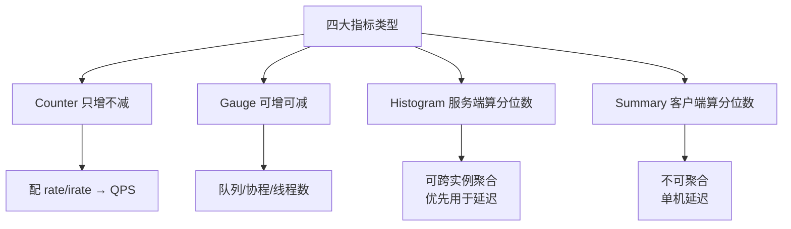

# 50. Go APM 监控系统实战: Prometheus 四大监控指标类型

## 纲要

- Counter（计数器）：只增不减，通常配合 `rate` / `irate` 计算单位时间内增量，用来反映 QPS
- Gauge（仪表盘）：可增可减，适合队列长度、协程数、线程数等随时变化的量
- Histogram（直方图）：把样本落入不同 bucket（桶）统计，自带 `_bucket{le=...}`、`_count`、`_sum`；用 `histogram_quantile` 算分位数
- Summary（摘要）：也在客户端算好分位数再上报，服务端**不能改分位数、不能跨实例聚合**，多主机场景不适合，接口延迟一般优先用 Histogram
- 关键细节：Histogram 的 `le` 表示「小于等于该边界」；`le="+Inf"` 的 bucket 计数等于总样本数（`_count`）

## 正文

### Counter：只增不减

Counter 是只会增加、不会减少的指标类型。在实际使用中，Counter 通常和 `rate` / `irate` 搭配，用来计算某段时间内的增量，从而反映应用的 QPS——请求每发生一次，Counter 加一即可。

`rate` 的计算逻辑是：取时间范围内**最后一个样本值**与**最早一个样本值**相减，再除以该时间范围对应的秒数，得到每秒增量。这也是 QPS 的定义。`rate` 还会对「进程重启后 Counter 归零」的样本做修正，避免归零造成错误的负速率。

```go
// 根据讲稿逻辑补充：用 Counter 记录请求总量，配合 rate 即为 QPS
var httpRequestsTotal = prometheus.NewCounterVec(
	prometheus.CounterOpts{
		Name: "http_request_total",
		Help: "HTTP 请求总量",
	},
	[]string{"method", "code"},
)

// 每次请求处理完调用
httpRequestsTotal.WithLabelValues("GET", "200").Inc()
```

### Gauge：可增可减

Gauge 的值可以增加也可以减少，适合描述那些「每时每刻都在变化」的量，例如队列长度、应用协程数（`goroutine`）、线程数。这些数值天生是波动的，用 Gauge 最自然。

```go
// 根据讲稿逻辑补充：用 Gauge 实时反映协程数
var goroutineNum = prometheus.NewGauge(
	prometheus.GaugeOpts{
		Name: "go_goroutines",
		Help: "当前 goroutine 数量",
	},
)

goroutineNum.Set(float64(runtime.NumGoroutine()))
```

### Histogram：直方图与分位数

Histogram 一般用于统计像「接口响应延迟」这类实验性数据。原理是：把样本采集到不同的 bucket 中，每个 bucket 统计「落入其中的样本个数」。

一个 Histogram 指标实际上由**多个指标**构成。客户端创建名为 `http_request_duration_seconds` 的 Histogram 时，Prometheus 客户端会同时生成三类指标：

- `<name>_bucket{le="..."}`：各桶的累计计数，`le` 是桶的上界
- `<name>_count`：样本总个数
- `<name>_sum`：样本总值

特别注意 `le` 的语义：`le` 表示 **less than or equal（小于等于该边界）**。例如 `le="0.01"` 的 bucket，统计的是「响应延迟 ≤ 0.01 秒」的样本个数。而 `le="+Inf"` 的 bucket 计数，等于全部样本数，和 `_count` 一致。

接口延迟通常存在**长尾效应**——大部分请求很快，但有一小部分会超时。我们关心的是「1% 的请求延迟大于多少」，这就需要分位数（quantile）。

分位数：把数据从小到大排序后，用「几分之几」表示某个数所处的位置。例如 100 个数里第 99 个位置的值是 80，则 99 分位数是 80，含义是「99% 的数都小于 80，仅 1% 大于 80」。

`histogram_quantile` 在**服务端**聚合计算分位数的逻辑是：

1. 取 `le="+Inf"` 的 bucket，得到样本总数 N
2. `N × 目标分位`（如 `0.99`）得到目标位置 rank
3. 拿 rank 与各 bucket 的累计计数比较，找到第一个「累计计数 ≥ rank」的桶，确定分位数落在哪个桶
4. 假设样本在该桶内**均匀分布**，用桶的边界做线性插值得出具体数值

```promql
# 计算接口响应延迟的 99 分位数
histogram_quantile(0.99, rate(http_request_duration_seconds_bucket[5m]))
```

### Summary：客户端算好的分位数

Summary 和 Histogram 一样用于统计分位数，但**计算发生在客户端**：客户端预先定义好分位数，算好后直接把结果随指标上报。服务端拉取时拿到的就是现成的分位数。

它的缺陷也正源于此：

- 服务端**不能改变**上报的分位数值（比如客户端上报了 0.99，服务端无法临时改成 0.95）
- 分位数聚合**没有意义**，因此 Summary 指标**不能跨实例聚合**
- 若应用部署在多台主机，想综合统计多机接口延迟，用 Summary 就不合适——此时只能用 Histogram（`_bucket` 可以聚合）

所以接口响应延迟通常优先用 Histogram。



## Demo 示例

下面给出可独立运行的示例：注册一个 Histogram 记录接口延迟，并演示 `le` 分桶与 `histogram_quantile` 的用法。

```go
package main

import (
	"fmt"
	"log"
	"net/http"
	"time"

	"github.com/prometheus/client_golang/prometheus"
	"github.com/prometheus/client_golang/prometheus/promhttp"
)

// ReqDuration 接口响应延迟直方图（根据讲稿逻辑补充）
var ReqDuration = prometheus.NewHistogramVec(
	prometheus.HistogramOpts{
		Name:    "http_request_duration_seconds",
		Help:    "接口响应延迟分布",
		Buckets: []float64{0.01, 0.05, 0.1, 0.5, 1, 5}, // le 边界
	},
	[]string{"method"},
)

func init() {
	prometheus.MustRegister(ReqDuration)
}

func main() {
	// 模拟一批延迟样本：多数很快，少量长尾
	samples := []float64{0.02, 0.03, 0.04, 0.08, 0.09, 0.6, 4.2}
	for _, s := range samples {
		ReqDuration.WithLabelValues("GET").Observe(s)
		time.Sleep(5 * time.Millisecond)
	}
	fmt.Println("已写入延迟样本，访问 http://localhost:8080/metrics 查看 _bucket/_count/_sum")
	log.Fatal(http.ListenAndServe(":8080", promhttp.Handler()))
}
```

### 运行说明

```bash
go mod init metric-types-demo
go get github.com/prometheus/client_golang/prometheus
go run main.go
# 另开终端
curl -s http://localhost:8080/metrics | grep http_request_duration_seconds
```

在 Grafana 中用 `histogram_quantile(0.99,rate(http_request_duration_seconds_bucket[5m]))` 即可得到 99 分位延迟。

### 代码说明

- Histogram 客户端会自动生成 `_bucket{le}`、`_count`、`_sum` 三个子类指标
- `le="+Inf"` 的 bucket 计数恒等于 `_count`（总样本数）
- 分位数计算依赖「桶内均匀分布」假设，因此桶边界设置越贴合真实延迟分布，估算越准

### 技术点总结

- Counter 配 `rate` 算 QPS；Gauge 记录波动量
- Histogram 用 bucket + `le`（≤ 语义）统计分布，`histogram_quantile` 在服务端算分位数且可聚合
- Summary 在客户端算分位数，不可聚合，多实例场景慎用
- 接口延迟优先选 Histogram

