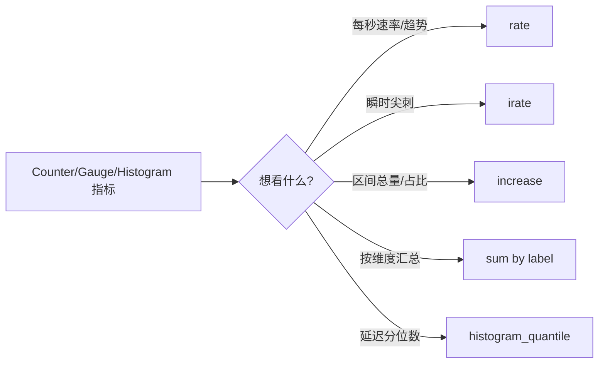

# 51. Go APM 监控系统实战: Prometheus 常用函数汇总（rate / irate / increase / sum / histogram_quantile）

## 纲要

- `rate`：入参范围向量，取区间内首尾样本算每秒平均增量，结果平稳，适合算 QPS
- `irate`：入参范围向量，只取区间内**最后两个样本**算差值，峰值变化比 `rate` 更剧烈
- `increase`：与 `rate` 类似但**不除以区间秒数**，返回区间内的绝对增量，适合做占比 / 总量统计
- `sum by (label)`：按指定标签聚合，聚合后结果只保留该标签维度
- `histogram_quantile`：基于 Histogram 的 `_bucket` 指标计算分位数（原理见前面）
- 应用服务的指标通过 `/metrics` 路由暴露，类型与标签由客户端定义

## 正文

### rate：平稳的每秒速率

`rate` 要求传入**范围向量**（用方括号指定区间，如 `[5m]`），返回瞬时向量。它取区间内第一个和最后一个样本，相减后除以区间秒数，得到平均每秒增量。对于 Counter 类指标，这个值就近似于 QPS。

```promql
# 过去 5 分钟每秒请求数（QPS）
rate(http_request_total[5m])
```

由于 `rate` 使用了区间内的首尾样本做整体平均，曲线相对平滑，适合观察长期趋势。

### irate：更敏感的瞬时速率

`irate` 同样入参范围向量，但取样逻辑不同：它只取区间内的**最后两个样本**算差值，再除以这两个样本的时间差。因此 `irate` 对短时波动更敏感，峰值变化比 `rate` 更剧烈；`rate` 则相对平稳。

```promql
# 瞬时速率，对尖刺更敏感
irate(http_request_total[5m])
```

> 选型建议：看整体趋势、画面板用 `rate`；排查瞬时尖刺、定位偶发抖动用 `irate`。

### increase：区间绝对增量

`increase` 和 `rate` 的区别只在一点：它**不除以区间的秒数**，只返回这段时间内的数据增量。正因为是「绝对增量」，它特别适合做占比和总量统计（例如饼图里看各维度的访问占比）。

```promql
# 过去 5 分钟内的请求总数（不是每秒）
increase(http_request_total[5m])
```

### sum by：按维度聚合

`sum` 能把一个指标按某个标签维度聚合。写法是「`sum by (维度)` + 括号内写具体指标」。聚合后返回的瞬时向量，其标签维度就只剩你指定的那一个。

```promql
# 按 server 维度聚合，结果只保留 server 一个标签
sum by (server) (server_handle_seconds_count)
```

例如 `server_handle_seconds_count` 原本带很多标签（每个标签值不同即不同 series），按 `server` 聚合后，每条 series 只由 `server` 决定，便于看「每台 server 各处理了多少请求」。

### histogram_quantile：分位数

用于基于 Histogram 的 `_bucket` 指标计算分位数，前面已详述原理。实际写法通常配合 `rate` 使用：

```promql
# 接口响应延迟的 99 分位数
histogram_quantile(0.99, rate(http_request_duration_seconds_bucket[5m]))
```



## Demo 示例

下面给出可独立运行的示例：暴露一个 Counter（请求数）和 Histogram（延迟），并在注释里给出各函数的 PromQL 用法。

```go
package main

import (
	"fmt"
	"log"
	"net/http"
	"time"

	"github.com/prometheus/client_golang/prometheus"
	"github.com/prometheus/client_golang/prometheus/promhttp"
)

// 根据讲稿逻辑补充：同时暴露 Counter 与 Histogram，覆盖常用函数场景
var (
	httpRequestsTotal = prometheus.NewCounterVec(
		prometheus.CounterOpts{
			Name: "http_request_total",
			Help: "HTTP 请求总量",
		},
		[]string{"method", "code"},
	)
	reqDuration = prometheus.NewHistogramVec(
		prometheus.HistogramOpts{
			Name:    "http_request_duration_seconds",
			Help:    "接口响应延迟",
			Buckets: []float64{0.01, 0.05, 0.1, 0.5, 1, 5},
		},
		[]string{"method"},
	)
)

func init() {
	prometheus.MustRegister(httpRequestsTotal, reqDuration)
}

func main() {
	// 模拟请求：记录计数与延迟
	for i := 0; i < 20; i++ {
		httpRequestsTotal.WithLabelValues("GET", "200").Inc()
		reqDuration.WithLabelValues("GET").Observe(time.Duration(i%10) * 10 * time.Millisecond.Seconds())
	}

	fmt.Println("已暴露指标，访问 http://localhost:8080/metrics")
	fmt.Println("可用 PromQL:")
	fmt.Println("  rate(http_request_total[5m])")
	fmt.Println("  irate(http_request_total[5m])")
	fmt.Println("  increase(http_request_total[5m])")
	fmt.Println("  sum by (method) (http_request_total)")
	fmt.Println("  histogram_quantile(0.99, rate(http_request_duration_seconds_bucket[5m]))")

	log.Fatal(http.ListenAndServe(":8080", promhttp.Handler()))
}
```

### 运行说明

```bash
go mod init prom-func-demo
go get github.com/prometheus/client_golang/prometheus
go run main.go
# 另开终端
curl -s http://localhost:8080/metrics | grep -E 'http_request_total|http_request_duration_seconds'
```

将示例中打印的 PromQL 逐条粘贴到 Grafana / Prometheus 的 Graph 界面即可验证各函数效果。

### 代码说明

- `rate` / `irate` / `increase` 的入参都必须是范围向量（带 `[窗口]`）；它们都返回瞬时向量，因此都能直接绘图
- `sum by (label)` 用于降维，`by` 后只写你想保留的标签
- `histogram_quantile` 必须作用于带 `le` 标签的 `_bucket` 指标

### 技术点总结

- `rate` 平稳、`irate` 灵敏、`increase` 看总量，三者都作用于范围向量
- `sum by (label)` 按维度聚合降维
- `histogram_quantile` 配合 `rate(..._bucket[...])` 算延迟分位数
- 这些函数覆盖了后续建设应用服务指标监控时绝大部分面板绘制需求

