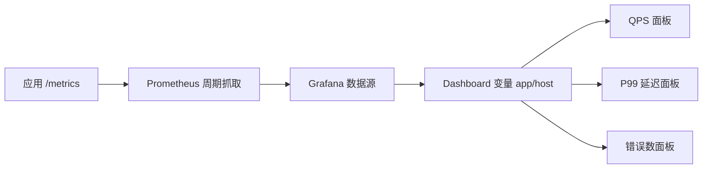

# 54. Go APM 监控系统实战: 用 Grafana 绘制监控面板（一）

## 纲要

- 在 docker-compose 中增加 **Grafana** 与 **Prometheus** 两个组件
- Prometheus 抓取配置：`global.scrape_interval`（默认 15s）、针对 `orderservice` 覆盖为 5s、抓取对象为 `IP:端口/metrics`
- Grafana 配置 Prometheus 数据源（同 compose 网络内用服务名代替 IP）
- 新建 Dashboard 与分类，依次绘制 **QPS**、**响应延迟 P99**、**错误数** 三类黄金指标面板
- 用 **模板变量** `$app` / `$host` 实现按应用名、主机名筛选，支持多选 / 全选

## 正文

### 组件与抓取配置

在 docker-compose 中补充 Grafana 与 Prometheus。Prometheus 通过挂载本地的 `prometheus.yml` 工作，核心是一个抓取配置数组：

```yaml
global:
  scrape_interval: 15s        # 全局默认抓取周期
scrape_configs:
  - job_name: orderservice
    scrape_interval: 5s       # 覆盖全局，对该 job 每 5s 抓一次
    metrics_path: /metrics    # 与前述暴露的路由一致
    static_configs:
      - targets:
          - "192.168.1.10:8080"  # 宿主机的 IP + 服务端口
```

由于 Prometheus 以容器方式启动，配置里的 target 必须是**宿主机真实 IP**（例如 `en0` 网卡地址），不能写 `localhost`。抓取格式即 `IP + 端口 + /metrics` 路由。

### 配置 Grafana 数据源

Grafana 默认账号密码是 `admin/admin`。登录后进入 `Connections → Data sources`，新增一个 Prometheus 类型的数据源，填写 Prometheus 的访问地址。因为 Grafana 与 Prometheus 在同一个 docker-compose 网络中，可以直接用服务名（如 `http://prometheus:9090`）代替 IP。点 `Save & test` 验证连通性。

### 绘制 QPS 面板

新建 Dashboard 并在其下建立面板。QPS 来自前述定义的 `server_handle_total`（Counter 类型）。Grafana 发现它是 Counter 后会提示用 `rate` 计算每秒增量——这正是 QPS：

```promql
sum by (method) (rate(server_handle_total{app="$app", host=~"$host", type="http"}[5m]))
```

要点：

- `rate(...[5m])` 把 Counter 转成「每秒平均增量」即 QPS；
- `sum by (method)` 把多台主机的结果按 `method` 聚合，避免每台主机各自一条线；
- 指标名相同但标签不同即不同时间序列，所以必须 `sum` 才能看整体。

### 用模板变量让面板可筛选

上面写死了聚合维度，但有时只想看某一台 / 某几台主机，硬编码不灵活。Grafana 的 **Dashboard 变量** 可以解决：在面板设置里加两个变量，值从 Prometheus 标签中查询得到。

| 变量名 | 取值来源 | 查询表达式 |
| --- | --- | --- |
| `$app` | 标签 `app` 的值 | `label_values(server_handle_total,app)` |
| `$host` | 标签 `host` 的值 | `label_values(server_handle_total,host)` |

引用时用 `$` 前缀；因为变量可能是数组（多选），标签匹配要写成正则形式 `=~"$host"` 而非 `="..."`。在变量设置里勾选 `Multi-value` 和 `Include All option`，即可支持多选与「全部」。

### 绘制响应延迟 P99 与错误数

**响应延迟（P99）**：复制 QPS 面板改名，表达式讲过的 `histogram_quantile`，并按 `method` 区分；单位设为 `s`（秒）。

```promql
histogram_quantile(0.99, sum by (method, le) (rate(server_handle_seconds_bucket{app="$app", host=~"$host", type="http"}[5m])))
```

**错误数**：错误数要统计「状态码不等于 200」的请求。利用 5-8 直方图自带的 `_count` 系列，过滤 `status` 标签：

```promql
sum by (method) (rate(server_handle_seconds_count{app="$app", host=~"$host", type="http", status!="200"}[5m]))
```

单位设为 `ops`（每秒错误数）。QPS、错误数、响应延迟三者正好对应 RED 方法里的三个核心指标，统一归入「黄金指标」分类。



## Demo 示例

下面给出可独立运行的程序，暴露与前述一致的两个指标，并附带本节用到的 PromQL 注释，方便把面板表达式逐条粘贴到 Grafana 验证。

```go
package main

import (
	"log"
	"net/http"
	"time"

	"github.com/prometheus/client_golang/prometheus"
	"github.com/prometheus/client_golang/prometheus/promhttp"
)

// 根据讲稿逻辑补充：沿用前述的指标定义，供 Prometheus 抓取后在 Grafana 绘图
var (
	base = prometheus.NewRegistry()
	reg  = prometheus.WrapRegistererWith(prometheus.Labels{"app": "orderservice", "host": "localhost"}, base)
	total = prometheus.NewCounterVec(prometheus.CounterOpts{Name: "server_handle_total"}, []string{"type", "method"})
	seconds = prometheus.NewHistogramVec(prometheus.HistogramOpts{
		Name: "server_handle_seconds", Buckets: []float64{0.01, 0.05, 0.1, 0.5, 1, 5},
	}, []string{"type", "method", "status"})
)

func init() {
	_ = reg.Register(total)
	_ = reg.Register(seconds)
}

func main() {
	for i := 0; i < 50; i++ {
		total.WithLabelValues("http", "GET /order").Inc()
		seconds.WithLabelValues("http", "GET /order", "200").Observe(time.Duration(i%20) * 5 * time.Millisecond.Seconds())
	}
	log.Println("已暴露指标，PromQL 示例：")
	log.Println(`  sum by (method) (rate(server_handle_total{type="http"}[5m]))`)
	log.Println(`  histogram_quantile(0.99, sum by (method,le) (rate(server_handle_seconds_bucket{type="http"}[5m])))`)
	log.Println(`  sum by (method) (rate(server_handle_seconds_count{type="http",status!="200"}[5m]))`)
	log.Fatal(http.ListenAndServe(":8080", promhttp.HandlerFor(base, promhttp.HandlerOpts{})))
}
```

### 运行说明

```bash
go mod init grafana-panel-demo
go get github.com/prometheus/client_golang/prometheus
go run main.go
# 浏览器打开 Grafana，配好 Prometheus 数据源后新建面板，粘贴上面的 PromQL
```

### 代码说明

- 指标暴露与 5-8 完全一致；本节的增量是**抓取配置 + Grafana 面板表达式**，属于配置层而非代码层
- `rate` 作用于范围向量，`histogram_quantile` 必须作用于带 `le` 标签的 `_bucket`

### 技术点总结

- Prometheus 抓取靠 `prometheus.yml`：全局 15s、可按 job 覆盖、`metrics_path` 对应 `/metrics`
- Grafana 数据源指向 Prometheus 服务名即可（同 compose 网络）
- QPS 用 `rate(total)`、延迟用 `histogram_quantile`、错误数用 `rate(..._count{status!="200"})`
- 模板变量 `$app` / `$host` 用 `label_values` 取标签值，引用时配 `=~"$host"` 支持多选

