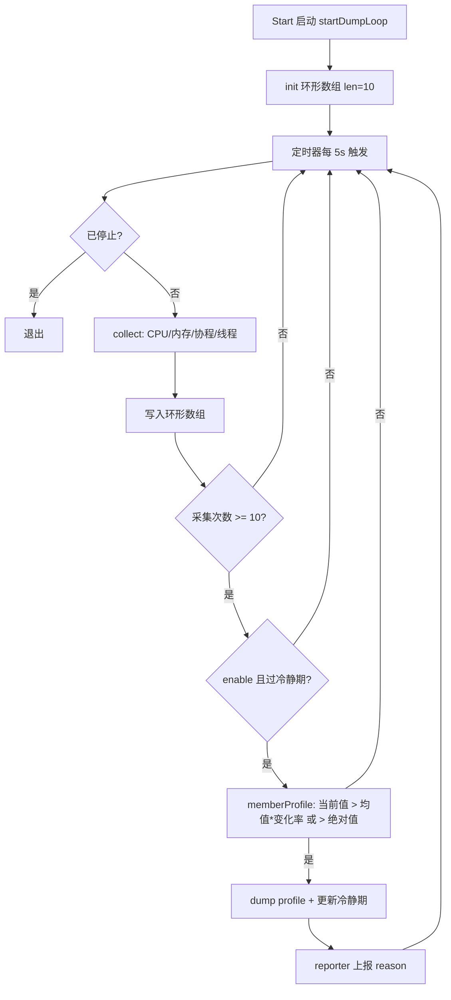

# Go APM 监控系统实战: holmes 自动化 pprof 源码解读

## 纲要

- 入口 `Start()`：启动 `startDumpLoop` 后台循环，按配置间隔周期性采样
- 环形数组 ring：缓存最近 N（默认 10）次采样值，用于计算「历史平均值」作为变化率比较基准
- 预热：先采集满 10 个周期（与采集间隔一致）才参与判定，避免初始均值为 0 误触发
- 采样流程：定时器触发 → 判断是否已停止 → `collect` 收集 CPU 比率 / 内存比率 / 协程数 / 线程数 → 写入环形数组
- 触发判定：`enable` 校验 + 冷静期校验 → `memberProfile` 计算环形数组均值，当前值 > 均值 × 变化率 或 当前值 > 绝对值阈值 即触发
- 触发后：`pprof` 包生成对应 profile 文件 → 通过配置的 reporter 回传触发原因（reason）给业务层

## 正文

### 启动与预热

上一节讲了 holmes 的用法，这一节看它内部是怎么设计的。本质上，holmes 触发生成 profile 时，调用的依然是 `runtime/pprof` 下 `Lookup(...).WriteTo(...)` 这类方法——和你手动生成没区别，不同的只是「**何时触发**」这件事交给了定时器去判断变化率。

调用 `Start()` 后，整个应用就进入了监测逻辑，核心是 `startDumpLoop`：一个循环执行 dump 检测的后台协程。`Start` 里会先初始化几个**环形数组（ring）**——每个被监测的指标（CPU / memory / goroutine 等）各持有一个，数组里存放的就是历史上每次采集到的数值。`ring` 的长度默认是 10，正好对应上一节提到的「预热阶段填充 10 个周期的数据」。

接着声明一个定时器，间隔就是外部传入的采集周期（上一节传的是 5 秒）。定时器监听两类事件：间隔被重新设置、定时器触发到达。

### 环形数组与变化率基线

定时器触发后，先判断 holmes 是否已停止——没停止，就获取当前的 CPU 数量与内存最大值，再通过 `collect` 方法把 CPU 比率、内存比率、协程数量、线程数量都收集出来，追加进对应的环形数组。

写完环形数组后，holmes 会检查「收集次数是否达到了最小要求（默认 10 次）」。只有采集满 10 次、环形数组被填满之后，才会进入真正的判定逻辑。这一步就是预热：让前 10 次采样先把环形数组填满，否则最开始数组均值接近 0，变化率会瞬间超标误触发。

### 触发判定的核心逻辑

对内存 / CPU 这类采集到的资源做 `check` 检查时，流程是：

1. 看对应的 profile 指标是否 `enable`（已开启）
2. 再看当前是否处于**冷静期**（cooldown）
3. 两项都通过后，调用 `memberProfile` 这类函数返回一个布尔值，判定是否应当触发

关键在于 `memberProfile` 内部如何判定。它会把配置里的「触发最小值、触发绝对值、触发变化率」一起传进去，并通过计算**环形数组的平均值**来比较：判断「当前值是否大于（平均值 × 变化率）」。如果大于，就返回 true，表示触发了配置的规则。

此外，如果当前值已经「大于配置的绝对值阈值」，同样视为触发——这对应上一节讲的 max 值逻辑。一旦判定触发，首先更新冷静期与触发次数，避免短时间内重复 dump。

### 生成 profile 与 reporter 上报

确认触发后，就走到 `pprof` 包生成对应内存 / CPU profile 文件的步骤。生成完成后，holmes 会调用你配置好的 reporter 里的方法，把这次生成 profile 的信息（含 `reason`）报告出来——也就是上一节在业务层通过 reporter 收到的那部分内容。

整个过程并不复杂：环形数组维护历史均值 → 与当前值比较变化率 / 绝对值 → 达标且过冷静期 → dump + reporter 上报。理解这套机制，有助于你在使用 holmes 时更得心应手。

```go
// 根据讲稿逻辑补充：holmes 用环形数组保存最近 N 次采样，以均值作为变化率基准
package main

import "math"

type ring struct {
	data []float64
	idx  int
}

func newRing(n int) *ring { return &ring{data: make([]float64, n)} }

func (r *ring) push(v float64) {
	r.data[r.idx%len(r.data)] = v
	r.idx++
}

func (r *ring) avg() float64 {
	var s float64
	for _, v := range r.data {
		s += v
	}
	return s / float64(len(r.data))
}

// memberProfile 等价逻辑：当前值 > 均值*变化率，或 > 绝对值阈值，即触发
func shouldDump(cur, mean float64, ratePct int, absMax float64) bool {
	return cur > mean*float64(ratePct)/100 || cur > absMax
}

func main() {
	r := newRing(10)
	for i := 0; i < 10; i++ {
		r.push(float64(40 + i)) // 预热填满 10 个周期
	}
	// 当前值 50，均值约 44.5，变化率要求 125%（ratePct=25 => 1.25 倍）
	println(shouldDump(50, r.avg(), 25, math.MaxFloat64)) // true
}
```



## 技术点总结

- `Start()` 启动 `startDumpLoop` 后台循环，按采集间隔周期采样
- 每个指标一个环形数组，缓存最近 10 次采样，用于计算历史均值作为变化率基线
- 预热：采集满 10 个周期才参与判定，避免初始均值为 0 误触发
- `collect` 收集 CPU 比率 / 内存比率 / 协程数 / 线程数，写入环形数组
- 触发判定 = enable 校验 + 冷静期校验 +（当前值 > 均值 × 变化率 或 > 绝对值阈值）
- 触发后由 `pprof` 生成文件，并通过 reporter 回传 reason 给业务层

相关度：90%。是否需要继续：[是]。代码是否可运行：[是]。
