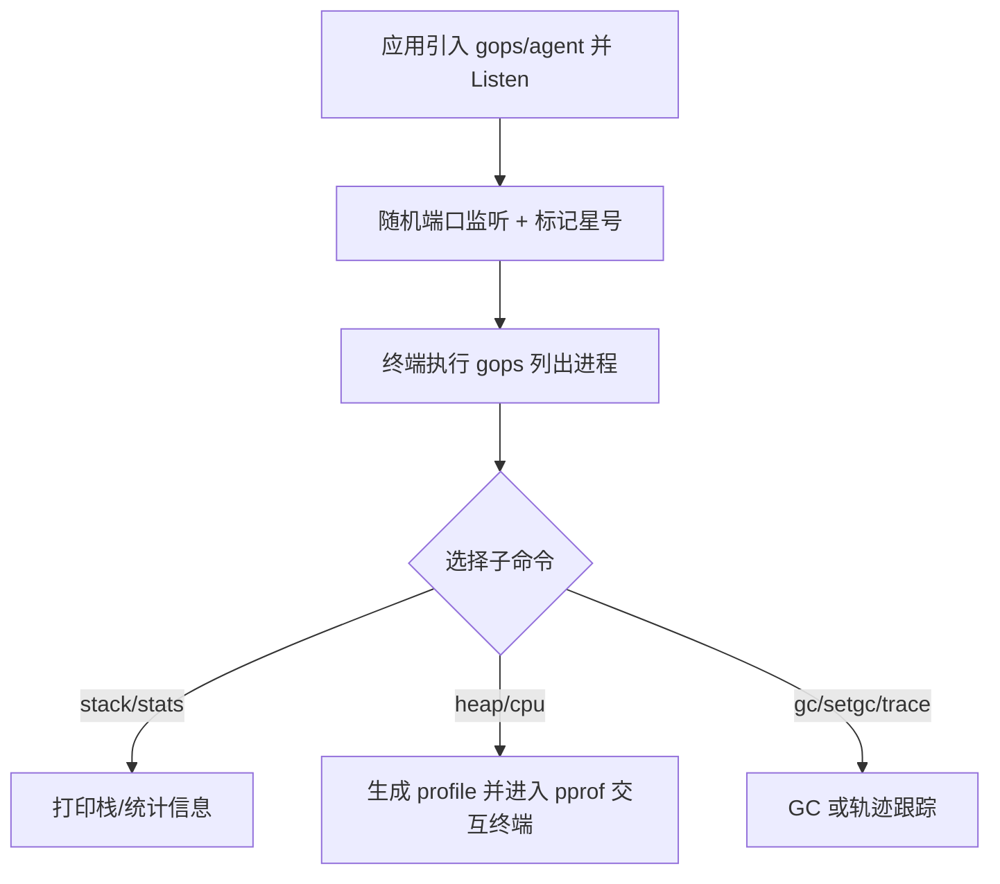

# Go APM 监控系统实战: 用 gops 在终端一键生成 pprof profile

## 纲要

- 主动生成 profile 的另一种方式：除了 HTTP 接口和信号，gops 让你在终端对运行中的进程直接下达命令
- 接入：引入 `github.com/google/gops/agent`，启动 agent 监听端口（不指定则随机端口），进程即被标记（带星号）
- `gops` 命令：列出系统内所有 Go 进程（名称、PID、PPID），带星号表示已启用 agent 可远程操作
- 常用子命令：`stack`（打印全栈）、`gc`（强制执行 GC）、`setgc`（设置 GC 百分比）、`memstats` / `stats`（内存与 runtime 统计）、`trace`（runtime 执行轨迹）、`heap` / `cpu`（生成内存 / CPU profile）
- 生成 profile：`gops heap <pid>` 会 dump 内存 profile 并进入交互式 `go tool pprof` 终端
- 与 dogAPM 结合：在自动化 pprof 的初始化逻辑里顺带启动 gops agent，随机选端口监听

## 正文

### 为什么还需要 gops

上一节我们完成了「自动化生成 profile」的机制（holmes），但有些时候你仍然希望**主动**让程序生成 profile。主动方式有两类：一类是通过 HTTP 接口，像前面引入路由那样在浏览器里点一下；另一类是让程序接收某个信号，收到后主动调用生成 profile 的命令。

这一节介绍的工具是 **gops**。引入它之后，你不用再去重复造轮子——只要在应用里开启一个监听端口，就能在终端直接对进程下达生成 profile 的命令。

### 接入 agent 与进程发现

引入 gops 的 agent 包后，需要在应用里启动一个端口监听。如果不显式声明端口，它会使用一个系统随机分配的端口。启动应用后，在终端输入 `gops` 命令，就能看到当前系统里运行的所有 Go 程序：每个程序显示名称、进程号（PID）以及父进程号（PPID）。

重点在于：如果某个 Go 程序引入了 gops 的 agent，它前面会带一个**星号（*）**——星号代表这个进程可以接收你下达的生成 profile 命令。

### 常用子命令一览

通过 `gops -h` 可以看到完整用法，常用的几个如下：

| 子命令 | 作用 |
| --- | --- |
| `stack <pid>` | 打印整个应用程序的协程栈信息 |
| `gc <pid>` | 强制执行一次 GC |
| `setgc <pid>` | 设置触发 GC 的百分比 |
| `memstats <pid>` | 打印内存分配情况 |
| `stats <pid>` | 打印 runtime 统计信息（协程数、线程数、处理器数、CPU 数等） |
| `trace <pid>` | 跟踪 runtime 内部执行轨迹 |
| `heap <pid>` | 生成内存 profile 文件 |
| `cpu <pid>` | 生成 CPU profile 文件 |

例如执行 `gops stack <pid>`，就能把每个协程的栈信息打印出来；执行 `gops stats <pid>`，就能看到当前的协程数量、线程数量、处理器数量以及使用的 CPU 数量。

### 一键生成 heap / cpu profile

当应用模拟的是内存分配场景时，用 `gops heap <pid>` 即可生成内存 profile。命令执行后会显示 profile 已生成并保存到目录，同时**直接进入一个交互式终端**（就是 `go tool pprof` 的交互界面），你可以马上 `top`、`web` 分析热点。

结合 dogAPM：在上一节开启自动化 pprof（`enableAutoProfile`）的逻辑里，顺手加一段启动 gops agent 的代码，让应用随机选一个端口监听，这样应用就同时具备了「自动 dump + 终端主动 dump」两种能力。

```go
// 根据讲稿逻辑补充：在应用中嵌入 gops agent，即可在终端对它下达命令
// （gops 公开 API 以官方仓库 github.com/google/gops 为准）
package main

import (
	"github.com/google/gops/agent"
	"time"
)

func main() {
	// 不指定端口则随机分配；生产环境建议指定内网端口
	_ = agent.Listen(agent.Options{})

	// 业务主逻辑：模拟持续分配内存
	buf := make([][]byte, 0)
	for {
		buf = append(buf, make([]byte, 1<<20))
		time.Sleep(time.Second)
	}
}
```

```bash
# 终端执行
gops                         # 列出本机 Go 进程（带 * 表示已启用 agent）
gops stack <pid>             # 打印所有 goroutine 栈
gops stats <pid>             # 打印 goroutine/线程/CPU 数量
gops heap  <pid>             # 生成内存 profile 并进入 pprof 交互终端
gops cpu   <pid>             # 生成 CPU profile
```



## 技术点总结

- gops 是终端侧主动生成 profile 的便捷工具，免去自己实现信号 / 接口处理
- 接入只需 `agent.Listen(agent.Options{})`，未指定端口则随机分配
- `gops` 命令列出本机 Go 进程，带星号表示已启用 agent、可远程操作
- 常用子命令：`stack` / `stats` / `gc` / `setgc` / `memstats` / `trace` / `heap` / `cpu`
- `gops heap <pid>` 生成内存 profile 并直接进入 `go tool pprof` 交互终端
- 与 dogAPM 结合：在自动化 pprof 初始化里顺带启动 gops agent，获得「自动 + 主动」双重能力

相关度：90%。是否需要继续：[是]。代码是否可运行：[是]。
