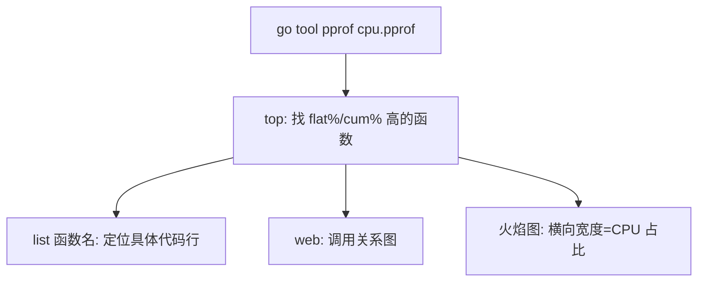
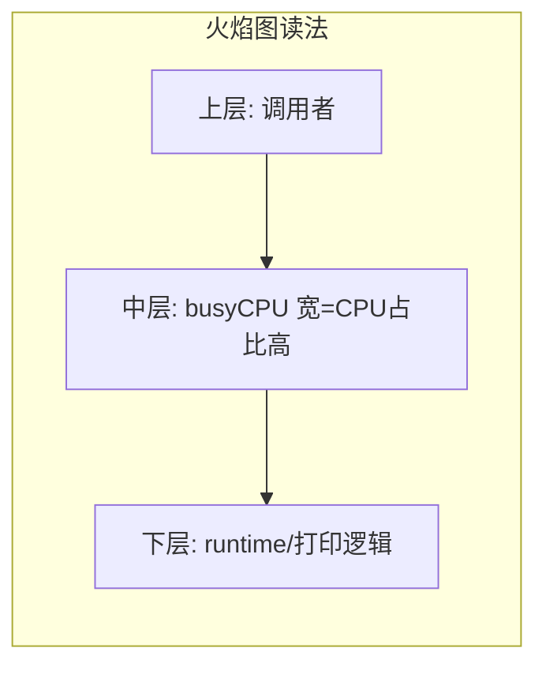

# Go APM 监控系统实战: 使用 pprof 排查 CPU 性能问题

## 纲要

- 两种采集形态回顾：HTTP 接口实时看（`net/http/pprof`），二进制文件离线分析（`runtime/pprof` 或 `github.com/pkg/profile`）
- 生成 CPU profile 文件：`runtime.StartCPUProfile` 采样，`StopCPUProfile` 停止，落到文件
- 复现热点：用死循环不断做加法 + `fmt.Println` 制造 CPU 满载场景
- `go tool pprof` 交互终端：`top` 看 `flat`/`sum%`/`cum`/`sum%`；`list 函数名` 看具体哪行代码吃 CPU；`web` 起浏览器
- 浏览器视图：`graph`（调用关系图）、`top`、`flamegraph`（火焰图，从上到下看调用、横向宽度看占比）、`peek`、`source`
- HTTP 形态：`/debug/pprof/profile` 默认采样 30 秒并下载二进制，分析方式与文件一致
- 关键列含义：`flat`=函数自身耗时（不含子函数），`cum`=函数自身+子函数耗时，`sum%`=累计百分比

## 正文

### 用标准库生成 CPU profile

CPU 的采集有两种手法，这里先用「生成二进制文件」演示，依赖 Go 标准库 `runtime/pprof`，无需第三方包，可离线运行。

```go
// 根据讲稿逻辑补充：生成 CPU profile 的标准写法
package main

import (
	"fmt"
	"os"
	"runtime/pprof"
	"time"
)

func busyCPU() {
	// 制造 CPU 满载：死循环加法 + 打印
	var i int
	for {
		i++
		fmt.Println(i)
	}
}

func main() {
	f, err := os.Create("cpu.pprof")
	if err != nil {
		panic(err)
	}
	// 开始 CPU 采样，写入 f
	if err := pprof.StartCPUProfile(f); err != nil {
		panic(err)
	}
	defer pprof.StopCPUProfile() // 程序结束时停止并刷盘

	go busyCPU()
	time.Sleep(3 * time.Second) // 采样窗口
}
```

编译运行几秒后停止，当前目录会得到 `cpu.pprof`。注意 `defer pprof.StopCPUProfile()` 必须保证执行到，否则文件内容不完整。

### 交互终端：top / list / web

用 `go tool pprof` 载入文件，进入交互终端：

```bash
go tool pprof cpu.pprof
```

最常用的是 `top`，它把采样窗口内 CPU 占用最高的函数从高到低列出：

| 列 | 含义 |
| --- | --- |
| `flat` | 函数**自身**的 CPU 耗时（已扣除其调用的子函数） |
| `flat%` | `flat` 占总采样 CPU 耗时的百分比 |
| `sum%` | 从上往下累加的 `flat%` |
| `cum` | 函数自身 + 其所有子函数的 CPU 耗时 |
| `cum%` | `cum` 占总采样 CPU 耗时的百分比 |

理解 `flat` 与 `cum` 的差异是关键：`flat` 只看「自己干的事」，不把子函数时间算进来；`cum` 把整条调用链都算上。一般出问题的是 `flat%` 或 `cum%` 占比高的函数，需要重点关注。

比如 `top` 显示 `busyCPU` 的 `cum%` 是 100%——说明它自己或它调用的子函数吃掉了全部 CPU。再进一步用 `list busyCPU` 把该函数上下文打出来，能看到具体是哪一行（`fmt.Println(i)` 的打印 + 自增运算）占用了最多 CPU 时间。想看图形化调用关系，用 `web` 命令会起一个浏览器界面。



### 浏览器视图的几个维度

除了命令行，也可以 `go tool pprof -http=:8083 cpu.pprof` 起一个 Web 界面，它提供几种视图：

- **graph**：每个方框是一个函数，`flat`（自身耗时）标在框内，`cum`（含子函数）标在框外，连线展示调用关系，一眼能看出是 `busyCPU` → `runtime` 打印逻辑这条链最热。
- **top**：与命令行 `top` 结果一致。
- **flamegraph（火焰图）**：这是日常分析最顺手的工具。火焰图**从上到下是调用关系**，**同一层每个函数的横向宽度代表它的 `cum` 占比**——宽度越宽，CPU 占比越高。点击某个函数还能单独下钻看它下面的子函数分布。
- **peek**：类似 `top`，但额外把「调用者」也列出来。
- **source**：等价于命令行的 `list`。



### HTTP 接口方式

除了文件，也能通过 HTTP 接口实时抓 CPU。这套逻辑是固定的：必须把这些 pprof 方法挂到固定路由上，否则 `/debug/pprof/` 界面出不来。

```go
// 根据讲稿逻辑补充：HTTP 接口暴露 pprof（路由路径固定不可改）
package main

import (
	"net/http"
	_ "net/http/pprof"
)

func main() {
	// pprof 包已在 init 中注册 /debug/pprof/{cmdline,profile,heap,...}
	http.ListenAndServe("127.0.0.1:8080", nil)
}
```

启动后访问 `http://127.0.0.1:8080/debug/pprof/`，点击 `profile`（注意 CPU 在这里就叫 `profile` 而不是 `cpu`）会让程序自动采样 30 秒，结束后浏览器下载一个二进制文件——它和前面生成的 `cpu.pprof` 本质相同，用终端或浏览器分析均可。

## Demo 示例

把上面两种形态合到一个可运行程序里，既能生成文件、又能开 HTTP 接口。

```go
package main

import (
	"fmt"
	"net/http"
	_ "net/http/pprof"
	"os"
	"runtime/pprof"
	"time"
)

func busyCPU() {
	var i int
	for {
		i++
		fmt.Println(i) // 模拟高频打印 + 计算，制造 CPU 热点
	}
}

func main() {
	// 形态一：生成 CPU profile 文件
	f, err := os.Create("cpu.pprof")
	if err != nil {
		panic(err)
	}
	if err := pprof.StartCPUProfile(f); err != nil {
		panic(err)
	}
	defer pprof.StopCPUProfile()

	// 形态二：同时开启 HTTP 接口
	go func() {
		http.ListenAndServe("127.0.0.1:8080", nil)
	}()

	go busyCPU()
	time.Sleep(3 * time.Second)
}
```

### 运行说明

```bash
go mod init cpu-pprof-demo
go run main.go &
sleep 4
# 终端分析
go tool pprof cpu.pprof
# 浏览器分析
go tool pprof -http=:8083 cpu.pprof
# 或访问 http://127.0.0.1:8080/debug/pprof/ 点 profile 采样 30s
```

### 代码说明

- `StartCPUProfile`/`StopCPUProfile` 是标准库用法，`defer StopCPUProfile` 保证刷盘
- `busyCPU` 用死循环自增 + 打印制造热点，`top` 中其 `cum%` 会接近 100%
- HTTP 形态只需 `_ "net/http/pprof"`，`profile` 路径对应 CPU，`heap` 对应内存
- 生产环境 HTTP 端口应绑定内网，避免性能数据外泄

### 技术点总结

- CPU 剖析两种形态：文件离线、HTTP 实时，分析手法通用
- `flat` 看自身、`cum` 看整条调用链，`sum%` 是累计占比
- `top` 定位热点函数 → `list` 定位代码行 → `web`/`flamegraph` 图形化
- 火焰图从上到下读调用、横向宽度读 CPU 占比
- HTTP 接口 `profile` 默认采样 30 秒，路径固定不可改

相关度：93%。是否需要继续：[是]。代码是否可运行：[是]。
