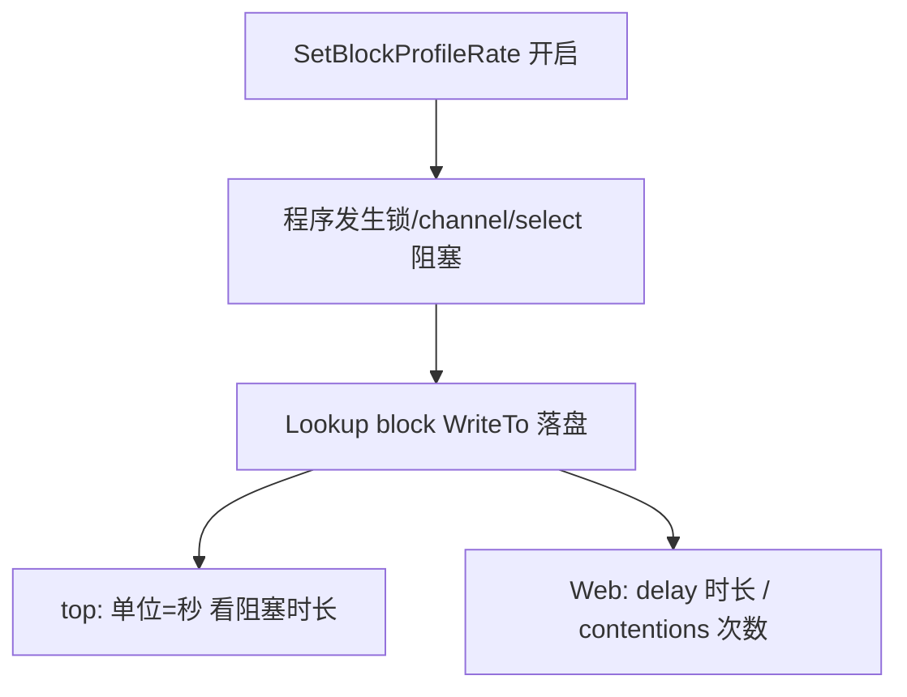

# Go APM 监控系统实战: 使用 pprof 排查 block 阻塞问题

## 纲要

- 可观测的阻塞来源：显式锁（`sync.Mutex`/`sync.RWMutex`）竞争、channel 阻塞、select 阻塞、`sync.WaitGroup` 等待——这些都能被 pprof 记录
- 阻塞采样默认关闭：与内存不同，block 事件**不会自动采样**，必须显式 `runtime.SetBlockProfileRate` 开启
- 采样频率语义：`1`=全量采样；`<=0`=关闭；`>1`=纳秒阈值，阻塞时长超过该值才采样，未超过则按 `rate` 分之一的概率被采到
- 生成 block profile：标准库 `pprof.Lookup("block").WriteTo` 输出
- 复现场景：主协程持锁 2 秒，两个子协程 `Lock` 被阻塞 2 秒
- 交互终端 `top`：单位变为「秒」（阻塞时长），`flat`/`cum` 语义同前
- 浏览器两维度：`delay`（阻塞时长）与 `contentions`（阻塞次数）；次数在同一函数上会累加
- HTTP 接口输出：含 `cycles/second`（每秒 CPU 周期数）、每栈阻塞周期数、阻塞次数与函数栈

## 正文

### 哪些阻塞能被记录

Go 里「程序阻塞」不止一种形态，pprof 都能观测到：

- 显式锁阻塞：多个协程对 `sync.Mutex` 争抢 `Lock`/`RLock`
- channel 阻塞：向满 channel 写、从空 channel 读
- `select` 阻塞：所有 case 都未就绪时的等待
- `sync.WaitGroup`：主协程 `Wait` 等待子协程 `Done`

### 必须先开启采样

这一点和内存、CPU 都不同——**阻塞事件的采样默认是关闭的**。不显式开启，生成的 `block` profile 会是空的。开启靠 `runtime.SetBlockProfileRate`：

```go
runtime.SetBlockProfileRate(1)        // 1 = 对所有阻塞事件采样
runtime.SetBlockProfileRate(0)        // <=0 = 关闭
runtime.SetBlockProfileRate(100)      // >1 = 纳秒阈值：阻塞 >100ns 必采；<=100ns 按 1/100 概率采
```

传 `>1` 的值时，Go 把它当成纳秒阈值：阻塞时长超过该值一定被采；没超过则内部算法保证约 `1/rate` 的概率被采到（例如阻塞 3 纳秒、阈值 100 纳秒，约 3% 概率被采）。

### 复现并生成 block profile

标准库写法：先 `SetBlockProfileRate` 开启，跑出阻塞，再 `Lookup("block").WriteTo` 落盘。

```go
// 根据讲稿逻辑补充：复现锁阻塞并生成 block profile
package main

import (
	"os"
	"runtime"
	"runtime/pprof"
	"sync"
	"time"
)

func mockBlock(mu *sync.Mutex) {
	mu.Lock() // 主协程已持锁，此处阻塞
	mu.Unlock()
}

func mockBlockTwo(mu *sync.Mutex) {
	mu.Lock()
	mu.Unlock()
}

func main() {
	runtime.SetBlockProfileRate(1) // 全量采样阻塞
	var mu sync.Mutex
	mu.Lock() // 主协程持锁 2 秒

	var wg sync.WaitGroup
	for _, fn := range []func(*sync.Mutex){mockBlock, mockBlockTwo} {
		wg.Add(1)
		go func(f func(*sync.Mutex)) {
			defer wg.Done()
			f(&mu)
		}(fn)
	}
	time.Sleep(2 * time.Second)
	mu.Unlock() // 解锁后两个子协程才拿到锁
	wg.Wait()

	f, _ := os.Create("block.pprof")
	pprof.Lookup("block").WriteTo(f, 0)
	f.Close()
}
```

主协程持锁 2 秒，期间 `mockBlock`、`mockBlockTwo` 各阻塞 2 秒，释放后它们才拿到锁。这个时序与 profile 数据完全吻合。

### 交互终端：单位是秒

`go tool pprof block.pprof` 进入终端，`top` 的列单位和 CPU/内存不同——这里显示的是**阻塞时长（秒）**：

```bash
(pprof) top
```

`mockBlock` 与 `mockBlockTwo` 的 `cum` 都是 2 秒（自身 + 子函数阻塞），总采样阻塞时长 4 秒，所以各占 50%。`list mockBlock` 能看到具体是 `mu.Lock()` 这一行发生了阻塞。

### 浏览器视图的两个维度

HTTP/Web 界面比交互终端多一个维度：

| 维度 | 含义 |
| --- | --- |
| `delay` | 阻塞时长（按时间分析） |
| `contentions` | 阻塞次数 |

比如 `mockBlock`、`mockBlockTwo` 各阻塞 1 次，`contentions` 各为 1；底层的 `sync.Mutex.Lock` 被两个函数调，次数累加为 2。火焰图看法与 CPU/内存一致：从上到下看调用层次，同一层各函数横向宽度代表对应资源占比（此处为阻塞时长或次数）。



### HTTP 接口输出细节

通过 `/debug/pprof/block` 拿到的文本里，关键字段：

- `cycles/second`：每秒 CPU 周期数。Go 记录阻塞时用「周期数」而非直接记秒，用「本栈阻塞周期数 / 每秒周期数」换算出以秒为单位的阻塞时长
- 各函数栈的阻塞周期数（同一栈上可累加）
- 阻塞次数（同栈累加）

## Demo 示例

可独立运行的锁阻塞示例，运行后生成 `block.pprof`。

```go
package main

import (
	"os"
	"runtime"
	"runtime/pprof"
	"sync"
	"time"
)

func main() {
	runtime.SetBlockProfileRate(1) // 全量采样
	var mu sync.Mutex
	mu.Lock()

	var wg sync.WaitGroup
	for i := 0; i < 2; i++ {
		wg.Add(1)
		go func() {
			defer wg.Done()
			mu.Lock() // 主协程持锁期间被阻塞
			mu.Unlock()
		}()
	}
	time.Sleep(2 * time.Second)
	mu.Unlock()
	wg.Wait()

	f, err := os.Create("block.pprof")
	if err != nil {
		panic(err)
	}
	defer f.Close()
	pprof.Lookup("block").WriteTo(f, 0)
}
```

### 运行说明

```bash
go mod init block-pprof-demo
go run main.go
# 终端分析
go tool pprof block.pprof
# 浏览器分析
go tool pprof -http=:8083 block.pprof
# 或访问 http://127.0.0.1:8080/debug/pprof/ 点 block
```

### 代码说明

- `SetBlockProfileRate(1)` 必须显式开启，否则 block profile 为空
- 采样窗口内需真实发生阻塞，主协程持锁 2 秒制造了子协程阻塞
- `top` 单位=秒，看 `delay`；Web 额外提供 `contentions` 看阻塞次数
- 生产环境不要长期开 block 采样，定位到 bug 后改回 `SetBlockProfileRate(0)` 关闭，因其较损耗性能

### 技术点总结

- 阻塞来源：锁竞争、channel、select、WaitGroup，均可被记录
- block 采样默认关闭，必须 `SetBlockProfileRate` 显式开启
- 频率语义：1 全量、<=0 关闭、>1 纳秒阈值 + 概率采样
- 分析单位=秒（阻塞时长），Web 额外有 `contentions` 次数维度
- 生产环境排查完即关闭采样，避免性能损耗

相关度：92%。是否需要继续：[是]。代码是否可运行：[是]。
