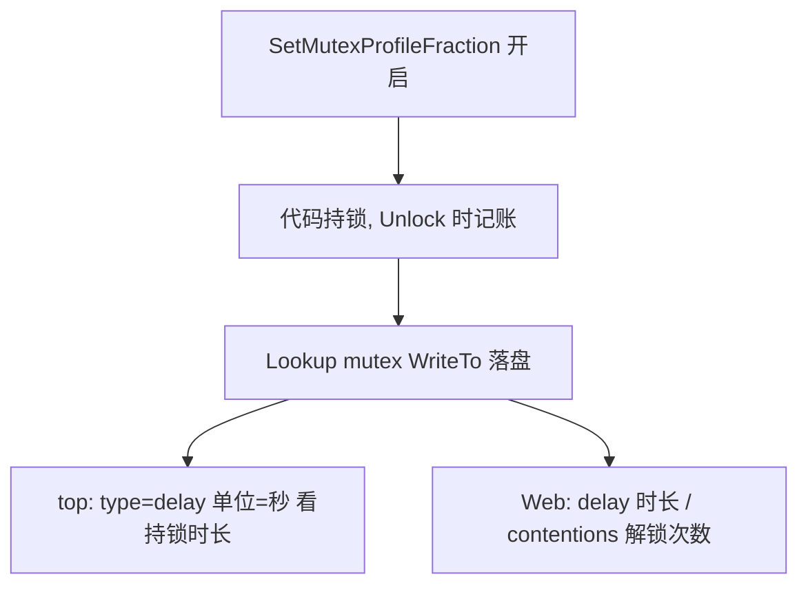

# Go APM 监控系统实战: 使用 pprof 排查加锁性能问题

## 纲要

- block 与 mutex 的区别：block 记录「等待获取锁的阻塞时长」，mutex 记录「**持有锁的时长**」——哪段代码持锁太久
- 采样需显式开启：`runtime.SetMutexProfileFraction`；`1`=全量，`0`=关闭，`<0`=返回当前 rate 值，`>1`=约 `1/rate` 概率采样
- 采样时机在「解锁」：只有 `Unlock` 时才能算出持锁时长，所以记账发生在 `Unlock` 而非 `Lock`
- 生成 mutex profile：标准库 `pprof.Lookup("mutex").WriteTo` 输出
- 复现场景：主协程持锁 2 秒，子协程获取锁后短暂持有再释放
- 交互终端 `top`：`type=delay`，单位秒，看哪个函数持锁最久
- 浏览器两维度：`delay`（持锁时长）与 `contentions`（持锁/解锁次数）
- HTTP 接口输出：含 `cycles/second`、每栈持锁周期数（换算成秒）、解锁次数与函数栈

## 正文

### block 和 mutex 到底差在哪

上一节我们看了 block——它记录的是「协程**等锁**等了多久」。这一节看 mutex，它回答的是另一个问题：**哪一段代码把锁持有的时间太长**。

两者经常被混淆，但观测对象完全不同：

| 指标 | 记录什么 | 记账时机 |
| --- | --- | --- |
| block | 等待获取锁的阻塞时长 | 发生阻塞（Lock 未拿到）时 |
| mutex | 持有锁的时长 | 释放锁（Unlock）时 |

mutex profile 的价值在于：即使没有「等锁」的阻塞，只要某段临界区持锁过久，一样会拖慢并发。它帮我们找到那段「占着锁不撒手」的代码。

### 显式开启采样

和 block 一样，mutex 采样也**默认关闭**，需要 `runtime.SetMutexProfileFraction` 开启：

```go
runtime.SetMutexProfileFraction(1)   // 1 = 对所有持锁事件采样
runtime.SetMutexProfileFraction(0)   // 0 = 关闭
rate := runtime.SetMutexProfileFraction(-1) // <0 = 不改设置，仅返回当前 rate 值
runtime.SetMutexProfileFraction(100) // >1 = 约 1/100 概率采样持锁事件
```

注意 `<0` 的特殊语义：它不会修改采样率，而是把当前 rate 值作为返回值读出来，常用于「先存旧值、事后恢复」。

### 复现并生成 mutex profile

标准库写法：开启采样 → 跑出持锁场景 → `Lookup("mutex").WriteTo` 落盘。

```go
// 根据讲稿逻辑补充：复现持锁过久并生成 mutex profile
package main

import (
	"os"
	"runtime"
	"runtime/pprof"
	"sync"
	"time"
)

func holdLock(mu *sync.Mutex) {
	mu.Lock()
	mu.Unlock() // 记账发生在 Unlock：算出自持锁时长
}

func main() {
	runtime.SetMutexProfileFraction(1) // 全量采样持锁事件
	var mu sync.Mutex
	mu.Lock()
	time.Sleep(2 * time.Second) // 主协程持锁 2 秒
	mu.Unlock()                 // 此处被采样，记录主协程持锁 2 秒

	var wg sync.WaitGroup
	for i := 0; i < 2; i++ {
		wg.Add(1)
		go func() {
			defer wg.Done()
			holdLock(&mu)
		}()
	}
	wg.Wait()

	f, _ := os.Create("mutex.pprof")
	pprof.Lookup("mutex").WriteTo(f, 0)
	f.Close()
}
```

主协程持锁 2 秒，因此 `top` 中 `main` 通过子函数持有 2 秒；用 `list main` 能看出是 `mu.Unlock()` 那一行触发了持锁采样，持锁时长与休眠的 2 秒一致。

### 交互终端与浏览器视图

`go tool pprof mutex.pprof` 进入终端：

```bash
(pprof) top
```

`top` 里 `type=delay`，单位秒，列出各函数持锁时长。`main` 自身 0 秒但子函数持锁 2 秒，所以 `cum` 是 2 秒；真正持锁的是调用 `Unlock` 的那一层。用 `list main` 即可看清具体位置。

浏览器（`go tool pprof -http=:8083 mutex.pprof`）同样提供两个维度：

| 维度 | 含义 |
| --- | --- |
| `delay` | 持锁时长（秒） |
| `contentions` | 持锁/解锁次数（即调用 `Unlock` 的次数） |

火焰图、top、peek 等看法与 CPU/内存/block 完全一致：从上到下看调用层次，横向宽度看资源占比。



### HTTP 接口输出细节

`/debug/pprof/mutex` 的文本结构与 block 类似：

- `cycles/second`：每秒 CPU 周期数，用于把「持锁周期数」换算成秒
- 各函数栈的持锁周期数（同栈可累加）
- 解锁次数（即 `contentions`）
- 末尾函数栈信息

重点关注的始终是：哪个函数**持锁时间最长**、**解锁次数最多**，据此判断临界区是否过大、是否可以缩小锁粒度。

## Demo 示例

可独立运行的持锁示例，运行后生成 `mutex.pprof`。

```go
package main

import (
	"os"
	"runtime"
	"runtime/pprof"
	"sync"
	"time"
)

func main() {
	runtime.SetMutexProfileFraction(1)
	var mu sync.Mutex

	mu.Lock()
	time.Sleep(2 * time.Second) // 模拟临界区过重：持锁 2 秒
	mu.Unlock()

	var wg sync.WaitGroup
	for i := 0; i < 3; i++ {
		wg.Add(1)
		go func() {
			defer wg.Done()
			mu.Lock()
			mu.Unlock()
		}()
	}
	wg.Wait()

	f, err := os.Create("mutex.pprof")
	if err != nil {
		panic(err)
	}
	defer f.Close()
	pprof.Lookup("mutex").WriteTo(f, 0)
}
```

### 运行说明

```bash
go mod init mutex-pprof-demo
go run main.go
# 终端分析
go tool pprof mutex.pprof
# 浏览器分析
go tool pprof -http=:8083 mutex.pprof
# 或访问 http://127.0.0.1:8080/debug/pprof/ 点 mutex
```

### 代码说明

- `SetMutexProfileFraction(1)` 必须显式开启，否则 mutex profile 为空
- 记账发生在 `Unlock`，所以持锁时长 = 上一次 `Lock` 到 `Unlock` 的间隔
- `top` 中 `type=delay`、单位秒；Web 额外提供 `contentions` 看解锁次数
- `<0` 传入仅读取当前 rate 而不修改，适合「保存/恢复」采样设置
- 排查完应改回 `SetMutexProfileFraction(0)` 关闭，避免额外开销

### 技术点总结

- mutex 看「持锁时长」，block 看「等锁时长」，二者观测对象不同
- mutex 采样默认关闭，需 `SetMutexProfileFraction` 显式开启
- 记账在 `Unlock`：只有释放锁时才能算出持锁时长
- 频率语义：1 全量、0 关闭、<0 读当前值、>1 概率采样
- 分析重点：持锁最久、解锁最多的函数，据此缩小临界区/降低锁粒度

相关度：92%。是否需要继续：[是]。代码是否可运行：[是]。
