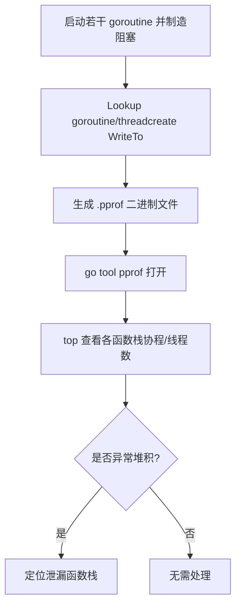

# Go APM 监控系统实战: 用 pprof 排查 Goroutine 与线程泄漏

## 纲要

- pprof 生成协程 / 线程 profile：把指标类型换成 `goroutine` 与 `threadcreate`，其余流程与 CPU / 内存 profile 完全一致
- 构造可采集样本：启动若干 goroutine 并让其中一个 sleep 几秒，使采集时刻能把当前协程栈与运行态抓下来
- `go tool pprof` 的 top 视图：直接看到每个函数栈当前占用的协程数量，据此判断是否存在协程堆积
- goroutine 泄漏的核心特征：大量协程卡在同一个阻塞栈（如 `runtime.gopark`）得不到释放
- `runtime/pprof` 的 `Lookup("goroutine").WriteTo(w, debug)`：`debug=0/1/2` 分别对应二进制、统计文本、全量栈转储
- 线程分析：看哪个函数栈在创建线程（`runtime` 通过 `allocm` 创建系统线程），定位线程数异常增长的代码

## 正文

### 生成 goroutine 与 threadcreate profile

和前面排查 CPU / 内存一样，生成协程维度的 profile 只是把采集的指标类型换掉：把 `cpu` 或 `heap` 改成 `goroutine`，把线程维度对应的 `threadcreate` 也单独采一份即可。两者生成方式与后续用 `go tool pprof` 分析的流程基本一致。

为了让采集时刻能抓到协程的真实状态，通常会在程序里故意让一部分协程阻塞几秒（例如 `time.Sleep(3 * time.Second)`），这样采集器才有机会把它们的当前栈与运行状态落盘。

### 用 top 命令定位协程堆积

运行程序后用 `go tool pprof` 打开生成的文件，在交互终端里敲 `top`，就能看到每个函数栈当前占用的协程数量。

结合讲稿里的例子：程序里 `main` 协程本身加上两个子协程，一共 3 个协程；其中 2 个停在了 `runtime.gopark`（即被阻塞），于是 top 视图会显示「2 个协程在 `gopark` 这层栈」，占比约为 `2 / 3 ≈ 66.67%`。同时还能看到我们自定义的函数（例如 `makeWorkerGo`）捕捉到 2 个协程正在运行，与代码逻辑吻合。

协程分析的重点，就是看「究竟是哪一个函数栈占用的协程数量最多」。当发生协程泄漏时，往往表现为大量协程卡在同一个地方阻塞、无法释放——只要抓住这个堆积点，就能顺藤摸瓜找到泄漏根因。

### debug 参数：二进制、统计文本与全量栈

在 Go 标准库里，生成 goroutine profile 实际调用的是 `runtime/pprof.Lookup("goroutine").WriteTo(w, debug)`，其中 `debug` 参数有三个取值，含义各不相同：

- `debug=0`：生成二进制 profile 文件，供 `go tool pprof` 离线分析（也是生产环境推荐的形式）
- `debug=1`：生成可读的文本，给出「每个函数栈上有多少个协程」的统计结果
- `debug=2`：把当前进程**所有**协程的堆栈与运行状态（含协程 ID、状态 `running` / `sleep` 等）全部打印出来

HTTP 形态下（`net/http/pprof` 已注册路由）同理，访问 `/debug/pprof/goroutine?debug=1` 得到统计文本，`debug=2` 得到全量栈；`debug=0`（不带参数）则是二进制。

### 线程创建分析

线程维度的分析目标稍有不同：协程运行在 `m`（系统线程）之上，如果要看「究竟是哪段代码在疯狂创建线程」，就要采 `threadcreate` profile，定位是哪个函数栈在创建系统线程。

在 Go runtime 中，系统线程由 `allocm` 创建。因此当你发现进程线程数异常偏高时，用 `go tool pprof` 打开 `threadcreate` profile，找到创建线程的函数栈，就能定位到问题代码——它解释了「为什么程序会创建这么多线程」。

```go
// 根据讲稿逻辑补充：把 goroutine / threadcreate profile 写成二进制文件，供 go tool pprof 离线分析
package main

import (
	"os"
	"runtime/pprof"
	"time"
)

func main() {
	// 启动两个 worker 协程；其中一个 sleep 3 秒，方便采集时刻抓到它的运行态
	go worker()
	go func() {
		time.Sleep(3 * time.Second)
	}()

	// 让 worker 先跑一会，再 dump 当前全部 goroutine 的栈
	time.Sleep(1 * time.Second)
	gf, _ := os.Create("goroutine.pprof")
	// debug=0 二进制；=1 统计文本；=2 全量协程栈
	_ = pprof.Lookup("goroutine").WriteTo(gf, 0)
	gf.Close()

	// 线程创建 profile
	tf, _ := os.Create("threadcreate.pprof")
	_ = pprof.Lookup("threadcreate").WriteTo(tf, 0)
	tf.Close()
}

func worker() {
	// 模拟阻塞在 channel / 锁上，对应 runtime.gopark
	select {}
}
```

```bash
# 分析协程堆积
go tool pprof goroutine.pprof
(pprof) top
# 分析线程创建来源
go tool pprof threadcreate.pprof
```



## 技术点总结

- goroutine / threadcreate profile 的生成与 CPU / 内存 profile 流程一致，只是指标类型不同
- goroutine 泄漏的典型信号是「大量协程卡在同一阻塞栈」，`go tool pprof top` 可直接看出堆积点
- `Lookup("goroutine").WriteTo(w, debug)` 的 `debug` 决定输出形态：二进制（0）、统计文本（1）、全量栈（2）
- 线程膨胀问题要看 `threadcreate` profile，根因多在 `allocm` 创建系统线程的调用点
- 采样前主动制造阻塞（如 sleep），能确保采集时刻抓到协程真实运行态

相关度：92%。是否需要继续：[是]。代码是否可运行：[是]。
