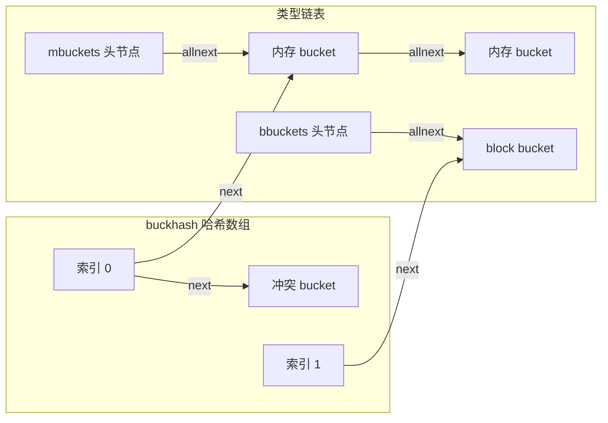
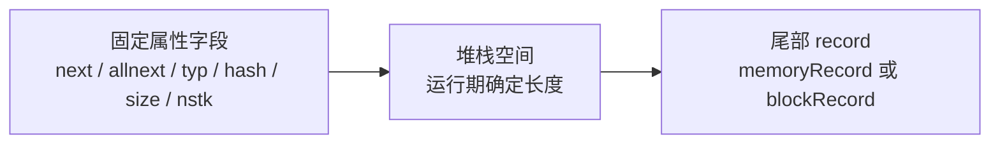
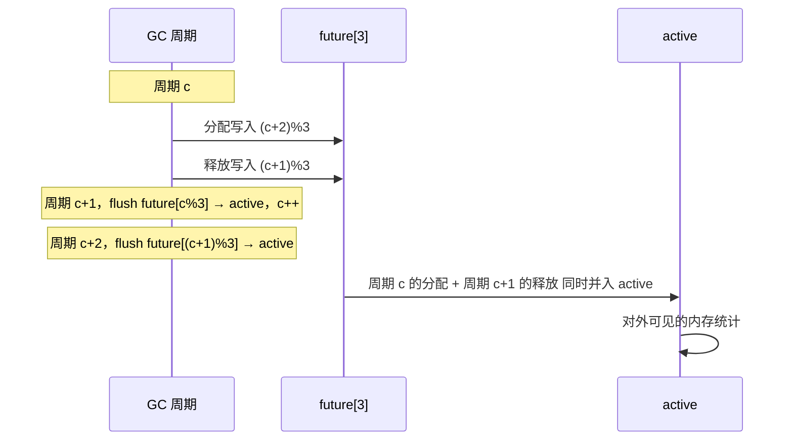

# Go APM 监控系统实战: pprof 内存、block 与 mutex 指标的统计原理

## 纲要

- Profile 注册表：`runtime/pprof` 全局 `profiles` map 统一管理 heap/block/mutex 等 Profile 对象，`Lookup` 取值、`WriteTo` 输出、`Count` 返回记录条数
- bucket 结构：三种指标共用同一种记录载体，通过 `allnext` 串成类型链表（`mbuckets`/`bbuckets`/`xbuckets`），通过 `next` 解决 `buckhash` 哈希冲突
- bucket 的唯一性由「类型 + 函数堆栈（+ size）」决定，命中旧 bucket 则累加，未命中才新建
- bucket 内存布局：固定字段 + 运行期才知道长度的堆栈 + 尾部 record，record 地址用 `unsafe` 指针偏移算出
- blockRecord：block 在阻塞时记账、mutex 在解锁时记账，共用 `saveblockevent`
- memoryRecord：借助 `future[3]` 数组与 GC 周期错位记账，保证统计到的是「经历了一次 GC 仍未被回收」的内存
- 采样时机：内存默认 512KB 采样一次，block/mutex 默认关闭需显式开启

## 从 Profile 注册表说起

在前面的实战里，我们都是这样采集 profile 的：

```go
f, _ := os.Create("heap.out")
pprof.Lookup("heap").WriteTo(f, 0)
```

点进 `runtime/pprof` 的源码可以看到，每种指标类型都会先注册到一个全局的 `profiles` 结构里，它内部有一个 `map[string]*Profile`，key 是指标名称：`goroutine`、`heap`、`allocs`、`block`、`mutex`、`threadcreate` 等。

`Profile` 对象对外暴露三个关键能力：

| 方法 | 作用 |
| --- | --- |
| `pprof.Lookup(name)` | 从全局 map 中取出指定名称的 Profile |
| `(*Profile).WriteTo(w io.Writer, debug int)` | 把内部记录写到输出流，内部调用的是 runtime 侧的 `write` 实现 |
| `(*Profile).Count()` | 返回当前记录的条数，如 heap 的记录条数、block 的阻塞记录条数 |

也就是说，**采集动作本身只是「把已经统计好的数据倒出来」**，真正有价值的问题是：这些记录是在什么时候、以什么结构被写进去的。

## bucket：三种指标共用的记录载体

无论是内存、block 还是 mutex，runtime 内部都使用同一个 `bucket` 结构记录信息，并且维护四个全局变量：

| 全局变量 | 含义 |
| --- | --- |
| `mbuckets` | 内存 profile bucket 链表的头节点 |
| `bbuckets` | block profile bucket 链表的头节点 |
| `xbuckets` | mutex profile bucket 链表的头节点 |
| `buckhash` | 哈希数组，用于快速定位某个 bucket，数组元素是 bucket 链表 |



这里必须区分两个指针：

- `allnext`：把**同类型**的 bucket 串成一条链表，链表头就是 `mbuckets`/`bbuckets`/`xbuckets`。统计输出时，遍历的就是这条链表。
- `next`：只用于 `buckhash` 冲突链。哈希冲突时，新 bucket 被插到链表头部，用 `next` 串联。

### bucket 的唯一性

我们最终关心的是「哪个函数分配的内存最多」「哪个函数阻塞次数最多」，所以 bucket 里必然要存函数堆栈。判定是否为同一个 bucket 的依据是：

- bucket 的类型相同（内存 / block / mutex）
- 函数堆栈相同
- 对内存 bucket 而言，`size` 也要相同

命中旧 bucket 就在其上累加字节数、对象数或阻塞次数/周期数；未命中才新分配一个 bucket，并把它的 `allnext` 指向对应类型链表的旧头节点，自己成为新的头节点。

## stkbucket：bucket 的创建与查找

负责创建/查找的函数是 `stkbucket(typ, size, stk, alloc)`：

1. 取 `buckhash` 数组；若为空则先分配内存。
2. 遍历传入的堆栈做哈希运算；如果是内存类型（有 `size`），再按 `size` 维度叠加一次哈希。
3. 用哈希值对 `buckhash` 数组长度取模得到索引，取出该索引位置的 bucket。
4. 依次比对 `typ`、`hash`、`size`、`stk`，全部相同则直接返回旧 bucket。
5. 不相同则沿 `next` 遍历冲突链表继续比对；`alloc` 参数为 true 时仍未找到，就分配新 bucket 并挂到类型链表头部。

```go
// 根据讲稿逻辑补充：stkbucket 的判定要点（伪代码，非 runtime 原文）
func stkbucket(typ bucketType, size uintptr, stk []uintptr, alloc bool) *bucket {
	if buckhash == nil {
		buckhash = newBucketHash() // 首次使用时分配哈希数组
	}

	// 以堆栈（以及内存类型的 size）为维度计算哈希
	h := hashStack(stk)
	if typ == memProfile {
		h += size
	}
	idx := h % uintptr(len(buckhash))

	// 命中冲突链上类型 + 哈希 + size + 堆栈完全一致的老 bucket，直接复用
	for b := buckhash[idx]; b != nil; b = b.next {
		if b.typ == typ && b.hash == h && b.size == size && sameStack(b.stk(), stk) {
			return b
		}
	}
	if !alloc {
		return nil
	}

	// 未命中：分配新 bucket，用 allnext 挂到对应类型链表头部
	b := newBucket(typ, size, stk, h)
	b.allnext = typeHead(typ) // mbuckets / bbuckets / xbuckets
	setTypeHead(typ, b)
	return b
}
```

## bucket 的内存布局

看 `bucket` 结构体本身，是找不到「分配的字节数」「阻塞次数」这类字段的。原因是**堆栈长度只有运行期才知道**，所以 runtime 在运行期才算出一个 bucket 实际要占多少内存，整体分成三段：



| 指标类型 | 尾部 record |
| --- | --- |
| heap / allocs | `memoryRecord` |
| block、mutex | `blockRecord`（两者共用） |

由于 record 与堆栈都没有声明在结构体里，取 record 的方式是通过 `unsafe` 包的指针加法算出偏移地址，再强制类型转换成对应的 record 指针。

## blockRecord 的记账逻辑

`blockRecord` 只有两个字段：`count`（次数）与 `cycles`（CPU 周期数）。记账入口是 `saveblockevent`：

- **block profile**：程序发生阻塞时调用，记录阻塞次数与阻塞时长
- **mutex profile**：释放锁（Unlock）时调用，记录持锁次数与持锁时长

两者共用一个函数、一个数据结构，区别只在**调用时机**。逻辑本身很朴素：按堆栈取出（或创建）bucket，取出其中的 `blockRecord`，然后对 `count`、`cycles` 做累加。

需要显式开启采样：

```go
runtime.SetBlockProfileRate(1)       // 每个阻塞事件都采样，生产建议设置更大的纳秒阈值
runtime.SetMutexProfileFraction(1)   // 采样比例，1 表示全量
```

## memoryRecord 与 GC 周期错位记账

内存指标的设计要精巧得多。结构如下：

```go
// 根据讲稿逻辑补充：runtime 内部 memoryRecord 的结构形态
type memoryRecord struct {
	active memRecordCycle    // 已生效、对外可见的统计值
	future [3]memRecordCycle // 未来三个 GC 周期的暂存值
}

type memRecordCycle struct {
	allocs     uint64 // 分配次数
	frees      uint64 // 释放次数
	allocBytes uint64 // 分配字节数
	freeBytes  uint64 // 释放字节数
}
```

### 为什么不能直接累加

垃圾回收是定时触发的。一个对象分配内存之后即使已经不再使用，在 GC 真正跑之前，这部分内存量也不会被扣减。如果直接把「当次分配的字节数」累加进统计值，就会出现误判：某个函数分配内存很多，但这些内存很快就被 GC 回收了，它并不是泄漏点。

我们真正想找的是**没能被 GC 回收掉的那部分内存**。于是 runtime 用了一个技巧：**让一次内存分配记录经历一个完整的 GC 周期之后，才被计入统计**。

### 错位记账的规则

`future` 是一个长度为 3 的循环数组，记账规则（设当前 GC 周期为 `c`）：

- 分配内存：写入 `future[(c+2)%3]`
- 释放内存：写入 `future[(c+1)%3]`
- 每经历一次 GC：`future[c%3]` 的四个属性累加进 `active`，然后清空该槽位，周期 `c` 自增



关键点在于：**周期 `c` 的分配与周期 `c+1` 的释放会落到同一个槽位**，二者在下一个 GC 周期被同时并入 `active`。这样一来，能进入 `active` 的分配量，都是「熬过了一轮 GC 还没被还回去」的量，用它来做内存分析才准确。

## 统计输出与采样时机

输出 heap profile 时（`writeHeapProfile`），runtime 遍历 `mbuckets` 链表，从每个 bucket 中取出的是 `active` 里的 `allocs`、`allocBytes`（以及 `frees`、`freeBytes`）组装成记录；同时 `mProf_FlushLocked` 负责在 GC 结束时做 future → active 的搬运。

三类指标的采样时机汇总：

| 指标 | 触发时机 | 默认采样率 |
| --- | --- | --- |
| heap / allocs | 内存分配时判定是否采样 | `runtime.MemProfileRate = 512 * 1024`，即平均每分配 512KB 采样一次 |
| block | goroutine 阻塞时 | 默认关闭，`SetBlockProfileRate` 开启 |
| mutex | 解锁（Unlock）时 | 默认关闭，`SetMutexProfileFraction` 开启 |

## API 速览

| API | 签名 | 说明 |
| --- | --- | --- |
| `pprof.Lookup` | `func Lookup(name string) *Profile` | 按名称取 Profile，未注册返回 nil |
| `(*Profile).WriteTo` | `func (p *Profile) WriteTo(w io.Writer, debug int) error` | 输出 profile，`debug=0` 二进制，`debug>0` 文本 |
| `(*Profile).Count` | `func (p *Profile) Count() int` | 返回当前记录条数 |
| `runtime.MemProfileRate` | `var MemProfileRate int = 512 * 1024` | 堆采样率，设为 1 表示全量（开销极大） |
| `runtime.SetBlockProfileRate` | `func SetBlockProfileRate(rate int)` | 纳秒阈值，阻塞超过该值才记录 |
| `runtime.SetMutexProfileFraction` | `func SetMutexProfileFraction(rate int) int` | 竞争事件的采样比例，返回旧值 |

## Demo 示例

### 运行说明

```bash
mkdir -p pprof-demo && cd pprof-demo
go mod init pprof-demo
go run main.go
ls -l *.out
go tool pprof -http=:8080 heap.out   # 内存
go tool pprof -http=:8081 block.out  # 阻塞
go tool pprof -http=:8082 mutex.out  # 锁竞争
```

### 代码

```go
package main

import (
	"fmt"
	"io"
	"os"
	"runtime"
	"runtime/pprof"
	"sync"
	"time"
)

// 模拟一块"只分配不释放"的内存，用于观察 heap profile
var leak [][]byte

func allocMem() {
	for i := 0; i < 32; i++ {
		leak = append(leak, make([]byte, 1024*1024)) // 每次 1MB
	}
}

// 模拟锁竞争，用于观察 mutex profile
func mutexHotPath() {
	var mu sync.Mutex
	var wg sync.WaitGroup
	for i := 0; i < 8; i++ {
		wg.Add(1)
		go func() {
			defer wg.Done()
			for j := 0; j < 2000; j++ {
				mu.Lock()
				time.Sleep(time.Microsecond)
				mu.Unlock()
			}
		}()
	}
	wg.Wait()
}

// 模拟 channel 阻塞，用于观察 block profile
func blockHotPath() {
	ch := make(chan struct{}, 1)
	var wg sync.WaitGroup
	for i := 0; i < 8; i++ {
		wg.Add(1)
		go func() {
			defer wg.Done()
			for j := 0; j < 200; j++ {
				ch <- struct{}{}
				time.Sleep(time.Millisecond)
				<-ch
			}
		}()
	}
	wg.Wait()
}

func dumpToFile(name string, w io.Writer) {
	if err := pprof.Lookup(name).WriteTo(w, 0); err != nil {
		fmt.Printf("dump %s failed: %v\n", name, err)
		return
	}
	fmt.Printf("dump %s ok, records: %d\n", name, pprof.Lookup(name).Count())
}

func main() {
	// 1. 设置采样率：内存每 512KB 采样一次（默认值，显式写出便于理解）
	runtime.MemProfileRate = 512 * 1024
	// 2. block：阻塞超过 1 微秒就记录；生产环境阈值应放大
	runtime.SetBlockProfileRate(int(time.Microsecond))
	// 3. mutex：全量采样锁竞争
	runtime.SetMutexProfileFraction(1)

	allocMem()
	mutexHotPath()
	blockHotPath()

	// 多跑一次 GC，让 future 数组中的记录有机会并入 active
	runtime.GC()
	runtime.GC()

	for _, name := range []string{"heap", "block", "mutex"} {
		f, err := os.Create(name + ".out")
		if err != nil {
			panic(err)
		}
		dumpToFile(name, f)
		f.Close()
	}
}
```

### 代码说明

- 代码根据讲稿逻辑补充，用于验证三类指标各自的记账时机
- `allocMem` 制造只增不减的内存，`runtime.GC()` 调用两次是为了让 `future` 数组里的记录经历完整周期后并入 `active`，这样 heap profile 才能反映「未被回收的内存」
- `mutexHotPath` 的记账发生在 `Unlock`，所以必须在锁释放之后数据才可见
- `blockHotPath` 的记账发生在 goroutine 真正阻塞时，需要 `SetBlockProfileRate` 显式开启
- `Count()` 可以直接看到各类 bucket 的数量，bucket 越少说明堆栈越收敛

### 技术点总结

- 三类指标共用 `bucket` 载体，差异只在尾部的 record 类型
- `allnext` 是类型链表，`next` 是哈希冲突链，二者不要混淆
- bucket 由「类型 + 堆栈 + size」唯一确定，命中则累加
- 内存统计通过 GC 周期错位记账，规避「分配多但很快被回收」的误判
- block 在阻塞时记账、mutex 在解锁时记账，是两个维度完全不同的问题

相关度：95%。是否需要继续：[是]。代码是否可运行：[是]。
