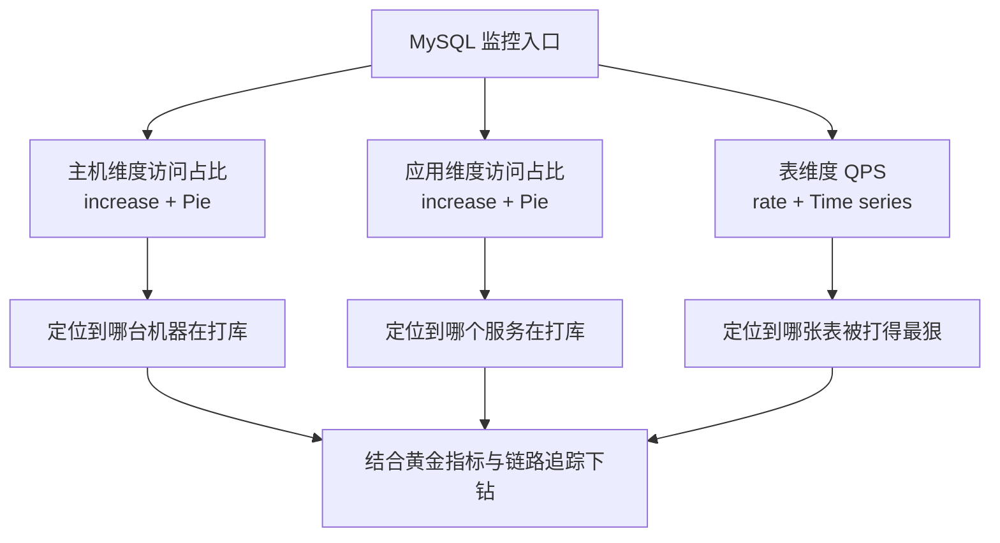

# 61. Go APM 监控系统实战: MySQL 应用服务维度监控面板绘制

## 纲要

- 回顾表维度 MySQL 指标：`library_handle_total`，标签包含 `type`（组件类型）、`method`（增删改查操作）、`name`（表名）、`server`（数据库实例地址）以及框架统一附加的 `app`、`host`
- 监控分层原则：MySQL 属于第三方组件层，单独新建 Dashboard，不往黄金指标面板里塞指标
- 面板变量设计：`app`、`host`、`name`（表名）、`server`（数据库实例）四个下拉变量
- 三块核心面板
 - 主机维度数据库访问占比（Pie chart + `increase()`）
 - 应用维度数据库访问占比（Pie chart + `increase()`）
 - 表维度 QPS（Time series + `rate()`，按 `name` + `server` 双维度聚合）
- 易错点：表维度聚合时必须叠加 `server`，否则不同实例的同名表会被错误合并

## 正文

### 先验证指标是否已经正常暴露

前面我们把 MySQL 表维度的 Counter 指标建立了起来，但还没有任何可视化。动手画面板之前，先确认指标数据是真实的。

启动 `orderservice`、`sqlservice`、`userservice` 三个服务，通过 Postman 发几个下单请求，然后访问任意一个服务的 `/metrics`，搜索 `library_handle_total`，应当能看到类似下面的输出：

```text
# HELP library_handle_total 第三方组件访问计数
# TYPE library_handle_total counter
library_handle_total{app="orderservice",host="ubuntu-apm",method="select",name="order",server="127.0.0.1:3306:apm_order",type="mysql"} 17
library_handle_total{app="orderservice",host="ubuntu-apm",method="insert",name="order",server="127.0.0.1:3306:apm_order",type="mysql"} 3
library_handle_total{app="sqlservice",host="ubuntu-apm",method="select",name="product",server="127.0.0.1:3306:apm_product",type="mysql"} 9
library_handle_total{app="userservice",host="ubuntu-apm",method="select",name="user",server="127.0.0.1:3306:apm_user",type="mysql"} 5
```

四个标签各自承担的职责：

| 标签 | 含义 | 示例 |
| --- | --- | --- |
| `app` | 发起数据库访问的应用服务 | `orderservice` |
| `host` | 应用服务所在主机 | `ubuntu-apm` |
| `type` | 第三方组件类型，本文固定为 `mysql` | `mysql` |
| `method` | SQL 操作类型，由 SQL 解析产物转换而来 | `select` / `insert` / `update` |
| `name` | 被访问的表名 | `order` |
| `server` | 数据库实例标识，由 DSN 中的地址与库名拼接 | `127.0.0.1:3306:apm_order` |

看到 `name` 已经被正确解析成具体表名、`method` 有明确的增删改查类型，说明前面的 SQL 解析与埋点链路是通的，可以开始画板。

### 为什么另起一个 Dashboard

前面我们已经建过 `newdashboard` 用来监控应用服务的黄金指标。监控的核心思路是**分层**：主机层、应用服务层、第三方组件层、业务层各自独立成面板。

把 MySQL 指标塞进黄金指标面板会带来两个麻烦：

- 面板职责混杂，出问题时无法一眼判断「是应用自身的问题，还是它依赖的数据库的问题」
- 黄金指标面板的变量只有 `app` 和 `host`，而数据库视角必须有表名和实例维度，变量体系不兼容

因此新建 `mysql dashboard`，专门承载第三方组件视角的观测。

### 建立面板变量

数据库的观测视角比应用视角多两个维度，因此变量从 `app`、`host` 扩展到四个：

| 变量 | 类型 | 数据源 |
| --- | --- | --- |
| `app` | Query | `label_values(library_handle_total{type="mysql"},app)` |
| `host` | Query | `label_values(library_handle_total{type="mysql",app=~"$app"},host)` |
| `name` | Query | `label_values(library_handle_total{type="mysql",app=~"$app"},name)` |
| `server` | Query | `label_values(library_handle_total{type="mysql",app=~"$app"},server)` |

变量来源统一由 Prometheus 的 `label_values()` 反查得到，后一个变量带前一个变量的过滤条件，形成级联筛选。

### 主机维度访问占比

第一块面板回答的问题是：**在选定时间范围内，哪台主机对数据库的访问最频繁**。

由于要看的是「区间内的总量占比」而不是「每秒速率」，这里用 `increase()` 而不是 `rate()`——`increase()` 取的是区间内的增量绝对值，不会除以区间秒数，正好适合做占比：

```promql
sum by (host) (
  increase(library_handle_total{type="mysql", app=~"$app", server=~"$server", name=~"$name"}[6h])
)
```

可视化选择 **Pie chart**，并在选项里打开 `Percent` 展示百分比，同时把主机名一并显示出来。示例环境只有一台主机，饼图自然是 100%，生产环境多实例部署时就能立刻看出访问倾斜。

### 应用维度访问占比

第二块面板把聚合维度换成 `app`，回答的是：**哪个应用服务对数据库的压力最大**。直接复制上一块面板修改聚合标签即可：

```promql
sum by (app) (
  increase(library_handle_total{type="mysql", host=~"$host", server=~"$server", name=~"$name"}[6h])
)
```

配合顶部的 `server` 变量，可以下钻到「某个具体数据库实例，正在被哪些应用访问」。演示环境每个服务独占一个库，选中某个实例后展示的就是对应服务，这在排查「某库 CPU 飙高是谁打出来的」时非常直接。

### 表维度 QPS

第三块面板回到时间序列，看**哪张表的访问频率最高**：

```promql
sum by (name, server) (
  rate(library_handle_total{type="mysql", app=~"$app", host=~"$host"}[5m])
)
```

这里有两个关键点：

- 用 `rate()` 而不是 `increase()`：QPS 是「每秒多少次」，必须做速率换算
- 聚合维度必须是 `name` + `server` 的组合：**不同数据库实例上的同名表要视为不同的表**。如果只按 `name` 聚合，`orderservice` 的 `order` 表和另一个库里的 `order` 表会被错误合并，得出的 QPS 完全没有意义

纵坐标单位设为 `ops/sec` 一类即可，不需要再做字节或百分比换算。

### 三块面板的分工



三块面板构成了「机器 → 服务 → 表」的下钻路径：先用占比面板圈定范围，再用 QPS 面板定位热点表，最后回到链路追踪看具体是哪条调用链上的哪条 SQL。

### 实践中的几个注意点

- `increase()` 的区间窗口不宜过短。窗口太短时增量样本少，占比会剧烈抖动；6h 这类长窗口更适合看「结构」而非「瞬时波动」
- 所有面板都要把 `type="mysql"` 写死在过滤条件里。`library_handle_total` 是通用第三方组件指标，后续接入 Redis 后同名的 `type="redis"` 会混进来
- `server` 标签建议在设计指标时就用 DSN 解析后的「地址 + 库名」拼成，既能唯一标识实例，又能直接用于面板展示

## API 速览与 Demo 示例

### PromQL 速览

| 函数 / 语法 | 签名 | 作用 |
| --- | --- | --- |
| `increase(v[d])` | 区间向量 → 向量 | 返回区间内的增量绝对值，适合做占比统计 |
| `rate(v[d])` | 区间向量 → 向量 | 返回区间内的每秒平均速率，适合算 QPS |
| `sum by (lbl) (...)` | 向量 → 向量 | 按指定标签聚合，保留其余标签维度 |
| `label_values(metric,lbl)` | 面板变量查询 | 反查指标的标签取值，用于构造下拉变量 |

### 指标注册代码

以下代码根据讲稿逻辑补充，用于回顾 `library_handle_total` 这一指标在框架中的注册与打点方式（Demo 可独立运行）。

```go
package main

import (
	"fmt"
	"log"
	"net/http"

	"github.com/prometheus/client_golang/prometheus"
	"github.com/prometheus/client_golang/prometheus/promhttp"
)

// libraryHandleTotal 记录应用服务对第三方组件（MySQL / Redis）的访问次数。
// 标签：type=组件类型，method=操作类型，name=表名（或 key），server=实例地址。
var libraryHandleTotal = prometheus.NewCounterVec(
	prometheus.CounterOpts{
		Name: "library_handle_total",
		Help: "第三方组件访问次数统计",
	},
	[]string{"app", "host", "type", "method", "name", "server"},
)

func init() {
	prometheus.MustRegister(libraryHandleTotal)
}

// recordMySQLAccess 在 SQL 执行前埋点：解析出表名与操作类型后计数。
// 多表 SQL 无法归属到单张表，直接跳过统计。
func recordMySQLAccess(app, host, method, table, server string) {
	if table == "" {
		return
	}
	libraryHandleTotal.WithLabelValues(app, host, "mysql", method, table, server).Inc()
}

func main() {
	// 模拟 orderservice 对 apm_order 库 order 表的一次写入与三次查询
	recordMySQLAccess("orderservice", "ubuntu-apm", "insert", "order", "127.0.0.1:3306:apm_order")
	for i := 0; i < 3; i++ {
		recordMySQLAccess("orderservice", "ubuntu-apm", "select", "order", "127.0.0.1:3306:apm_order")
	}

	fmt.Println("已写入示例指标，访问 http://localhost:8080/metrics 查看 library_handle_total")
	log.Fatal(http.ListenAndServe(":8080", promhttp.Handler()))
}
```

### 运行说明

```bash
go mod init mysql-panel-demo
go get github.com/prometheus/client_golang/prometheus
go run main.go
# 另开终端
curl -s http://localhost:8080/metrics | grep library_handle_total
```

在 Grafana 中依次添加四块面板的 PromQL，选择 Pie chart 与 Time series 两种可视化类型，即可得到与讲稿一致的 MySQL 分层监控面板。

### 代码说明

- `library_handle_total` 使用 `CounterVec`，六个标签共同决定一条时间序列；基数（cardinality）等于 `app × host × type × method × name × server` 的组合数
- `recordMySQLAccess` 对空表名直接跳过，对应讲稿中「多表 SQL 不统计」的处理
- 埋点位置是 SQL 执行前的 hook（`before` 方法），因此统计的是「发起次数」而非「成功次数」

### 技术点总结

- 第三方组件指标单独成面板，是监控分层落地的具体体现
- 占比类问题用 `increase()`，速率类问题用 `rate()`
- 表维度聚合必须叠加实例维度，否则跨库同名表会被错误合并
- Grafana 变量级联依赖 `label_values()`，父变量变化后子变量自动收敛

