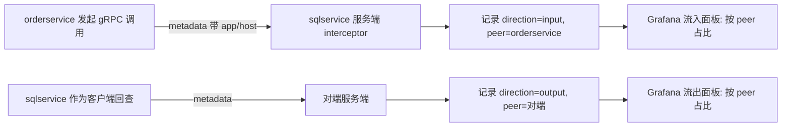

# 64. Go APM 监控系统实战: 应用服务内部流量分布监控

## 纲要

- 流量分布监控的对象：应用作为客户端「流出」的请求量，以及作为服务端「流入」的请求量，本质是请求量的占比，而非带宽
- 补全指标维度：`serverHandleHistory` 原只有 `app`、`host`，新增 `peer`（对端服务名）与 `peerHost`（对端地址），否则无法按对端做流入占比
- HTTP 客户端侧：`peer`/`peerHost` 填空字符串，因为重点监控的是 gRPC 服务间流量
- gRPC 客户端侧：通过 `metadata` 把本端 `app`、`host` 传给对端；服务端 interceptor 取出后写入 `serverHandleHistory`
- 面板分层：新建「流量分布」一行，包含流入 app 维度、流入 host 维度、流出 app 维度三块占比面板
- 占比用 `increase`：看的是「选定时间范围内请求量占比」，不需要每秒速率
- 流出流量只知道对端 `app`：流出的请求最终落到哪台 host 在客户端视角不可知，故流出只做 app 维度

## 正文

### 流量分布到底在监控什么

前面我们建的指标大多反映「某个服务自己怎么样」，但服务之间是会互相调用的：应用 A 会对应用 B 发请求（流出），同时 A 也会收到来自 B 的请求（流入）。**流量分布监控**要的就是这两个方向的请求量，并按对端维度画出占比——注意这里的「流量」是请求量的大小，不是网络带宽。

要做流入占比，必须知道「是谁在请求我」。而原来的 `serverHandleHistory` 只记了自身的 `app`、`host`，没有对端信息，所以第一步是给指标加维度。

### 补全指标维度

给 `serverHandleHistory` 增加两个标签：`peer`（对端服务名称）和 `peerHost`（对端主机地址）。这样无论流入还是流出，都能按对端聚合。

```go
// 根据讲稿逻辑补充：带对端维度的服务端处理计数
var serverHandleHistory = prometheus.NewCounterVec(
	prometheus.CounterOpts{
		Name: "server_handle_total",
		Help: "服务端处理请求计数，含对端维度（根据讲稿逻辑补充）",
	},
	[]string{"app", "host", "peer", "peerHost", "direction"},
)
```

- **HTTP 客户端侧**：发请求的是浏览器或外部客户端，没必要区分它的服务名/主机名，`peer`、`peerHost` 直接填空字符串。
- **gRPC 侧**：这才是监控重点。客户端要把自己的 `app`、`host` 通过 `metadata` 随每次调用带过去，服务端用 interceptor 取出来，写进 `serverHandleHistory` 的 `peer`、`peerHost`。

### gRPC 两侧的 metadata 传递

客户端在调用前，把本端信息塞进 `metadata`；服务端在 interceptor 里取出，调用之前写好的 `buildInfo` 拿到对端 `app`/`host`，再随指标记录。

```go
// 根据讲稿逻辑补充：gRPC 客户端注入本端信息
func clientUnaryInterceptor(
	ctx context.Context, method string, req, reply interface{},
	cc *grpc.ClientConn, invoker grpc.UnaryInvoker, opts ...grpc.CallOption,
) error {
	ctx = metadata.AppendToOutgoingContext(ctx,
		"app", buildInfo().App,
		"host", buildInfo().Host,
	)
	return invoker(ctx, method, req, reply, cc, opts...)
}

// 根据讲稿逻辑补充：gRPC 服务端取出对端信息并记录
func serverUnaryInterceptor(
	ctx context.Context, req interface{}, info *grpc.UnaryServerInfo,
	handler grpc.UnaryHandler,
) (interface{}, error) {
	md, _ := metadata.FromIncomingContext(ctx)
	peer := firstMD(md, "app")
	peerHost := firstMD(md, "host")
	serverHandleHistory.WithLabelValues(
		buildInfo().App, buildInfo().Host, peer, peerHost, "input",
	).Inc()
	return handler(ctx, req)
}
```

编译、重启 `orderservice`/`sqlservice`/`userservice`，发请求后去 `/metrics` 看，`peer`、`peerHost` 两个维度就有值了。

### 在 Grafana 画出流量分布

新建「流量分布」一行，放三块占比面板。核心都围绕一个判断：**流入看的维度是 `peer`，流出看的维度是 `server`（对端 app）**。

| 面板 | 方向 | 聚合维度 | 含义 |
| --- | --- | --- | --- |
| 流入流量（app 维度） | `direction="input"` | `peer` | 进来流量中哪个对端服务占比最高 |
| 流入流量（host 维度） | `direction="input"` | `peerHost` | 进来流量来自哪台主机 |
| 流出流量（app 维度） | `direction="output"` | `peer` | 出去流量打向哪个对端服务最多 |

三块面板的 PromQL 形态一致，都是「按对端聚合的 `increase`」：

```promql
# 流入流量，按对端服务名占比
sum by (peer) (
  increase(server_handle_total{direction="input", app=~"$app"}[6h])
)
# 流入流量，按对端主机占比
sum by (peerHost) (
  increase(server_handle_total{direction="input", app=~"$app"}[6h])
)
# 流出流量，按对端服务名占比
sum by (peer) (
  increase(server_handle_total{direction="output", app=~"$app"}[6h])
)
```

为什么用 `increase` 而不是 `rate`？我们关心的是「这段时间内请求量的结构占比」，不需要每秒速率，`increase` 取区间增量绝对值正好合适。



实测环境里 `orderservice` 同时向 `sqlservice`、`userservice` 发 gRPC 请求，所以流出面板 `peer` 会出现这两个服务；流入面板选 `userservice` 时，能看出当前是哪些服务、哪些主机在请求它。

## Demo 示例

下面给出一个可独立运行的示例，演示「带对端维度的请求计数 + 按方向/对端聚合」的核心逻辑（gRPC 传输部分用普通函数模拟，指标与聚合语义与讲稿一致）。

```go
package main

import (
	"fmt"
	"log"
	"net/http"

	"github.com/prometheus/client_golang/prometheus"
	"github.com/prometheus/client_golang/prometheus/promhttp"
)

var serverHandleHistory = prometheus.NewCounterVec(
	prometheus.CounterOpts{
		Name: "server_handle_total",
		Help: "请求计数，含对端与方向维度（根据讲稿逻辑补充）",
	},
	[]string{"app", "host", "peer", "peerHost", "direction"},
)

func init() { prometheus.MustRegister(serverHandleHistory) }

// record 模拟一次请求记录：from 调 to，标记方向与对端信息
func record(fromApp, fromHost, toApp, toHost string) {
	// 对 from 而言是流出
	serverHandleHistory.WithLabelValues(fromApp, fromHost, toApp, "", "output").Inc()
	// 对 to 而言是流入
	serverHandleHistory.WithLabelValues(toApp, toHost, fromApp, fromHost, "input").Inc()
}

func main() {
	// 模拟 orderservice 向 sqlservice、userservice 各发 3 次 gRPC 调用
	for i := 0; i < 3; i++ {
		record("orderservice", "host-a", "sqlservice", "host-b")
		record("orderservice", "host-a", "userservice", "host-c")
	}
	fmt.Println("已写入示例指标，访问 http://localhost:8080/metrics 查看 server_handle_total")
	log.Fatal(http.ListenAndServe(":8080", promhttp.Handler()))
}
```

### 运行说明

```bash
go mod init traffic-dist-demo
go get github.com/prometheus/client_golang/prometheus
go run main.go
# 另开终端
curl -s http://localhost:8080/metrics | grep server_handle_total
```

在 Grafana 添加三块 Panel，PromQL 分别填上面三条 `increase(...)`，即可得到与讲稿一致的流量分布占比图。

### 代码说明

- `direction` 标签区分流入/流出，避免两类流量混在同一条序列里
- 流出方向不记 `peerHost`：客户端发出请求时并不知道对端最终落到哪台主机，只知对端 `app`
- `peer` 来自 gRPC `metadata`，由客户端注入、服务端 interceptor 提取
- HTTP 客户端侧 `peer`/`peerHost` 留空，符合「重点监控服务间 gRPC 流量」的初衷

### 技术点总结

- 流量分布 = 按对端的请求量占比，需要先给指标补 `peer`/`peerHost` 维度
- gRPC 服务间流量用 `metadata` + interceptor 传递本端身份，HTTP 客户端侧留空即可
- 占比类面板统一用 `increase`，不要用 `rate`
- 流入看 `peer`/`peerHost`，流出只看 `peer`，因为流出视角的对端 host 不可知
- 面板分层：流量分布单独成行，与应用/组件/业务层互不混杂

