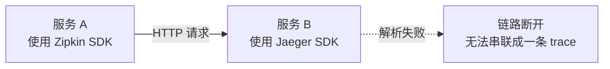
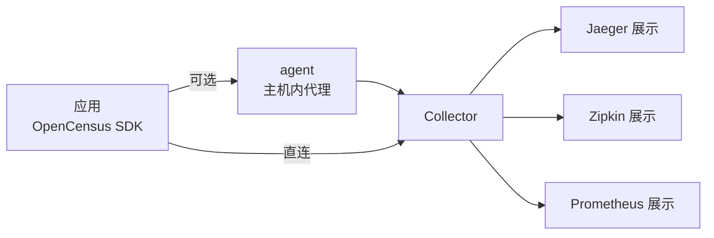
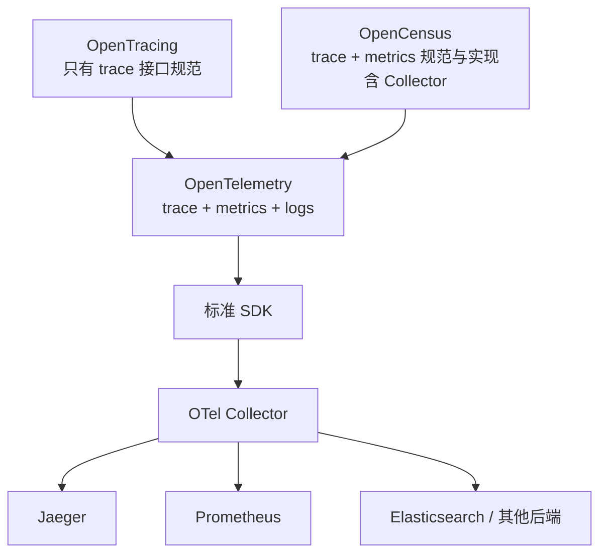

# 6. Go APM 监控系统实战: 从 OpenTracing 到 OpenTelemetry 的规范演进

## 纲要

- 三个项目解决的是同一个问题的不同层次
 - **OpenTracing**：只制定客户端接入 trace 的 API 规范（含 `inject` / `extract` 接口）
 - **OpenCensus**：既制定规范，又提供**标准实现**，并把指标（metrics）纳入进来，引入 Collector 中间层
 - **OpenTelemetry**：合并前两者，并进一步把日志（logs）规范纳入
- OpenTracing 的致命缺陷：只规定接口，**不规定跨进程的 trace 数据格式**，导致 Zipkin 与 Jaeger 的链路无法串联
- 跨进程传播的三代协议：B3（Zipkin 私有）→ `uber-trace-id`（Jaeger 私有）→ `traceparent` / `tracestate`（W3C 统一标准）
- 解决异构问题的核心思想是**加中间层**：Collector 把"上报"与"展示"解耦

## OpenTracing：只定接口，不定格式

OpenTracing 制定的是"客户端如何接入链路追踪"的 API 规范，它提供了跨进程传播的两个方法：

- `inject`：把链路追踪的上下文注入到一个**携带者**（carrier）里，例如 HTTP 请求头
- `extract`：从携带者里提取出链路追踪上下文

但问题在于：**这两个方法只是接口，实现由各厂商自己写**，而往 HTTP 头部注入什么 key、内容以什么格式组织，OpenTracing 完全不管。

于是就出现了下面的场景：



服务 A 用 Zipkin 的 SDK 往 HTTP 头部注入内容，服务 B 用 Jaeger 的 SDK 去解析——Jaeger 的客户端根本不认识 Zipkin 定义的头部，链路就此断开。

## 三代跨进程传播协议

### B3 协议（Zipkin）

Zipkin 在各种语言（HTTP、gRPC 等）的 SDK 实现里都遵循 **B3 标准**。客户端请求服务端时会注入一组自定义头部：

```text
X-B3-TraceId: 463ac35c9f6413ad48485a3953bb6124
X-B3-SpanId: a2fb4a1d1a96d312
X-B3-ParentSpanId: 0020000000000001
X-B3-Sampled: 1
```

服务端按同样的标准解析。只要客户端和服务端都用 Zipkin 的 SDK，链路串联就没有问题。

### uber-trace-id（Jaeger）

Jaeger 没有在官网上说明跨进程协议，需要看源码。在 `jaeger-client-go` 中，针对 `HTTPHeaders` 这个 format 注册的是 `HTTPHeaderPropagator`，它定义了自己的头部 key：

```text
uber-trace-id: 463ac35c9f6413ad48485a3953bb6124:a2fb4a1d1a96d312:0020000000000001:1
uberctx-key1: value1
```

其中 `uber-trace-id` 承载 traceID、spanID、parentSpanID、采样标记；`uberctx-` 是 baggage 的前缀。

结论很清楚：**B3 与 uber-trace-id 互不认识**，两套 SDK 混用时无法串联整条链路。

### W3C Trace Context（统一标准）

W3C 后来制定了统一规范，规定 trace 上下文在 HTTP header 中的组织形式，只需要两个自定义头部：

```text
traceparent: 00-4bf92f3577b34da6a3ce929d0e0e4736-00f067aa0ba902b7-01
tracestate: congo=t61rcWkgMzE
```

- `traceparent`：格式为 `version-traceid-spanid-traceflags`，承载核心传播信息
- `tracestate`：携带厂商自定义的扩展信息

只要各个链路追踪框架都遵循这个标准，即使不同服务使用不同的框架，整条链路依然能够串起来。

| 协议 | 提出方 | 头部 | 跨厂商互通 |
| --- | --- | --- | --- |
| B3 | Zipkin | `X-B3-TraceId` 等 | 否 |
| uber-trace-id | Jaeger | `uber-trace-id`、`uberctx-` | 否 |
| W3C Trace Context | W3C | `traceparent`、`tracestate` | **是** |

## OpenCensus：规范 + 实现 + 中间层

OpenCensus 是 Google 开源的项目，它遵循 W3C 的 trace context 定义，把 trace 数据放在 `traceparent` / `tracestate` 这两个头部里，解析时也遵循 W3C 规定的格式。

它与 OpenTracing 的区别有两点：

- **不仅制定规范，还提供了标准实现**。只要各语言的客户端 SDK 都由 OpenCensus 提供，注入与解析 trace 数据的协议就是一致的，不同服务之间天然可以互通。
- **把指标（metrics）也纳入进来**，让 trace 和 metrics 的收集有了统一标准。

更重要的是 OpenCensus 引入了 **Collector** 组件：



这层中间层的作用是：客户端只负责"推送数据"，至于想用哪个 APM 工具去展示，把 Collector 的数据导出到对应系统即可——想用 Zipkin 就导出到 Zipkin，想用 Jaeger 就导出到 Jaeger。

这就是计算机领域最经典的思想之一：**通过加一层中间层来解耦**。后面做埋点设计时也会反复用到这个技巧——不要在业务代码里直接耦合具体的监控后端。

## OpenTelemetry：三者的合流

CNCF 发现 OpenTracing 和 OpenCensus 都在做"统一客户端调用形式"这件事，目的高度重合，于是把两个项目合并成了 **OpenTelemetry（OTel）**。

OpenTelemetry 的定位：

- 合并 OpenTracing 的 trace 规范与 OpenCensus 的 trace + metrics 规范
- 进一步把 **logs** 的数据规范也纳入进来
- 最终目标是统一创建和管理 **metrics、logs、trace** 三大数据类型的规范，并提供标准 SDK
- 目前 trace 的使用规范最成熟，metrics 次之，logs 仍在演进中



本课程正是使用 OpenTelemetry 来完成链路追踪相关的落地工作。

## API 速览

| API | 说明 |
| --- | --- |
| `otel.SetTextMapPropagator(prop)` | 设置全局的跨进程传播器 |
| `propagation.TraceContext{}` | W3C Trace Context 传播器，使用 `traceparent` / `tracestate` |
| `propagation.B3{}` | B3 传播器，兼容 Zipkin 生态 |
| `propagation.Jaeger{}` | Jaeger 传播器，使用 `uber-trace-id` |
| `prop.Inject(ctx,carrier)` | 把 trace 上下文注入到 carrier（如 HTTP header） |
| `prop.Extract(ctx,carrier)` | 从 carrier 中提取 trace 上下文，返回新的 ctx |

## Demo 示例

**运行说明**：以下代码根据讲稿逻辑补充，演示同一段链路上下文在三种传播协议下的注入结果，直观说明"为什么 W3C 标准能打通异构系统"。

```bash
go mod init otel-propagation-demo
go get go.opentelemetry.io/otel
go run main.go
```

**完整代码**：

```go
package main

import (
	"context"
	"fmt"
	"net/http"

	"go.opentelemetry.io/otel/propagation"
	"go.opentelemetry.io/otel/trace"
)

// 用固定的 traceID / spanID 构造一个 span 上下文，便于观察注入结果
func newCtx() context.Context {
	traceID, _ := trace.TraceIDFromHex("4bf92f3577b34da6a3ce929d0e0e4736")
	spanID, _ := trace.SpanIDFromHex("00f067aa0ba902b7")
	sc := trace.NewSpanContext(trace.SpanContextConfig{
		TraceID:    traceID,
		SpanID:     spanID,
		TraceFlags: trace.FlagsSampled,
	})
	return trace.ContextWithSpanContext(context.Background(), sc)
}

func main() {
	ctx := newCtx()

	// W3C Trace Context：跨厂商互通的推荐方案
	w3c := propagation.TraceContext{}
	h := http.Header{}
	w3c.Inject(ctx, propagation.HeaderCarrier(h))
	fmt.Println("W3C  :", h.Get("traceparent"))

	// B3：Zipkin 生态
	b3 := propagation.B3{}
	h2 := http.Header{}
	b3.Inject(ctx, propagation.HeaderCarrier(h2))
	fmt.Println("B3   :", h2.Get("b3"))

	// Jaeger：uber-trace-id
	jg := propagation.Jaeger{}
	h3 := http.Header{}
	jg.Inject(ctx, propagation.HeaderCarrier(h3))
	fmt.Println("Jaeger:", h3.Get("uber-trace-id"))

	// 服务端侧：从 W3C 头部提取上下文，还原出同一个 traceID
	got := w3c.Extract(context.Background(), propagation.HeaderCarrier(h))
	fmt.Println("提取的 traceID :", trace.SpanContextFromContext(got).TraceID().String())
}
```

**代码说明**：

- `propagation.HeaderCarrier` 把 `http.Header` 适配成 carrier，这正是 OpenTracing 里 `inject` / `extract` 所说的"携带者"。
- 三种传播器注入的头部完全不同，这就是历史上异构系统链路断裂的根因。
- 只要上下游都使用 W3C 的 `traceparent`，即便一个服务上报到 Jaeger、另一个上报到 Zipkin，Collector 侧也能把它们拼成同一条 trace。
- 生产环境推荐 `otel.SetTextMapPropagator(propagation.NewCompositeTextMapPropagator(propagation.TraceContext{},propagation.Baggage{}))`。

**技术点总结**：

- OpenTracing 解决了"接口统一"，没解决"数据格式统一"
- B3 与 uber-trace-id 是各自私有的传播协议，互不兼容
- W3C Trace Context 用 `traceparent` / `tracestate` 统一了跨进程传播格式
- OpenCensus 通过 Collector 引入中间层，OpenTelemetry 把这套思路继承并扩展到了三大数据类型
- 新项目应直接采用 OpenTelemetry SDK，而不是 opentracing-go

