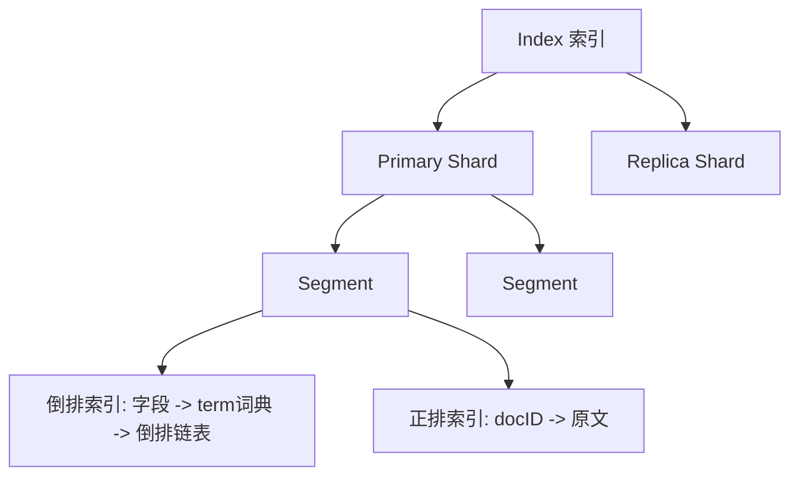

# Go APM 监控系统实战: Elasticsearch 原理与倒排索引

## 纲要

- ES 定位：天然分布式、可水平扩展、近乎实时的搜索引擎，适合海量日志的存储与检索
- 写入模型：文档写入先落主分片，再复制到其他分片，确认后返回客户端
- 数据模型层级：索引（Index）→ 分片（Shard，含主 / 副）→ 段（Segment）
- 段内核心：每个字段一份倒排索引，由前缀树 + term 词典 + 倒排链表组成
- 正排索引：按文档 ID 存原文，用于命中倒排后取回完整文档
- 与 MySQL B+ 树的本质区别：ES 一个分片内含多个可并行搜索的 Segment，能利用多核

## 素材索引



## Elasticsearch 是什么

Elasticsearch（下文简称 ES）官方定义是一个**天然分布式、可水平扩展、搜索近乎实时**的搜索引擎。它有三点关键特性：

1. **分布式 + 易扩展**：一份数据会被切成多个分片（Shard），分片可以落在不同节点上；想扩容就加节点，ES 会自动把部分分片迁移过去。因此哪怕日志量再大，只要分片数足够，存储就不是问题。
2. **近乎实时（NRT）**：数据写入后默认约 1 秒才可被搜索到，这跟它的刷新（refresh）机制有关。需要 100% 实时一致性的场景（如交易），更适合用 MySQL 这类关系型库。日志分析恰好是「看最近一段时间」的近实时场景，ES 非常合适。
3. **适合两类问题**：一是复杂多字段条件的搜索（MySQL 的 B+ 树索引要求查询条件都在索引列内，条件一多索引会膨胀甚至超过全表扫描开销，而 ES 能快速合并多个字段的查询结果）；二是**日志分析**——日志量大且有时效性，ES 可用冷热分离 + 索引生命周期策略解决，并支持按日志任意字段检索。

## 写入过程与分片

ES 把数据拆成多个分片，分片分**主分片（Primary）**和**副分片（Replica）**。写入时：

1. 先写主分片；
2. 主分片把数据复制到其他副分片所在节点；
3. 汇总「主分片成功多少、副分片成功多少」回给客户端。

## 段（Segment）与数据模型

进入单个分片内部看数据模型。写入的一行数据叫**文档（Document）**，文档带若干属性（如 `name`、`school`）。分片里包含多个 **Segment**，每个 Segment 只存该分片的一部分数据。搜索时是**并发搜索该分片下所有 Segment**，能充分利用 CPU 多核——这正是 ES 检索快的原因，而 MySQL 的 B+ 树只能单线程顺序搜。

每个 Segment 内部结构是：每个字段维护一份**倒排索引**。

## 倒排索引的内部结构

以 `name` 字段为例，倒排索引由三部分组成：

- **term 词典（Term Dictionary）**：存放所有词项（term），如「小红」「小蓝」各是一个 term；
- **前缀树（Trie）**：term 太多放内存不现实，前缀树占用极小内存，且能加速定位 term 在词典中的位置（如「小红」「小蓝」共享前缀「小」，从父节点「小」往下即可定位）；
- **倒排链表（Posting List）**：每个 term 对应一个倒排链表，存的是**包含该 term 的文档 ID 列表**，以及词频等信息。

查询时，先经前缀树定位 term，取出其倒排链表得到文档 ID 集合；多个字段的查询结果以**位图求交 / 并**快速合并，得到最终文档 ID 列表。

拿到文档 ID 列表后，再经**正排索引**（按 `docID → 文档内容` 存储）取回完整文档。一句话区分：

- 倒排索引：`字段值 → 符合条件的文档 ID 列表`（用于搜）；
- 正排索引：`文档 ID → 完整内容`（用于取回）。

## 用 Go 实现一个迷你倒排索引

下面用纯 Go 实现上述「term → 文档 ID 集合」的建索引与查询，不依赖任何外部组件（根据讲稿逻辑补充，用于直观理解倒排链表与求交）：

```go
// invert/invert.go —— 根据讲稿逻辑补充（自包含可运行）
package main

import (
	"fmt"
	"sort"
)

// InvertedIndex 字段值 -> 文档ID集合
type InvertedIndex struct {
	m map[string]map[int]struct{}
}

func NewInvertedIndex() *InvertedIndex {
	return &InvertedIndex{m: make(map[string]map[int]struct{})}
}

// Add 把某个 term 关联到文档ID
func (idx *InvertedIndex) Add(term string, docID int) {
	if idx.m[term] == nil {
		idx.m[term] = make(map[int]struct{})
	}
	idx.m[term][docID] = struct{}{}
}

// Search 返回命中的文档ID（求交集）
func (idx *InvertedIndex) Search(terms ...string) []int {
	if len(terms) == 0 {
		return nil
	}
	var result map[int]struct{}
	for _, t := range terms {
		set := idx.m[t]
		if result == nil {
			result = make(map[int]struct{})
			for k := range set {
				result[k] = struct{}{}
			}
			continue
		}
		// 与已有权集合求交
		for k := range result {
			if _, ok := set[k]; !ok {
				delete(result, k)
			}
		}
	}
	out := make([]int, 0, len(result))
	for k := range result {
		out = append(out, k)
	}
	sort.Ints(out)
	return out
}

func main() {
	idx := NewInvertedIndex()
	idx.Add("小红", 1)
	idx.Add("小红", 3)
	idx.Add("小蓝", 1)
	idx.Add("小蓝", 2)

	fmt.Println("小红且小蓝:", idx.Search("小红", "小蓝")) // [1]
	fmt.Println("仅小红:", idx.Search("小红"))            // [1 3]
}
```

运行 `go run invert/invert.go` 会输出「小红且小蓝: [1]」「仅小红: [1 3]」，正是倒排链表求交的过程。

## 技术点总结

- ES = 分布式 + 近实时 + 易扩展，天然适合日志存储检索
- 写入走主分片再复制副分片；分片 → Segment 两级拆分
- 段内每个字段一份倒排索引（前缀树 + term 词典 + 倒排链表），多段可并行搜，利用多核
- 倒排索引用于「按字段搜文档 ID」，正排索引用于「按 ID 取原文」
- 复杂多字段检索是 ES 相对 MySQL 的核心优势

相关度：90%。是否需要继续：[是]。代码是否可运行：[是]。
