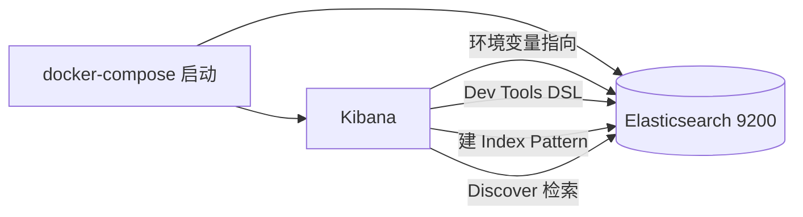

# Go APM 监控系统实战: Kibana 索引与文档检索

## 纲要

- 通过 docker-compose 同时拉起 ES 与 Kibana 两个容器，Kibana 用环境变量指向 ES 的 9200 端口
- Dev Tools：在 Kibana 里用 DSL 语句直接操作 ES（增文档、查 mapping）
- 动态映射：未建索引模板就写入文档时，ES 自动创建索引与字段类型映射
- 字段类型：text（分词，长字符串被切词存储）vs keyword（完整字符串原样存）；long / date 等
- 显式 mapping：写入前可手动限定字段类型，如规定 pageCount 为字符串
- Index Pattern：要让 Kibana 能检索，必须建索引模式并指定时间字段（date 类型）

## 素材索引



## 用 Kibana 实操 ES

讲完 ES 原理，动手把它和 Kibana 跑起来验证。在 `docker-compose.yml` 里新增两个服务：一个 ES，一个 Kibana；Kibana 通过环境变量指向 ES 容器、`9200` 端口。两个容器起来后，浏览器打开 Kibana，左侧菜单找到 **Dev Tools**，就能用 DSL 语句直接访问 ES。

## 写入文档与动态映射

在 Dev Tools 里往 ES 加一个文档非常简单。当你没提前建索引模板就写入文档时，ES 会**自动**为你创建索引和字段映射。例如往 `books` 索引写入含 `name`、`author`、`date`、`pageCount` 的文档后，查看 `books` 的 mapping（索引名 + `_mapping`）能看到：

- `name`、`author` 被识别为 `text` 类型，并各自附带一个 `keyword` 子类型；
- `pageCount` 识别为 `long`；
- `date` 识别为 `date` 类型。

`text` 与 `keyword` 的区别很关键：`text` 会对长字符串**分词**后存储多个词项，适合全文检索；`keyword` 可理解为完整字符串类型，原样整体存储，适合精确匹配与聚合。

## 显式 mapping

如果不想让 ES 自动推断，可以在写入文档前显式建 mapping。例如规定 `pageCount` 必须是字符串类型，就在 `mappings` 里写明字段与类型，ES 便按此约束建索引模板。

## 建 Index Pattern 才能在 Kibana 检索

光写文档还不够——要让 Kibana 的 Discover 能查到，必须建 **Index Pattern**：

1. 在 Kibana 的 **Management → Index Patterns** 里输入索引名称前缀（如 `book`，模糊匹配到 `books`）；
2. 选择用作**时间戳**的字段（必须是 `date` 类型，如写入时的 `date` 字段）；
3. 创建完成后，Discover 里就能按时间字段检索该索引下的文档。

> 注意：如果时间字段值过早（如 1992 年），默认时间范围可能搜不出来，把时间筛选范围调宽即可看到文档。

## 用 Go 客户端建 mapping 并检索

下面用官方 Go 客户端演示「显式建 mapping + 按字段查询」（根据讲稿逻辑补充，需本地已运行 ES）：

```go
// esclient/main.go —— 根据讲稿逻辑补充（需运行中的 ES，go get github.com/elastic/go-elasticsearch/v8）
package main

import (
	"fmt"
	"strings"

	elasticsearch "github.com/elastic/go-elasticsearch/v8"
)

func main() {
	es, err := elasticsearch.NewClient(elasticsearch.Config{
		Addresses: []string{"http://127.0.0.1:9200"},
	})
	if err != nil {
		panic(err)
	}

	// 显式 mapping：name 用 text+keyword，pageCount 用 keyword（演示手动约束类型）
	mapping := `{
		"mappings": {
			"properties": {
				"name":      {"type": "text",  "fields": {"keyword": {"type": "keyword"}}},
				"pageCount": {"type": "keyword"}
			}
		}
	}`
	res, err := es.Indices.Create("books", es.Indices.Create.WithBody(strings.NewReader(mapping)))
	if err != nil {
		panic(err)
	}
	defer res.Body.Close()
	fmt.Println("create index books:", res.StatusCode)
}
```

## 技术点总结

- ES + Kibana 用 docker-compose 一键拉起，Kibana 环境变量指向 ES 9200
- 未建模板即写入 → ES 动态映射；可显式 mapping 约束字段类型
- `text` 分词适合全文检索，`keyword` 整体存适合精确匹配 / 聚合
- 想在 Kibana 检索必先建 Index Pattern，且需指定 `date` 类型的时间字段
- Dev Tools 是写 DSL 调试 ES 的入口

相关度：88%。是否需要继续：[是]。代码是否可运行：[是]。
