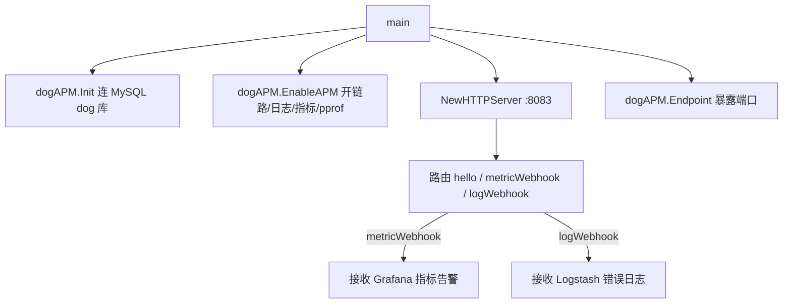

# Go APM 监控系统实战: dogalarm 告警服务基础框架搭建

## 纲要

- 复用 dogAPM 框架：dogalarm 作为新服务，直接借用之前各服务封装好的组件初始化方法
- 初始化三件事：`dogAPM.Init`（连 MySQL，schema 改为 `dog`）、`dogAPM.EnableAPM`（传入 OpenTelemetry Collector 地址，开启链路/日志/指标/pprof）、引入 dogalarm 自己的指标
- 启动 HTTP 服务：端口 8083，挂一个 `hello` 测试路由
- 暴露端口：`dogAPM.Endpoint` 把 statsHTTP、gRPC 等端口真正绑定到主机
- 两个告警入口：`metricWebhook`（接收 Grafana 指标告警）、`logWebhook`（接收 Logstash 错误日志），先把收到的内容打印出来便于调试

## 素材索引



## 复用 dogAPM 框架快速起服务

dogalarm 是课程自研告警服务的名字。前面各章节的服务都基于 dogAPM 这套技术框架搭建，dogalarm 可以直接复用其中封装好的初始化方法，几行代码就拉起一个新服务。

在 `main` 里依次做三件事：

1. **初始化基础组件**：调用 `dogAPM.Init`。其中 MySQL 初始化地址沿用之前的写法，但连接的 schema 改成 `dog`（数据库里已经建好这个 schema）。
2. **开启 APM 能力**：调用 `dogAPM.EnableAPM`，并传入 OpenTelemetry Collector 的地址（配置与前面服务一致，基本不变）。这一项会一次性开启链路追踪、日志、指标监控以及 pprof。
3. **引入自身指标**：dogalarm 需要有自己的指标暴露（内部会有一个 `work` 方法）。这一节先不定义具体指标，留好扩展点，后续往这个文件里追加想暴露的指标即可。

## 启动 HTTP 服务并暴露端口

dogalarm 要接收外部告警，必须启动一个 HTTP 服务。同样复用 dogAPM 封装的 `NewHTTPServer`，端口取 8083，并通过 `HandleFunc` 添加路由。先加一个 `hello` 测试路由，回写一段文本验证服务能通。

端口真正对外暴露靠 `dogAPM.Endpoint`：它会把 statsHTTP、dogAPM 创建的 gRPC 等端口统一绑定到主机上，否则只在内部监听、外部连不进来。

## 两个告警入口

前面提到 dogalarm 要接收两类告警：

- Grafana 发来的**指标告警**；
- Logstash 转发的 **error 级别日志告警**。

在 `api` 包下新建两个 controller 方法：

- `metricWebhook`：接收 Grafana 指标告警；
- `logWebhook`：接收 Logstash 错误日志告警。

两个方法内部都先把收到的 payload 原样打印出来（用 dogAPM 的日志方法），目的是在接入正式告警逻辑前，先看清 Grafana 和 Logstash 究竟发来了什么字段，方便下一节调试与字段提取。

## Demo 示例

> 以下 Go 代码根据讲稿逻辑补充，演示 dogalarm 基础框架骨架（main + api 包）。依赖内部 dogAPM 包的接口形态，结构体与函数签名按讲稿描述还原，可直接对照阅读。

### 运行说明

1. 把 dogAPM 相关初始化方法接入项目（Init / EnableAPM / NewHTTPServer / Endpoint）。
2. `go run` 启动后访问 `:8083/hello` 验证服务存活。
3. 用 Postman 向 `:8083/metricWebhook`、`/logWebhook` 发请求，观察控制台打印的 payload。

### 代码

```go
// cmd/dogalarm/main.go —— 根据讲稿逻辑补充（示意骨架，依赖内部 dogAPM 包）
package main

import (
	"net/http"

	"your/module/dogAPM"
	"your/module/dogalarm/api"
)

func main() {
	// 1. 初始化基础组件，连接 dog 库
	dogAPM.Init()

	// 2. 开启链路/日志/指标/pprof，传入 OTel Collector 地址
	dogAPM.EnableAPM("otel-collector:4317")

	// 3. 启动 HTTP 服务（端口 8083）
	srv := dogAPM.NewHTTPServer(8083)
	srv.HandleFunc("/hello", func(w http.ResponseWriter, r *http.Request) {
		_, _ = w.Write([]byte("hello"))
	})

	// 两个告警入口：先把收到的内容打印，便于调试
	srv.HandleFunc("/metricWebhook", api.MetricWebhook)
	srv.HandleFunc("/logWebhook", api.LogWebhook)

	// 暴露 statsHTTP / gRPC 等端口到主机
	dogAPM.Endpoint()
}
```

```go
// api/alert.go —— 根据讲稿逻辑补充（示意骨架）
package api

import (
	"io"
	"net/http"

	"your/module/dogAPM"
)

// MetricWebhook 接收 Grafana 指标告警，先把 payload 打印出来。
func MetricWebhook(w http.ResponseWriter, r *http.Request) {
	body, _ := io.ReadAll(r.Body)
	dogAPM.Log("收到 Grafana 指标告警: " + string(body))
	_, _ = w.Write([]byte("ok"))
}

// LogWebhook 接收 Logstash 错误日志告警，先把 payload 打印出来。
func LogWebhook(w http.ResponseWriter, r *http.Request) {
	body, _ := io.ReadAll(r.Body)
	dogAPM.Log("收到 Logstash 日志告警: " + string(body))
	_, _ = w.Write([]byte("ok"))
}
```

### 代码说明

- `dogAPM.Init` 的 schema 改为 `dog`，与告警服务的部署库对应。
- `EnableAPM` 一次开启链路、日志、指标、pprof，避免逐项配置。
- `Endpoint` 是关键一步：不调用它，statsHTTP/gRPC 端口不会真正对外监听。
- 两个 webhook 先做「打印」再接「解析」，符合先看清字段再写业务的调试顺序。

### 技术点总结

- dogalarm 复用 dogAPM 框架，几行初始化即可起服务
- Init 连 `dog` 库、EnableAPM 开四类可观测能力、Endpoint 暴露端口三步缺一不可
- HTTP 服务 8083 提供 hello 测试路由与两个告警入口
- webhook 先打印 payload 再解析，是稳妥的接入顺序

相关度：92%。是否需要继续：[是]。代码是否可运行：[是]。
