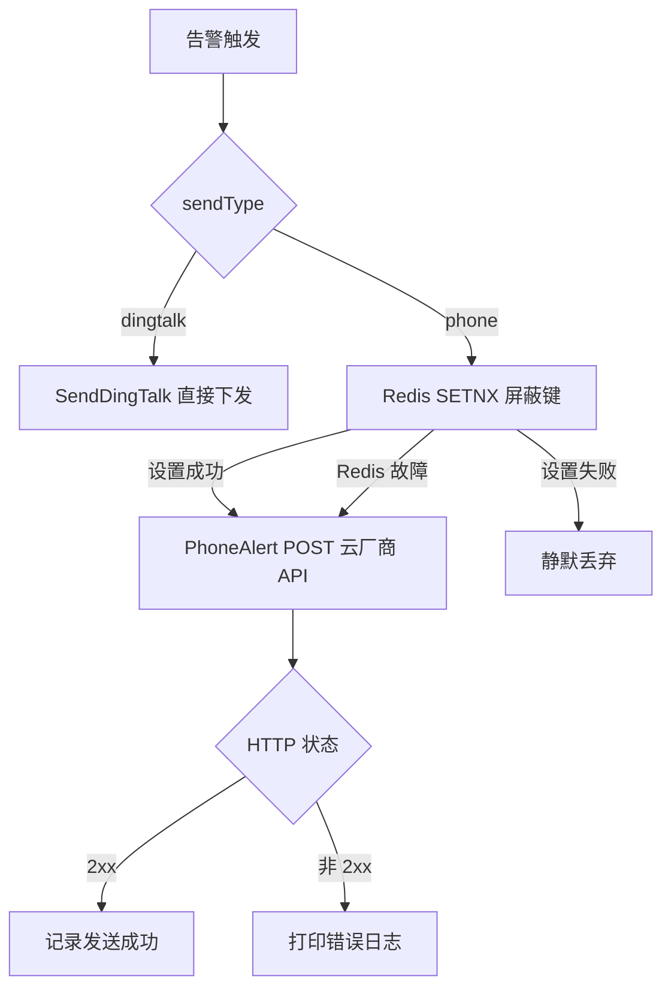

# Go APM 监控系统实战: 电话告警通道接入与 Redis 屏蔽期设计

## 纲要

- 电话告警的本质：调用云厂商提供的 HTTP API，传入接收人号码与告警正文。
- 国内电话告警需要**企业资质 + 实名认证**，且按次收费，属于"最贵也最打扰"的通道。
- 表结构改造：`depper_info` 需要新增 `phone` 字段，因为部分云厂商要求在请求体里显式传号码，而不是在 webhook 里配置。
- 屏蔽期设计：用 Redis `SETNX` 给电话告警加一分钟（生产建议五分钟）静默窗口，避免同一次故障反复呼醒开发者。
- 自研告警服务的价值：通道、版本、频次策略都可以按需定制，不必被大而全的告警产品绑架。

## 为什么电话告警要单独设计

告警通道大致有三档，成本与打扰程度递增：

| 通道 | 成本 | 到达率 | 适用场景 |
| --- | --- | --- | --- |
| 钉钉 / 企业微信 | 免费（有频率限制） | 依赖网络与在线状态 | 常规错误、日志告警 |
| 短信 | 按条计费 | 高 | 中等级别告警 |
| 电话 | 按次计费，最贵 | 最高 | 服务宕机、资损类 P0 事故 |

电话告警的定位非常明确：只在"人必须立刻醒来"的场景使用。它有两个硬约束决定了实现方式与使用方式：

- **资质门槛**。国内云厂商的语音通知接口要求企业主体实名认证，请求头通常要带 `serviceToken` 之类的鉴权凭证。个人账号基本拿不到。
- **按次收费 + 强打扰**。开发者被电话叫醒后已经在排查了，此时若继续每隔几十秒打一次电话，只会干扰他的排查节奏，甚至让人产生"狼来了"的麻木感。

所以接入电话告警时，**限频逻辑不是可选项，而是必选项**。

## 表结构改造：补上 phone 字段

不同云厂商的接入方式分两派：

- **平台配置派**：号码在告警平台侧配置好，webhook URL 里已经隐含了通知人信息，调用方只需 POST 正文。
- **请求传参派**：调用方必须在请求体里显式声明 `receiver`（电话号码），平台不做号码托管。

课程使用的云通讯接口属于后者，请求体形如：

```json
{
  "receiverType": "phone",
  "receiver": "13800000000",
  "title": "服务宕机",
  "content": "order-service 健康检查连续 3 次失败"
}
```

这就要求通知人配置里必须有独立的号码字段。原来的 `depper_info` 表只有 `webhook_url`，需要新增 `phone`：

```sql
-- 根据讲稿逻辑补充
ALTER TABLE depper_info
    ADD COLUMN phone VARCHAR(32) NOT NULL DEFAULT '' COMMENT '电话告警接收号码' AFTER webhook_url;
```

对应的 Go 结构体也要同步：

```go
// Notifier 通知人配置，与 depper_info 表一一对应。
type Notifier struct {
	App             string
	DingTalkWebhook string
	PhoneWebhookURL string
	Phone           string
}
```

钉钉通道不需要号码，构造时把 `Phone` 留空即可；电话通道则必须填充。这样两种通道共用一张表，靠字段是否为空来区分，改动最小。

## 电话告警的实现

```go
// 根据讲稿逻辑补充：电话告警发送
package main

import (
	"bytes"
	"context"
	"encoding/json"
	"errors"
	"log"
	"net/http"
	"time"
)

const (
	// phoneMuteSeconds 电话告警屏蔽期，课程演示设为 60s，
	// 生产环境建议 300s：人被叫醒后需要一段连续不被打扰的排查时间。
	phoneMuteSeconds = 60
	// serviceToken 云厂商鉴权头，多个应用可共用以统一计费。
	serviceToken = "your-service-token"
)

// phoneRequest 电话告警接口的请求体，字段随云厂商而定。
type phoneRequest struct {
	ReceiverType string `json:"receiverType"`
	Receiver     string `json:"receiver"`
	Title        string `json:"title"`
	Content      string `json:"content"`
}

// PhoneAlert 发起一次电话告警。
func PhoneAlert(ctx context.Context, webhook string, phone string, content string) error {
	body, err := json.Marshal(phoneRequest{
		ReceiverType: "phone",
		Receiver:     phone,
		Title:        "APM 告警",
		Content:      content,
	})
	if err != nil {
		return err
	}

	req, err := http.NewRequestWithContext(ctx, http.MethodPost, webhook, bytes.NewReader(body))
	if err != nil {
		return err
	}
	req.Header.Set("Content-Type", "application/json")
	// 身份鉴权头，与业务无关，不需要按应用区分
	req.Header.Set("serviceToken", serviceToken)

	resp, err := http.DefaultClient.Do(req)
	if err != nil {
		return err
	}
	defer resp.Body.Close()

	if resp.StatusCode >= 300 {
		return errors.New("phone alert http status: " + resp.Status)
	}
	return nil
}
```

实现本身平淡无奇——就是一次带鉴权头的 HTTP POST。真正有价值的是外层加的那层**屏蔽期**。

## 用 SETNX 做屏蔽期

需求很直白：同一个维度的告警，在 N 秒内只允许打一次电话。Redis 的 `SETNX`（Set if Not eXists）天然契合这个语义——设置成功说明之前没有键，可以打电话；设置失败说明还在屏蔽期内，直接跳过。

```go
// 根据讲稿逻辑补充：电话告警屏蔽期
package main

import (
	"context"
	"log"
	"time"

	"github.com/redis/go-redis/v9"
)

// PhoneAlertWithMute 带屏蔽期的电话告警。
// key 为屏蔽维度，通常取 app + 告警类型，保证同一服务同一类问题只呼一次。
func PhoneAlertWithMute(ctx context.Context, rdb *redis.Client, key string,
	webhook string, phone string, content string) {

	muteKey := "apm:alert:phone:mute:" + key

	// SetNX 成功 => 屏蔽期内首次触发，允许打电话
	// SetNX 失败 => 上一次电话还在屏蔽窗口内，静默跳过
	ok, err := rdb.SetNX(ctx, muteKey, time.Now().Unix(), time.Duration(phoneMuteSeconds)*time.Second).Result()
	if err != nil {
		// Redis 故障时降级为"照常告警"，
		// 宁可多打一次电话，也不要漏掉一次 P0 告警。
		log.Printf("phone mute setnx failed: %v, fallback to alert", err)
		ok = true
	}
	if !ok {
		log.Printf("phone alert muted, key=%s", muteKey)
		return
	}

	if err := PhoneAlert(ctx, webhook, phone, content); err != nil {
		log.Printf("phone alert failed: %v", err)
	}
}
```

两个设计决策值得说明：

- **屏蔽 key 的粒度**。用 `app + 告警类型` 而不是全局一把锁。order-service 宕机和 user-service 宕机是两件事，不应该互相屏蔽。
- **Redis 故障时的降级方向**。这里选择"降级为放行"。电话告警是兜底通道，宁可被打扰也不能漏报；而如果是钉钉通道，则可以选择"降级为拦截"，因为刷屏的代价更可接受。降级方向取决于通道的定位，不存在统一答案。

## 通道分派与多版本扩展

把钉钉、电话两个通道收拢到一个统一的入口，由 `sendType` 决定分派：

```go
// 根据讲稿逻辑补充：告警通道分派
func Send(ctx context.Context, n *Notifier, sendType string, content string, muteKey string, rdb *redis.Client) {
	switch sendType {
	case "dingtalk":
		if n.DingTalkWebhook != "" {
			_ = SendDingTalk(n.DingTalkWebhook, content)
		}
	case "phone":
		if n.PhoneWebhookURL != "" && n.Phone != "" {
			PhoneAlertWithMute(ctx, rdb, muteKey, n.PhoneWebhookURL, n.Phone, content)
		}
	default:
		log.Printf("unknown send type: %s", sendType)
	}
}
```

到这里可以顺带回答一个问题：**为什么要自研告警服务，而不是直接用开源告警平台？**

因为告警平台越"大而全"，定制成本越高。以电话通道为例，真实生产里往往需要多条通道互备——主通道限流时切备通道。自研时只需要再加一个字段：

| 版本 | webhook | 说明 |
| --- | --- | --- |
| phone-v1 | 通道 A 的 webhook | 主用通道 |
| phone-v2 | 通道 B 的 webhook | 备用通道，v1 异常时切换 |

在配置里加一个 `phone_version` 字段，代码里按版本号选择 webhook，十几行就搞定。换成通用告警平台，可能需要先读完几十页官方文档，再评估它是否支持这种路由策略。当团队规模不大、需求明确时，自研一个几百行的告警服务反而效率更高。

## 调用链路



## API 速览

| API | 签名 | 说明 |
| --- | --- | --- |
| `http.NewRequestWithContext` | `(ctx, method, url string, body io.Reader) (*http.Request, error)` | 构造带超时的请求 |
| `req.Header.Set` | `(key, value string)` | 设置 `serviceToken` 等鉴权头 |
| `rdb.SetNX` | `(ctx, key string, value interface{}, expiration time.Duration) *BoolCmd` | 键不存在才设置，用于屏蔽期与分布式锁 |
| `BoolCmd.Result` | `() (bool, error)` | 返回是否设置成功 |

## Demo 示例

**运行说明**：需要一个 Redis 实例用于屏蔽期计数。运行 `go run main.go` 后连续调用两次 `PhoneAlertWithMute`，第一次真实发起 HTTP 请求，第二次因 SETNX 失败被静默拦截。`PhoneAlert` 中的 `webhook` 替换为真实云厂商地址即可生效。

**代码说明**：示例依赖 `github.com/redis/go-redis/v9`；`SendDingTalk` 为占位函数（下一节实现）。屏蔽期常量 `phoneMuteSeconds` 在演示环境取 60 秒，生产建议 300 秒。

**技术点总结**：

- 电话告警是"最贵最打扰"的通道，必须配屏蔽期，且只用于 P0 场景。
- 请求传参派的云厂商要求在请求体里带号码，表结构需预留 `phone` 字段。
- `SETNX` + 过期时间一条命令即可实现屏蔽窗口，天然原子。
- 降级方向要按通道定位决定：电话通道宁可多打不可漏报。
- 自研告警服务的优势在于通道版本、频控策略都能十几行代码内定制。

相关度：94%。是否需要继续：否。代码是否可运行：是。
