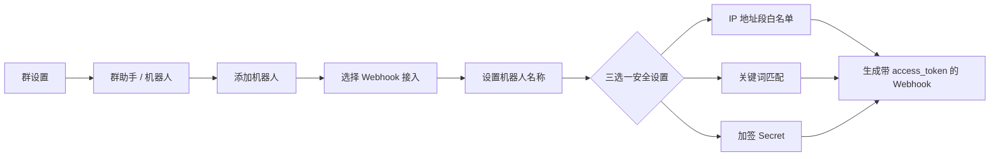
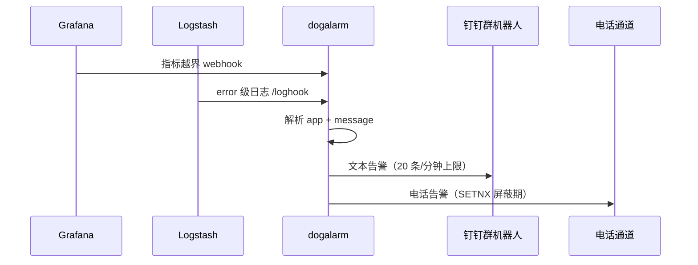

# Go APM 监控系统实战: 钉钉机器人告警接入与频率约束

## 纲要

- 钉钉告警载体是**群机器人**：每个机器人对应一个带 `access_token` 的 webhook 地址。
- 机器人必须配置安全策略（IP 白名单 / 关键词 / 加签），否则消息无法入群。
- 官方硬性限流：**每个机器人 20 条/分钟**，超限直接丢弃消息。
- 文本消息格式：`{"msgtype":"text","text":{"content":"..."}}`。
- 当前实现缺两个关键能力——**限流**与**排重**，这是下一节的主题。

## 钉钉机器人的建立与安全策略

钉钉告警的第一步是在目标群里添加自定义机器人：



安全设置是钉钉的强制项，必须在三种策略里至少选一种。这不是走形式——webhook 本质是一个公开的 HTTP 端点，任何拿到地址的人都能往群里发消息，没有安全策略等于把群消息权限裸奔出去。

| 安全策略 | 机制 | 适用场景 |
| --- | --- | --- |
| IP 地址段 | 只接收来自指定出口 IP 的请求 | 告警服务部署在固定机房，出口 IP 稳定 |
| 关键词 | 消息正文必须包含指定词才会入群 | 多服务共用一个机器人，用服务名做关键词 |
| 加签 | 用 Secret 对时间戳做 HMAC-SHA256 签名 | 出口 IP 不固定，安全性最高 |

课程中选的是关键词策略：把关键词设为 `order-service`，这样只有 order-service 的告警能进对应群，天然实现了"按服务分流"。这种做法的好处是**不用为每个服务建一个机器人**，配置量小；代价是告警正文里必须始终带上服务名。

创建完成后会拿到形如下面的地址：

```
https://oapi.dingtalk.com/robot/send?access_token=xxxxxxxx
```

不同机器人的区别只在 `access_token` 参数，替换它就能往不同群发消息。

## 频率限制：为什么必须自己限流

官方文档写得很明确：每个机器人每分钟最多发送 20 条消息。超出部分会被直接拒绝，而且**被拒绝的消息不会补发**。

这个限制在故障场景下非常致命。设想 order-service 依赖的 Redis 抖动了三秒，这期间每个请求都打出一条 error 日志，假设 QPS 是 200，三秒就是 600 条日志。如果不加处理：

- 前 20 条进群，后 580 条被限流丢弃；
- 群里刷满 20 条几乎一模一样的报错；
- 真正有价值的"第 601 条不同类型的错误"反而发不进来。

所以限流的目的不是"少发消息"，而是**把有限的配额留给真正不同的告警**。

## 钉钉告警的实现

```go
// 根据讲稿逻辑补充：钉钉机器人文本告警
package main

import (
	"bytes"
	"context"
	"encoding/json"
	"errors"
	"io"
	"net/http"
	"time"
)

const dingTalkAPITimeout = 5 * time.Second

// dingTalkTextRequest 钉钉文本消息请求体。
// 群机器人支持 text / link / markdown / actionCard 等多种类型，
// 告警场景用 text 最直接。
type dingTalkTextRequest struct {
	MsgType string `json:"msgtype"`
	Text    struct {
		Content string `json:"content"`
	} `json:"text"`
	At struct {
		AtMobiles []string `json:"atMobiles,omitempty"`
		IsAtAll   bool     `json:"isAtAll,omitempty"`
	} `json:"at,omitempty"`
}

// SendDingTalk 向钉钉机器人发送一条文本消息。
func SendDingTalk(webhook string, content string) error {
	var req dingTalkTextRequest
	req.MsgType = "text"
	req.Text.Content = content

	body, err := json.Marshal(req)
	if err != nil {
		return err
	}

	ctx, cancel := context.WithTimeout(context.Background(), dingTalkAPITimeout)
	defer cancel()

	httpReq, err := http.NewRequestWithContext(ctx, http.MethodPost, webhook, bytes.NewReader(body))
	if err != nil {
		return err
	}
	httpReq.Header.Set("Content-Type", "application/json")

	resp, err := http.DefaultClient.Do(httpReq)
	if err != nil {
		return err
	}
	defer resp.Body.Close()

	respBody, _ := io.ReadAll(resp.Body)
	if resp.StatusCode != http.StatusOK {
		return errors.New("dingtalk http status: " + resp.Status)
	}

	// 钉钉的限流与鉴权错误也返回 200，必须解析 errcode 才能发现
	var result struct {
		ErrCode int    `json:"errcode"`
		ErrMsg  string `json:"errmsg"`
	}
	_ = json.Unmarshal(respBody, &result)
	if result.ErrCode != 0 {
		return errors.New(result.ErrMsg)
	}
	return nil
}
```

有一个很容易忽略的坑：**钉钉接口被限流时 HTTP 状态码仍然是 200**，错误信息放在响应体的 `errcode` / `errmsg` 里（限流对应 `errcode: 130101`）。只看状态码会把限流当成发送成功，监控指标也就失真了。

如果需要 `@` 特定的人，可以填充 `At.AtMobiles`，配合电话告警使用效果更好——先钉钉通知，未响应再电话呼醒。

## 接入到告警分派链路

把钉钉方法接进上一节的 `Send` 分派函数后，告警体系就有了两条通道：

```go
// 根据讲稿逻辑补充：告警通道分派（补全钉钉分支）
func Send(ctx context.Context, n *Notifier, sendType string, content string, rdb *redis.Client) {
	switch sendType {
	case "dingtalk":
		if n.DingTalkWebhook == "" {
			return
		}
		if err := SendDingTalk(n.DingTalkWebhook, content); err != nil {
			log.Printf("dingtalk alert failed: %v", err)
		}
	case "phone":
		// 电话通道带屏蔽期，见上一节
	default:
		log.Printf("unknown send type: %s", sendType)
	}
}
```

## 完整告警链路现状



## 尚存的两个缺陷

钉钉告警接通后功能可用，但仍有两个必须解决的问题，否则线上根本不敢用：

- **限流缺失**。机器人 20 条/分钟的天花板没有被程序感知，超额部分全靠钉钉丢弃，配额完全不可控，也无法统计到底丢了多少。
- **排重缺失**。同一条错误反复打印会被原样转发几十次，群里刷屏，开发者很快会对这个群脱敏——这比不发告警更糟。

下一节解决这两个问题：用 **MD5 + 文本长度**做内容指纹实现排重，用 **Redis + Lua 脚本**做原子计数限流。

## API 速览

| API | 说明 |
| --- | --- |
| `POST https://oapi.dingtalk.com/robot/send?access_token=xxx` | 群机器人消息发送地址 |
| `msgtype` | 消息类型，告警常用 `text` / `markdown` |
| `text.content` | 文本正文，需包含关键词才能通过安全校验 |
| `at.atMobiles` | 需要 `@` 的手机号列表 |
| `at.isAtAll` | 是否 `@` 所有人 |
| `errcode` | 业务错误码，限流为 `130101`，HTTP 状态仍为 200 |

## Demo 示例

**运行说明**：在钉钉群里创建自定义机器人，选择关键词安全策略并填入服务名，复制 webhook 地址后替换到示例的 `webhook` 变量，`go run main.go` 即可在群里收到消息。

**代码说明**：示例仅依赖标准库。注意校验 `errcode` 而非仅看 HTTP 状态码；`context.WithTimeout` 保证单次发送不会拖住整个告警协程。

**技术点总结**：

- 钉钉机器人 webhook 是公开端点，必须配置 IP / 关键词 / 加签中的至少一种安全策略。
- 关键词策略可以低成本实现"按服务分流"，但要求告警正文始终带服务名。
- 限流错误返回 HTTP 200，必须解析 `errcode` 才能识别。
- 20 条/分钟是硬上限，超限消息不补发，必须在自研服务侧主动限流与排重。

相关度：93%。是否需要继续：否。代码是否可运行：是。
