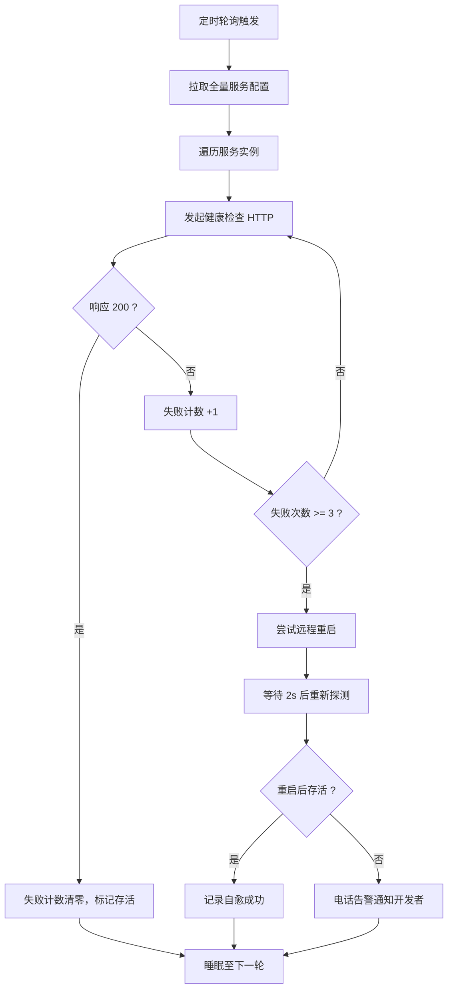

# Go APM 监控系统实战: 应用服务保活探测与健康检查探针设计

## 纲要

- 保活目标：dogalarm 定时轮询 order-service、sql-service、user-service 的健康状态。
- 配置驱动：`depper_info` 表存 app 名、逗号分隔的主机 IP、端口、健康检查路径。
- 健康检查接口放在**框架层统一注入**，而不是让每个业务模块各写一个 handler。
- 探针本体：后台协程跑无限循环，每轮拉全量服务配置，逐个发起 HTTP 探测。
- **重试机制是关键**：单次失败不告警，连续失败 N 次（默认 3 次）才判定宕机，避免网络抖动与自动恢复场景误报。
- 宕机属 P0 级，走电话告警通道。

## 配置表结构

`depper_info` 表承载服务的部署拓扑与通知配置，保活探测用到的核心字段：

| 字段 | 示例值 | 说明 |
| --- | --- | --- |
| `app` | `order-service` | 服务名，告警定位与分群的依据 |
| `hosts` | `192.168.1.10,192.168.1.11` | 服务部署的主机 IP，逗号分隔支持多实例 |
| `port` | `8080` | 服务监听端口 |
| `health_path` | `/hello` | 健康检查路径 |
| `dingtalk_webhook` | `https://oapi.dingtalk.com/...` | 钉钉机器人地址 |
| `phone_webhook` / `phone` | — | 电话告警通道配置 |

`hosts` 用逗号分隔而不是建关联表，是因为这套配置量级很小（几十个服务、每个服务几台机器），用字符串存储能让查询与配置都保持简单。规模再大时才考虑拆表。

## 健康检查接口放在哪一层

第一反应是在每个业务的 Controller 里加一个 `/hello`。这是个糟糕的设计：

- 每个新服务、每个新模块都要重复写一遍同样的 handler；
- 基础设施代码污染业务层，业务同学被迫感知监控框架的存在；
- 想统一改响应格式或加鉴权时要改 N 处。

正确做法是**在 HTTP server 这一层统一注册**：

```go
// 根据讲稿逻辑补充：在框架层统一注入健康检查 handler
package httpserver

import (
	"net/http"
)

// NewServer 构造 HTTP server，并统一注册健康检查路由。
// 健康检查属于基础设施能力，不应下沉到业务 Controller。
func NewServer(addr string, businessHandler http.Handler) *http.Server {
	mux := http.NewServeMux()

	// 框架层统一提供，所有接入的服务自动具备
	mux.HandleFunc("/hello", func(w http.ResponseWriter, r *http.Request) {
		w.Header().Set("Content-Type", "text/plain; charset=utf-8")
		w.WriteHeader(http.StatusOK)
		_, _ = w.Write([]byte("ok"))
	})

	// 业务路由挂在根路径下
	mux.Handle("/", businessHandler)

	return &http.Server{Addr: addr, Handler: mux}
}
```

这样每个接入 APM 的服务只要用了这个 server 封装，就自动拥有了 `/hello`，业务代码零改动。返回体用最简单的 `ok` 字符串即可——健康检查不需要返回 JSON，也不需要查库，它的唯一职责是证明"进程还活着且能处理 HTTP 请求"。

## 探针的实现

探针由三部分构成：常驻循环、单服务探测、带重试的单实例探测。

```go
// 根据讲稿逻辑补充：保活探针
package probe

import (
	"context"
	"log"
	"net/http"
	"strconv"
	"strings"
	"time"
)

const (
	// probeInterval 每轮探测的间隔，演示取 60s。
	// 生产环境建议缩短到 10~15s，一分钟的业务损失已经很长。
	probeInterval = 60 * time.Second
	// requestTimeout 单次健康检查的超时时间
	requestTimeout = 3 * time.Second
)

// ServiceInfo 一个服务的部署与健康检查配置。
type ServiceInfo struct {
	App        string
	Hosts      string
	Port       int
	HealthPath string
}

// Probe 保活探针。
type Probe struct {
	client *http.Client
	store  Store
	alert  Alerter
}

// Enable 启动探针，内部跑一个常驻协程。
func (p *Probe) Enable() {
	go func() {
		for {
			p.checkAll()
			time.Sleep(probeInterval)
		}
	}()
}

// checkAll 拉取全量服务配置并逐个探测。
// 服务数量少时同步遍历足够；规模变大可改为协程并发 + WaitGroup。
func (p *Probe) checkAll() {
	services, err := p.store.GetAll()
	if err != nil {
		log.Printf("probe: load services failed: %v", err)
		return
	}

	for _, svc := range services {
		for _, host := range strings.Split(svc.Hosts, ",") {
			host = strings.TrimSpace(host)
			if host == "" {
				continue
			}
			url := "http://" + host + ":" + strconv.Itoa(svc.Port) + svc.HealthPath
			// 连续失败 3 次才判定宕机
			p.checkAlive(svc.App, host, url, 3)
		}
	}
}
```

## 重试机制：为什么单次失败不能告警

这是保活探测里最重要的一个设计点。

如果探测失败就立刻告警，会有大量误报：

- **网络抖动**：一次 TCP 重传失败不代表服务不可用，下一秒可能就恢复了。
- **自动恢复机制**：生产环境普遍有守护脚本或 supervisor，检测到进程挂掉会自动拉起。这种"自己能好"的情况通知开发者纯属骚扰。
- **发布窗口**：滚动发布期间实例本来就会短暂不可用。

所以判定的正确姿势是**连续失败 N 次**。注意措辞是"连续"——只要中间有一次成功，失败计数就清零，重新开始累计。

```go
// 根据讲稿逻辑补充：带重试的单实例探测
// checkAlive 对单个实例发起 maxRetry 次探测。
// 只要其中任意一次成功，即认为实例存活并重置失败计数；
// 连续失败达到 maxRetry 次才触发告警。
func (p *Probe) checkAlive(app string, host string, url string, maxRetry int) {
	failCount := 0

	for i := 0; i < maxRetry; i++ {
		ctx, cancel := context.WithTimeout(context.Background(), requestTimeout)
		resp, err := p.client.Get(url)
		cancel()

		if err != nil || (resp != nil && resp.StatusCode != http.StatusOK) {
			failCount++
			if resp != nil {
				resp.Body.Close()
			}
			continue
		}

		resp.Body.Close()
		// 任意一次成功即判定存活
		failCount = 0
		break
	}

	if failCount == 0 {
		log.Printf("probe: %s on %s is alive", app, host)
		return
	}

	// 连续失败，判定宕机，走电话告警通道
	content := "服务宕机告警\n服务: " + app + "\n主机: " + host + "\n地址: " + url
	p.alert.Phone(app, host, content)
	log.Printf("probe: %s on %s is down, alert sent", app, host)
}
```

几个实现细节：

- **响应体必须关闭**。否则每次探测都泄漏一个连接，探针跑几小时就会把文件描述符耗尽。这一条在循环里尤其致命。
- **失败判定包含两层**：`err != nil`（连接层失败）或 `StatusCode != 200`（进程活着但状态异常）。后者同样需要告警，比如服务陷入死锁时端口还在监听但已经无法响应。
- **`context.WithTimeout` 的 cancel 要及时调用**。虽然这里用的是 `client.Get` 不带 ctx 的简化形式，实际项目应当用 `NewRequestWithContext` 保证单次探测不会拖垮整轮循环。

## 演进方向：从告警到自愈

当前实现只是"发现宕机并通知人"。更完善的运营系统会往前走一步：**检测到失败后先尝试自动重启，重启后再次探测，仍然失败才通知人**。



这样可以把大量"进程崩了但能自动拉起"的情况消化在系统内部，开发者只需要在真正需要人介入时被叫醒。下一节就来实现这条自愈链路。

## 调试过程中的一个真实报错

首次跑通探针时遇到了 `panic`：`depper_info` 表里该服务的 `phone_webhook` 等字段还是空的，代码直接取用导致空指针。这暴露了一个通用问题——**配置驱动的组件必须容忍配置不完整**。

完善的做法是探测前校验配置，缺失则跳过并打日志，而不是让整个探针协程崩掉。一个 panic 会让常驻协程直接退出，之后所有服务的保活探测全部静默失效，这比漏掉一个服务严重得多。

## API 速览

| API | 签名 | 说明 |
| --- | --- | --- |
| `http.NewServeMux` | `() *ServeMux` | 路由多路复用器，用于框架层统一注入 `/hello` |
| `http.Client.Get` | `(url string) (*http.Response, error)` | 发起健康检查请求 |
| `resp.Body.Close` | `()` | 必须关闭，否则连接与 FD 泄漏 |
| `strings.Split` | `(s, sep string) []string` | 拆分逗号分隔的 hosts 配置 |
| `context.WithTimeout` | `(parent Context, d Duration) (Context, CancelFunc)` | 单次探测超时控制 |

## Demo 示例

**运行说明**：`go run .` 启动后，探针协程每 60 秒拉一次配置并探测。把某个服务停掉，可以观察到连续三次失败后触发告警回调；重启该服务后下一轮探测恢复存活状态，失败计数清零。

**代码说明**：示例为标准库实现。真实项目中 `Store.GetAll` 对应查询 `depper_info` 表，`Alerter.Phone` 对应前面实现的电话告警通道（含 Redis 屏蔽期）。演示时把 `probeInterval` 调小到 5 秒便于观察。

**技术点总结**：

- 健康检查接口属于基础设施，应在框架层统一注入，避免污染业务代码。
- 保活判定必须带重试，单次失败告警会产生大量误报；任意一次成功即清零"连续"失败计数。
- 失败判定要同时覆盖连接错误与非 200 状态码。
- 循环探测中 `resp.Body.Close()` 不可省略，否则 FD 泄漏。
- 配置驱动的组件必须容忍配置缺失，绝不能让常驻协程 panic 退出。
- 宕机是 P0 事件，走电话通道；但更完善的做法是重启自愈后再决定是否通知人。

相关度：95%。是否需要继续：否。代码是否可运行：是。
