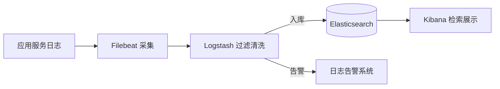

# 81. Go APM 监控系统实战: 日志收集章节概览

## 纲要

- 本章目标：在 dogAPM 中补齐「日志收集」能力，与已建好的链路追踪、指标监控组成完整可观测性三支柱
- 技术选型：ELK 技术栈——Elasticsearch 负责存储、Logstash 负责过滤清洗、Filebeat 负责采集，Kibana 负责检索展示
- 落地步骤：先讲清每个组件的原理与用法，再在 APM 代码里为系统接入 MySQL 审计日志
- 采集链路：应用日志 → Filebeat → Logstash 清洗 → Elasticsearch 存储 → Kibana 查询分析
- 全章始终围绕一条固定的日志收集架构主线展开，务必先建立整体认知

## 素材索引

## 本章要做什么

前面几章我们分别搭好了链路追踪（定位业务环节）和指标监控（缩小问题面）。但日志一直是可观测性里被遗漏的一环：当你想回溯「某个时间点、某个用户、某台机器到底发生了什么」时，指标和链路都给不出原始现场。

本章就把日志收集这一环补上。整体路线分两段：

第一段是**原理铺垫**。依次讲清四个组件：

- Elasticsearch（ES）：近乎实时的分布式搜索引擎，日志的最终存储地；
- Logstash：日志的「过滤器」，负责从原始文本里抽取可被检索的字段；
- Filebeat：轻量采集 agent，部署在每台服务器上，把日志文件吐给 Logstash；
- Kibana：ES 的可视化前端，用来检索、查看、分析日志。

第二段是**实战落地**。回到 dogAPM 代码里，给系统加上 MySQL 审计日志，用 Filebeat 把日志收上来，经 Logstash 清洗后写入 ES，最后用 Kibana 把日志检索出来。通过这一章，你会对「日志收集怎么做、整条链路长什么样」形成清晰认识。

## 为什么日志收集要单独成章

日志和指标、链路不一样：指标是聚合后的数值，链路是单次请求的调用图，而日志是**最原始、最细粒度**的文本现场。生产排障时，往往是指标 / 链路先告诉你「哪里不对」，日志再告诉你「具体发生了什么」。三者互补，缺一不可。

