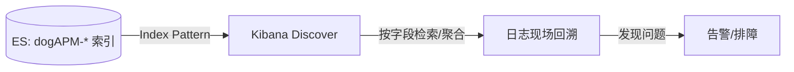

# 88. Go APM 监控系统实战: Kibana 日志检索与展示实战

## 纲要

- 前置：Logstash 已把清洗后的日志写入 ES 的 `dogAPM-*` 索引，并建好 Kibana Index Pattern
- Discover 检索：在 Kibana 的 Discover 页按时间范围 + 字段条件搜索日志
- 结构化检索：因 `level`/`app`/`hostname`/`time` 已是顶层字段，可精确搜 `level:error`、`uid:0`
- 聚合分析：按 `app`、`level`、`hostname` 等维度做统计（如各应用 error 数）
- 全链路闭环：应用日志 → Filebeat → Logstash → ES → Kibana，日志收集能力补齐

## 素材索引



## 在 Kibana 里看到日志

经过前几节，Logstash 已把清洗后的日志写入 ES 的 `dogAPM-*` 索引，且我们已在 Kibana 建好前缀为 `dogAPM`、时间字段为 `@timestamp` 的 Index Pattern。现在打开 Kibana 的 **Discover**，就能看到收集上来的日志。

## 结构化检索：从「搜不到」到「精准搜」

这正是清洗的价值体现。因为 `level`、`app`、`hostname`、`time` 已是文档顶层字段（ES 对它们建了索引），我们可以做精确检索，而不再受 `message` 文本分词的干扰：

- 搜 `level: error`：立刻捞出所有错误日志，交给后续告警或排障；
- 搜 `uid: 0`：精确匹配某用户的日志（text 类型的 message 做不到）；
- 组合 `app: order AND level: error`：定位某服务的错误现场。

## 聚合分析

除了逐条看，还能按维度聚合。例如按 `app` 分组统计各应用的日志量，或按 `level` 统计 error/warn/info 占比，快速看出「哪台机器、哪个服务、什么等级」的日志异常偏高。这些聚合正是 APM 监控大盘里「日志维度」的指标来源。

## 用 Go 客户端按字段查询

下面用官方 Go 客户端演示「查 `level=error` 的日志」（根据讲稿逻辑补充，需运行中的 ES）：

```go
// esquery/main.go —— 根据讲稿逻辑补充（需运行中的 ES，go get github.com/elastic/go-elasticsearch/v8）
package main

import (
	"context"
	"encoding/json"
	"fmt"
	"strings"

	elasticsearch "github.com/elastic/go-elasticsearch/v8"
)

func main() {
	es, _ := elasticsearch.NewClient(elasticsearch.Config{
		Addresses: []string{"http://127.0.0.1:9200"},
	})
	// term 查询：level 精确等于 error（顶层字段，可检索）
	q := `{"query":{"term":{"level":{"value":"error"}}}}`
	res, err := es.Search(
		es.Search.WithContext(context.Background()),
		es.Search.WithIndex("dogAPM-*"),
		es.Search.WithBody(strings.NewReader(q)),
	)
	if err != nil {
		panic(err)
	}
	defer res.Body.Close()

	var hit struct {
		Hits struct {
			Total struct{ Value int `json:"value"` } `json:"total"`
		} `json:"hits"`
	}
	_ = json.NewDecoder(res.Body).Decode(&hit)
	fmt.Printf("error 日志条数: %d\n", hit.Hits.Total.Value)
}
```

## 全章闭环

到此，日志收集全链路跑通：


应用日志经 Filebeat 采集、Logstash 清洗、ES 存储，最终在 Kibana 被检索分析。至此，dogAPM 的可观测性三支柱——链路追踪、指标监控、日志收集——全部补齐，三者互补：指标 / 链路告诉你「哪里不对」，日志告诉你「具体发生了什么」。

## 技术点总结

- Discover 按时间范围 + 顶层字段条件检索日志
- 清洗抽出的 `level`/`app`/`hostname`/`time` 支持精确搜与聚合
- 典型查询：`level:error`、`uid:0`、`app:order AND level:error`
- 按维度聚合可产出日志类监控指标
- 日志收集闭环补齐，与链路、指标组成完整可观测性

