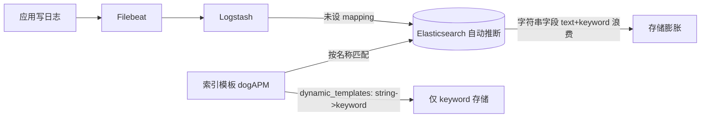

# 89. Go APM 监控系统实战: 索引模板配置与 dynamic_templates 动态映射

## 纲要

- 问题：日志经 Filebeat → Logstash 入库 ES 时未显式设定 mapping，ES 对字符串字段会同时建 `text` 和 `keyword`，带来额外存储成本
- 机制：索引模板（Index Template）按索引名称匹配，新建索引时自动套用预设的 mapping 与 settings
- 动态模板（dynamic_templates）：用一条规则让所有字符串字段仅映射为 `keyword`，不再分词存储
- 单节点环境：主分片设为 1、副本为 0
- 验证：删旧索引 → 重新写入 → 查看 mapping，确认字符串字段只剩 `keyword`
- 注意：`message` 字段也会变成 `keyword`，需要在 Logstash 中把要检索的字段（如 `action`）单独提取出来

## 素材索引



## 为什么要显式配置 mapping

前面的链路已经能把日志收集进 Elasticsearch（下文简称 ES）并用 Kibana 展示。但有一个隐患：写入文档时我们没有为索引显式指定 mapping，ES 会根据写入的字段值自动推断类型。

对数值、布尔等非字符串类型，ES 推断出的 mapping 基本合理。一旦遇到字符串类型，ES 默认会为每个字符串字段同时建立两种类型：

- `text`：分词后存储，用于全文检索；
- `keyword`：原样存储，用于精确匹配与聚合。

以 `hostname` 字段为例，我们并不希望它对这个值做分词、建倒排索引，只想把它当成一个完整字符串（即 `keyword`）来存和搜。用 `text` 存储既没必要，又多占一份倒排索引的空间。因此写入前必须为索引规定好映射。

## 索引模板机制

ES 提供的解决方案是**索引模板（Index Template）**。模板按索引名称（index pattern）匹配：每当新建一个索引，ES 会用名称去匹配对应的模板，并自动套用模板里定义的 settings 与 mappings。

在 Kibana 的「Index Management → Index Templates」中创建一个名为 `dogAPM` 的模板：

1. 指定匹配模式，例如 `dogapm-*`，凡是这个前缀的索引都会套用该模板；
2. 配置索引 settings（本例单节点，主分片设为 1、副本设为 0）；
3. 配置映射关系——因为我们一开始并不知道日志里会出现哪些字段，所以不写死具体字段，而是用**动态模板**。

## 用 dynamic_templates 让字符串只映射为 keyword

动态模板允许我们对「还没显式声明、但未来会出现的字段」按类型套规则。核心诉求是：所有字符串字段一律映射成 `keyword`，不要 `text`。

```json
{
  "index_patterns": ["dogapm-*"],
  "template": {
    "settings": {
      "number_of_shards": 1,
      "number_of_replicas": 0
    },
    "mappings": {
      "dynamic_templates": [
        {
          "strings_as_keyword": {
            "match_mapping_type": "string",
            "mapping": { "type": "keyword" }
          }
        }
      ]
    }
  }
}
```

这条 `strings_as_keyword` 规则的含义是：凡是被推断为 `string` 类型的字段，都按 `keyword` 存储，不再生成 `text`。这样能大幅减少 ES 的存储成本。

创建完模板、删掉旧的索引、重新写入一条日志后，再查看新索引的 mapping，就会看到所有字符串字段都只有 `keyword`，不再有 `text`。

需要提醒的是：`message` 字段同样会变成 `keyword`。这意味着以后想按 `message` 里的某个子字段（如 `action`）检索时，不能再直接搜 `message`，而必须把需要的字段单独提取成文档的顶层字段——这一提取工作在 Logstash 的配置里完成。

## Demo 示例

> 以下 Go 代码根据讲稿逻辑补充，通过 ES 的 REST API 创建索引模板，可直接 `go run` 执行（依赖本机 ES 在 9200 端口）。

### 运行说明

1. 本地启动 Elasticsearch（默认 9200）。
2. 执行程序，向 `_index_template/dogAPM` 发送 PUT 请求创建模板。
3. 写入一条日志文档后，用 `GET /dogapm-2024/logs/_mapping` 验证字符串字段已为 `keyword`。

### 代码

```go
// indextpl/main.go —— 根据讲稿逻辑补充（自包含可运行）
package main

import (
	"bytes"
	"fmt"
	"io"
	"net/http"
)

// tpl 即 Kibana 中配置的索引模板：单分片、字符串统一映射为 keyword。
const tpl = `{
  "index_patterns": ["dogapm-*"],
  "template": {
    "settings": { "number_of_shards": 1, "number_of_replicas": 0 },
    "mappings": {
      "dynamic_templates": [
        {
          "strings_as_keyword": {
            "match_mapping_type": "string",
            "mapping": { "type": "keyword" }
          }
        }
      ]
    }
  }
}`

func main() {
	req, err := http.NewRequest(http.MethodPut,
		"http://localhost:9200/_index_template/dogAPM",
		bytes.NewBufferString(tpl))
	if err != nil {
		panic(err)
	}
	req.Header.Set("Content-Type", "application/json")

	resp, err := http.DefaultClient.Do(req)
	if err != nil {
		panic(err)
	}
	defer resp.Body.Close()

	body, _ := io.ReadAll(resp.Body)
	fmt.Println("status:", resp.StatusCode)
	fmt.Println(string(body))
}
```

### 代码说明

- `index_patterns` 用前缀匹配，避免为每个日期索引单独建模板。
- `match_mapping_type: "string"` 是动态模板的触发条件，`mapping.type: keyword` 是落地类型。
- 真实环境中模板通常随部署脚本下发，而非业务代码里硬编码。

### 技术点总结

- 不显式设 mapping 时，ES 对字符串字段会建 `text + keyword`，造成存储浪费
- 索引模板按名称匹配，新建索引自动套用，适合按天滚动的日志索引
- `dynamic_templates` 用一条规则让所有字符串只存 `keyword`，杜绝分词
- `message` 变 `keyword` 后，检索子字段需在 Logstash 侧提取为独立 field

