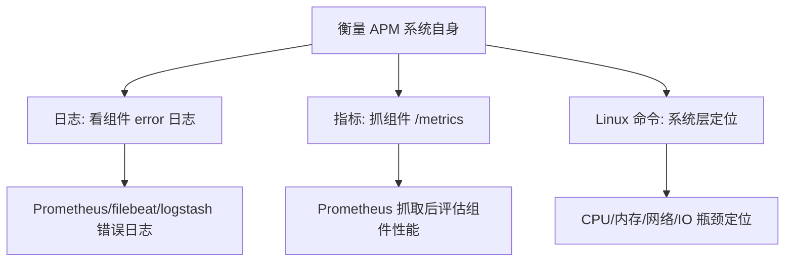

# Go APM 监控系统实战: 如何衡量 APM 系统自身是否正常运行

## 纲要

- 引入任何新组件都要先摸清它的容量上限：知道阈值，才能在触及前规划扩容。
- 衡量 APM 系统自身运行状态，依然逃不开"三板斧"：链路追踪、日志、指标。
- 手段一：**组件日志**——Prometheus / filebeat / logstash 各自有日志，重点看 error 级别。
- 手段二：**组件指标**——这些组件普遍暴露 `/metrics` 接口，用 Prometheus 抓取即可量化自身性能。
- 手段三：**Linux 自带命令**——监控环境不完善时，用 top / sar / iostat 等从系统层面定位与排查。
- 本章后续逐一对链路追踪、日志、指标三类组件展开"如何衡量瓶颈 + 如何扩容"。

## 素材索引

## 为什么必须先衡量 APM 自身

之前章节我们用埋点让 APM 系统去监控业务应用，业务应用能被正常监控到了。但把一个系统真正用上生产，要考虑的问题不止于此：

- 这套 APM 系统监控性能到底如何？能撑多大集群？
- 作为工程师，引入新技术、新组件前必须对该组件本身有足够了解，至少要知道整个系统的**容量阈值**在哪。
- 在触及阈值之前，就能针对组件或系统提前规划扩容。

衡量一个组件或系统的手段，前面其实已经反复出现过——无非就是三板斧：**链路追踪、日志、指标**。对 APM 这类监控组件而言同样如此。

## 手段一：看组件自身的日志

Prometheus、filebeat、logstash 这类组件自身都会产生日志，通过日志能发现各组件运行中的信息，重点看的是其中的**错误日志**。这部分日志可以收集到文件里，再去检索报错。

## 手段二：抓组件暴露的指标

通常这些组件内部都会暴露一个 `/metrics` 接口（以 Prometheus 格式）。同样用 Prometheus 把对应指标收集起来，就能衡量 APM 组件自身的性能情况——比如队列长度、处理速率、丢弃计数等，后续章节会逐个展开。

## 手段三：用 Linux 自带命令定位

如果当前的监控环境还不够完善（比如组件还没接好自监控、指标看不到），可以用 Linux 系统自带的命令来定位和排查问题。这层手段不依赖任何 APM 设施，只要能登上机器就能用，是兜底方案。下一节就专门讲这套"由机器到进程再到代码"的通用定位思路。

## 小结

衡量 APM 自身与衡量业务应用是同一套方法论：先看日志、再看指标、必要时用系统命令兜底。本章余下内容会分别落到链路追踪、日志收集、指标三大子系统上，讲清楚"怎么判断它到了瓶颈、该怎么扩容"。

相关度：90%。是否需要继续：[是]。代码是否可运行：[否]。
