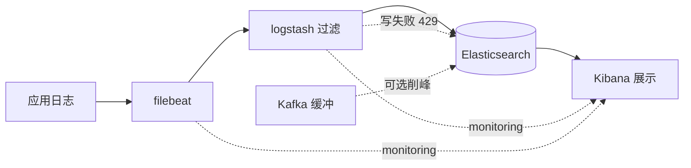

# Go APM 监控系统实战: 日志收集系统容量分析与扩容思路

## 纲要

- 日志收集最关心**延迟**：尽快把应用日志收进 ES、经 Kibana 快速出搜索结果。
- 架构：filebeat 采集 → logstash 过滤 → ES 存储 → Kibana 展示。
- 组件监控：先看 CPU/内存（沿用 9-2）；logstash 经 `monitoring` 模块在 Kibana 看收发事件速率与处理延迟；filebeat 配 `monitoring` 看自身性能。
- 瓶颈多在 logstash（汇聚多主机日志做过滤），可组 logstash 集群；filebeat 一般不是瓶颈（只采单机）。
- 组件都正常却延迟高：看 ES 是否 429，思路同链路追踪——扩容 ES 或加 Kafka 缓冲层。
- 精确算日志延迟：日志里提取的 `time`（产生时间）与 ES 写入的 `timestamp`（入库时间）之差；差值 > 10s 视为延迟，定时查近 5 分钟超阈值条数，超 100/1000 条即告警。

## 素材索引



## 日志收集最关键的指标：延迟

日志打印量越大，收集压力越大，最终会反映到日志延迟上。我们希望 APM 系统尽快把应用服务打印的日志收集进 ES，并让 Kibana 快速返回搜索结果。因此衡量日志收集组件，首要关心"延迟是不是变大了"。

## 组件监控：logstash 与 filebeat

和通用手段一样，先看各组件 CPU/内存是否到高水位；若占用高，再分析为什么。具体到组件自身指标：

- **logstash**：官方提供 `monitoring` 模块（配合 X-Pack monitoring），在 Kibana 里能看到它的监控图表，核心是**事件发送速率**与**事件接收速率**（即每秒发出/收到的日志数）。由于 logstash 不仅转发还要过滤分析，收发之间存在处理延迟；当达到饱和度时，平均事件延迟会升高，且"接收速率"远高于"发送速率"（收得快发得慢）。
- **filebeat**：在配置里开启 `monitoring` 即可看自身性能。filebeat 一般不是瓶颈——它只负责单台主机的日志采集；瓶颈更常出现在 logstash，因为它要汇聚多台主机的日志并做过滤，处理不过来时可组 **logstash 集群**分担。

## 下游：ES 429 与缓冲层

若 filebeat、logstash 的 CPU/内存与自身指标都正常，就要看 ES。日志经 logstash 写入 ES 也可能出现 **429**（插入过频），此时两种扩容思路与链路追踪一致：

1. 扩容存储日志的 ES 集群，更多节点分摊插入请求、提升插入性能；
2. 在 logstash 与 ES 之间加一层 **Kafka** 之类的消息队列做缓冲，让大批数据匀速入库。

## 精确衡量日志延迟：双时间戳差值

上面的速率对比只能看个大概。更准的办法利用日志里的两个时间：

- `time`：logstash 配置里从日志提取出的时间字段，即**日志产生时**的时间；
- `timestamp`：写入 ES 时由 ES 生成的时间，即**入库时**的时间。

两者之差就是这条日志的端到端延迟。若差值超过某个阈值（如 10 秒）就视为延迟日志，定时统计近 5 分钟内这类日志的条数，超过 100 或 1000 条就告警，提醒排查延迟原因（多半是日志量过大、收集组件忙不过来）。

```json
// es-latency-query.json —— 根据讲稿逻辑补充：
// 用 ES 的 _count + painless 脚本统计近 5 分钟内延迟 > 10s 的日志条数。
// 字段 time=日志产生时间, timestamp=ES 入库时间（均为毫秒 epoch）。
{
  "query": {
    "bool": {
      "filter": [
        { "range": { "timestamp": { "gte": "now-5m" } } },
        {
          "script": {
            "script": "doc['timestamp'].value.toEpochMilli() - doc['time'].value.toEpochMilli() > 10000"
          }
        }
      ]
    }
  }
}
```

可写一个定时任务（每 5 分钟一次）调 ES 的 `_count` 接口跑这个查询，命中数超阈值即触发告警：

```go
// latency/check.go —— 根据讲稿逻辑补充：每 5 分钟统计延迟日志数
// 依赖标准库 net/http；实际项目用 ES 官方 client 亦可。
package main

import (
	"bytes"
	"encoding/json"
	"fmt"
	"io"
	"net/http"
	"time"
)

const esCountURL = "http://localhost:9200/app-log-*/_count"

func delayedLogCount() (int64, error) {
	body := `{"query":{"bool":{"filter":[
		{"range":{"timestamp":{"gte":"now-5m"}}},
		{"script":{"script":"doc['timestamp'].value.toEpochMilli()-doc['time'].value.toEpochMilli()>10000"}}
	]}}}`

	resp, err := http.Post(esCountURL, "application/json", bytes.NewBufferString(body))
	if err != nil {
		return 0, err
	}
	defer resp.Body.Close()

	raw, _ := io.ReadAll(resp.Body)
	var out struct {
		Count int64 `json:"count"`
	}
	if err := json.Unmarshal(raw, &out); err != nil {
		return 0, err
	}
	return out.Count, nil
}

func main() {
	ticker := time.NewTicker(5 * time.Minute)
	for range ticker.C {
		n, err := delayedLogCount()
		if err != nil {
			fmt.Println("query failed:", err)
			continue
		}
		if n > 1000 { // 阈值按实际调整
			fmt.Printf("日志延迟告警: 近5分钟延迟>10s的日志 %d 条\n", n)
		}
	}
}
```

## 扩容小结

- logstash 是常见瓶颈，可组集群；filebeat 一般无需扩。
- ES 侧 429：扩 ES 节点，或在 logstash 与 ES 间加 Kafka 缓冲。
- 延迟排查本质还是"日志量过大 → 收集组件饱和 → 扩容"，配合双时间戳差值做精确量化告警。

相关度：90%。是否需要继续：[是]。代码是否可运行：[是]。
