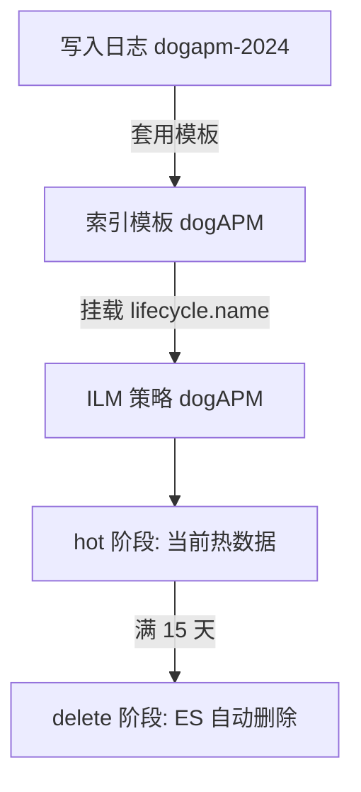

# 90. Go APM 监控系统实战: 索引生命周期 ILM 策略配置

## 纲要

- 动机：日志不能永久存储，必须按时间周期清理以控制磁盘占用
- 工具：用 Kibana 的 Index Lifecycle Management（ILM）配置生命周期策略
- 阶段选择：日志场景只需 `hot`（热数据）与 `delete`（删除）两个阶段
- 删除策略：`delete` 阶段设为 15 天，到期由 ES 自动删除索引
- 挂载：把 ILM 策略绑定到 7-9 创建的 `dogAPM` 索引模板，新索引自动带生命周期
- 验证：索引处于 `hot` 阶段，15 天后进入 `delete` 阶段被清理

## 素材索引



## 为什么需要生命周期管理

前面配好了索引模板，但日志会随业务持续累积。如果不加约束，磁盘迟早被写满。日志本身有很强的时间局部性——我们更多关注最近的日志，老日志几乎不再被检索。因此需要一个时间周期，过了这个周期就把对应日志清理掉，确保磁盘占用不会无限增长。

ES 内置的 **索引生命周期管理（ILM）** 正好解决这个问题。

## 配置 ILM 策略

在 Kibana 的「Index Lifecycle Policies」中新建一个名为 `dogAPM` 的策略。ILM 提供了多个阶段（hot / warm / cold / frozen / delete），但日志场景只需用到两个：

- `hot`：当前热数据阶段，保留默认配置即可（写入就在 hot 阶段）。
- `delete`：配置 `min_age` 为 15 天，即索引存在满 15 天后执行删除动作。

其余的 warm / cold / frozen 等阶段与本场景无关，直接删掉默认配置即可。

```json
{
  "policy": {
    "phases": {
      "hot": {
        "actions": {}
      },
      "delete": {
        "min_age": "15d",
        "actions": {
          "delete": {}
        }
      }
    }
  }
}
```

## 把策略挂到索引模板

单独创建 ILM 策略还不够，必须让索引「装上」这个策略。做法是已经建好的 `dogAPM` 索引模板里增加 lifecycle 配置：

```json
{
  "index_patterns": ["dogapm-*"],
  "template": {
    "settings": {
      "number_of_shards": 1,
      "number_of_replicas": 0,
      "index.lifecycle.name": "dogAPM"
    }
  }
}
```

绑定之后，只要日志继续写入、`dogapm-*` 索引被新建，就会自动带上 `dogAPM` 这个生命周期策略。在 Kibana 的索引管理里能看到该索引当前处于 `hot` 阶段；等到 15 天到期，阶段流转到 `delete`，ES 会自动把索引删除。

## Demo 示例

> 以下 Go 代码根据讲稿逻辑补充，通过 ES REST API 创建 ILM 策略并把 `dogAPM` 索引模板挂上该策略，可直接 `go run`（依赖本机 ES 在 9200）。

### 运行说明

1. 本地启动 Elasticsearch。
2. 先 PUT `_ilm/policy/dogAPM` 创建生命周期策略。
3. 再 PUT `_index_template/dogAPM` 创建（或覆盖）索引模板并挂上 `index.lifecycle.name`。
4. 写入日志后，用 `GET /dogapm-*/_ilm/explain` 查看阶段。

### 代码

```go
// ilm/main.go —— 根据讲稿逻辑补充（自包含可运行）
package main

import (
	"bytes"
	"fmt"
	"io"
	"net/http"
)

const ilmPolicy = `{
  "policy": {
    "phases": {
      "hot": { "actions": {} },
      "delete": { "min_age": "15d", "actions": { "delete": {} } }
    }
  }
}`

const indexTpl = `{
  "index_patterns": ["dogapm-*"],
  "template": {
    "settings": {
      "number_of_shards": 1,
      "number_of_replicas": 0,
      "index.lifecycle.name": "dogAPM"
    }
  }
}`

// putJSON 向 ES 发送 PUT 请求创建资源。
func putJSON(url, body string) {
	req, _ := http.NewRequest(http.MethodPut, url, bytes.NewBufferString(body))
	req.Header.Set("Content-Type", "application/json")
	resp, err := http.DefaultClient.Do(req)
	if err != nil {
		panic(err)
	}
	defer resp.Body.Close()
	b, _ := io.ReadAll(resp.Body)
	fmt.Printf("PUT %s -> %d\n%s\n", url, resp.StatusCode, string(b))
}

func main() {
	putJSON("http://localhost:9200/_ilm/policy/dogAPM", ilmPolicy)
	putJSON("http://localhost:9200/_index_template/dogAPM", indexTpl)
}
```

### 代码说明

- `min_age` 表示进入该阶段的年龄，从索引创建算起；`delete` 阶段的 `min_age: 15d` 即 15 天后删除。
- `index.lifecycle.name` 写在索引模板的 settings 里，新索引滚动创建时自动继承，无需逐个索引配置。
- 若后续想改成 30 天，只需更新 ILM 策略，已绑定模板的索引会自动按新周期流转。

### 技术点总结

- 日志不应永久存储，ILM 用阶段流转自动清理，保护磁盘
- 日志场景只需 hot + delete 两阶段，delete 设 `min_age` 即可
- 生命周期策略必须挂到索引模板，新索引才能自动生效
- 阶段流转可在 Kibana 的 ILM explain 中观察

