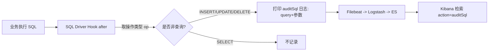

# 91. Go APM 监控系统实战: MySQL 写操作审计日志打印

## 纲要

- 背景：链路追踪与指标无法记录「系统数据怎么变的」，写操作（增删改）直接影响数据正确性，必须有据可查
- 切入点：复用前述封装的 SQL Hook，在 `after` 钩子里取操作类型（op）
- 取舍：只对非查询操作（INSERT / UPDATE / DELETE / REPLACE）打印完整 SQL 与参数，查询不记
- 落地：用封装的日志库打印 `action=auditSql`，把 query 与参数完整记录下来
- 验证：重启 orderservice → Postman 发请求 → Kibana 搜 `action=auditSql` 能查到带参数的完整 SQL
- 原则：日志不是越全越好，打日志的目标是「检测正确性」与「可回滚、可容错」，要权衡磁盘与性能

## 素材索引



## 为什么需要审计日志

前面的章节里，我们用 SQL Hook 在 `after` 钩子中记录了操作涉及的表、耗时等指标，并且重点关注慢查询。但指标只关心「慢不慢」，不会把完整的 SQL 语句原样保存下来。

系统长期运行，每时每刻都在发生增删查改。其中「修改数据」的那一类操作（插入、删除、更新）会直接影响数据的正确性。一旦业务对数据准确性产生疑问，或出了 bug 需要回滚，我们最需要的恰恰是：当时到底对哪条数据执行了什么 SQL、传了什么参数。这是链路追踪和指标都覆盖不到的盲区，只能用**日志**把系统的变化完整留痕。

## 从 SQL Hook 扩展出审计

前述已经在 SQL 驱动外面包了一层 Hook，能在 SQL 执行前后插入逻辑。这里我们复用 `after` 钩子，但把关注点从「慢查询」换成「操作类型」：

- Hook 能拿到 `op`，代表这次 SQL 是查询、插入、更新还是删除；
- 我们只对**非查询**的操作记录日志，即 `INSERT`、`UPDATE`、`DELETE`、`REPLACE`；
- 用之前封装好的日志库打印一条 `action=auditSql` 的日志，把整条 SQL 及其参数完整写进去。

这样任何一次写操作都会留下现场，后续排查或恢复数据时可以直接拿审计日志复盘。

## Demo 示例

> 以下 Go 代码根据讲稿逻辑补充，演示在 SQL 执行层对写操作打印审计日志。仅依赖标准库，可直接 `go run`。

### 运行说明

1. 把业务里的 `db.ExecContext` 改写为调用 `AuditExec`。
2. 执行一条 `INSERT`，观察日志输出 `action=auditSql` 及完整参数。
3. 日志经 Filebeat/Logstash 入库后，可在 Kibana 按 `action=auditSql` 检索。

### 代码

```go
// audit/audit.go —— 根据讲稿逻辑补充（仅依赖标准库，可直接 go run）
package main

import (
	"context"
	"database/sql"
	"log"
	"strings"
)

// AuditExec 在写操作执行后打印审计日志（完整 SQL + 参数）。
// 查询类 SQL 不记录，避免日志爆炸。
func AuditExec(ctx context.Context, db *sql.DB, query string, args ...interface{}) (sql.Result, error) {
	if isWriteOp(query) {
		log.Printf("action=auditSql query=%q args=%v", query, args)
	}
	return db.ExecContext(ctx, query, args...)
}

// isWriteOp 判定 SQL 是否以写操作关键字开头（忽略前导空白与大小写）。
func isWriteOp(query string) bool {
	s := strings.TrimSpace(query)
	for _, kw := range []string{"INSERT", "UPDATE", "DELETE", "REPLACE"} {
		if len(s) >= len(kw) && strings.EqualFold(s[:len(kw)], kw) {
			return true
		}
	}
	return false
}

func main() {
	// 演示：真实场景传入 *sql.DB，这里仅展示判定与打印逻辑
	_ = context.Background()
	log.SetFlags(0)
	_ = AuditExec(nil, nil, "INSERT INTO orders(uid, status) VALUES(?, ?)", 1, "paid")
	_ = AuditExec(nil, nil, "SELECT * FROM orders WHERE uid = ?", 1)
}
```

### 代码说明

- `isWriteOp` 用关键字前缀判定，覆盖 INSERT/UPDATE/DELETE/REPLACE，SELECT 等查询不记入审计。
- 审计日志把 `query` 与 `args` 都打出来，保证「现场可还原」；生产上用结构化字段（如 `action`）输出，方便后续按字段检索。
- 本例用 `database/sql` 接口签名，可无缝替换业务里的 Exec 调用；真实项目里 Hook 挂在驱动层，无需逐个改调用点。

### 技术点总结

- 链路追踪与指标管不了「数据怎么变」，写操作审计日志补上这块盲区
- 只对 INSERT/UPDATE/DELETE/REPLACE 记日志，SELECT 不记，控制日志量
- 审计日志要带完整 SQL 与参数，才能支撑排查与回滚
- 打日志以「正确性、可回滚」为目标，避免无脑全量打印拖累性能

