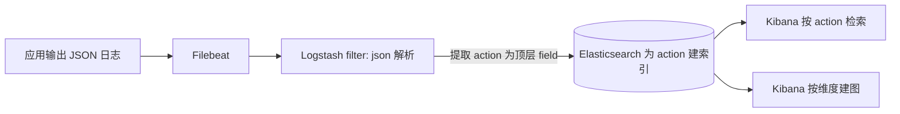

# 92. Go APM 监控系统实战: Kibana 日志分析与 action 字段提取

## 纲要

- 问题：日志越来越多后想只看某类（如审计）日志，但 `message` 是 `keyword`，无法按内部子字段检索
- 解决：在 Logstash 的 filter 阶段把 `action` 等字段从 JSON 日志中提取为独立 field，ES 会为其建索引
- 前提：日志库强制要求每条日志都带 `action`，便于后续分类分析
- 验证：重启 Logstash → Postman 发请求 → Kibana 搜 `action=auditSql` 即列出全部审计日志
- 进阶：用 Kibana 按 `app` / `host` / `action` 维度建图（如饼图），看哪类日志打印最多，反向优化打印策略

## 素材索引



## 为什么必须提取 action 字段

此前配置索引模板时，我们把所有字符串字段（含 `message`）都映射成了 `keyword`。好处是省存储，代价是：不能对 `message` 内部的内容做检索——例如想只把审计日志捞出来看，直接搜 `message` 是搜不到其中 `action` 子字段的。

打印审计日志时留了一个关键字段 `action=auditSql`。如果我们能让 ES 知道 `action` 是一个独立的可检索字段，就能精准过滤。办法是在采集链路里把 `action` 从日志正文中「提取」出来。

## 在 Logstash 中提取字段

应用输出的日志本身是 JSON，所以 Logstash 侧只需加一个 `json` filter，把 `message` 里的 JSON 解析到文档顶层，`action` 就会成为一条独立 field，ES 自动为它建索引：

```ruby
# logstash.conf —— 根据讲稿逻辑补充（filter 阶段）
filter {
  json {
    source => "message"   # 把 message 中的 JSON 解析为顶层字段，action 等随之可检索
  }
}
```

加上这段后**必须重启 Logstash** 配置才会生效。重启、重新发请求，再到 Kibana 检索 `action: auditSql`，就能把全部审计日志单独列出来。

注意：这依赖我们的日志库强制要求每条日志都带 `action` 字段——这是一开始为方便分析埋下的伏笔。

## 用 Kibana 做日志分析

`action` 能被检索后，可以进一步做可视化。在 Kibana 新建一个可视化（如饼图），选择某个维度字段（app、host 或 action）做聚合，就能看到：

- 哪个 `app` 打印的日志量最大；
- 哪个 `action` 类型出现得最频繁。

这一步的意义不只是看热闹：如果某类日志占比异常高，往往意味着打印策略需要优化。例如发现某个非关键 `action` 打印极多，就可以考虑降级或限频，避免浪费磁盘与影响性能。

## Demo 示例

> 以下 Go 代码根据讲稿逻辑补充，演示应用侧输出带 `action` 字段的 JSON 结构化日志，供 Logstash 提取与 Kibana 检索。仅依赖标准库，可直接 `go run`。

### 运行说明

1. 业务日志以 JSON 形式写到文件（供 Filebeat 采集）。
2. Logstash 用上面的 `json` filter 解析，`action` 成为可检索字段。
3. 在 Kibana 检索 `action: auditSql` 验证审计日志可被单独过滤。

### 代码

```go
// applog/main.go —— 根据讲稿逻辑补充（仅依赖标准库，可直接 go run）
package main

import (
	"encoding/json"
	"fmt"
	"os"
)

// AppLog 业务日志结构，强制带 action 字段以便分类检索。
type AppLog struct {
	Action string        `json:"action"`
	App    string        `json:"app"`
	Host   string        `json:"host"`
	Query  string        `json:"query,omitempty"`
	Args   []interface{} `json:"args,omitempty"`
}

func main() {
	// 审计日志：action=auditSql，SQL 与参数完整保留
	b, _ := json.Marshal(AppLog{
		Action: "auditSql",
		App:    "orderservice",
		Host:   "node-1",
		Query:  "INSERT INTO orders(uid,status) VALUES(?,?)",
		Args:   []interface{}{1, "paid"},
	})
	fmt.Fprintln(os.Stdout, string(b))

	// 普通访问日志：action=access
	b2, _ := json.Marshal(AppLog{Action: "access", App: "orderservice", Host: "node-1"})
	fmt.Fprintln(os.Stdout, string(b2))
}
```

### 代码说明

- `action` 是结构化日志的一等字段，写日志时由日志库强制注入，保证后续可检索。
- `Query` / `Args` 用 `omitempty`，仅在审计日志时填充，避免无关日志冗余。
- 输出的 JSON 文本进入 `message`，经 Logstash `json` filter 后 `action` 被提升为独立 field。

### 技术点总结

- `message` 是 keyword 时搜不到内部子字段，必须在采集侧提取
- Logstash `json` filter 把 JSON 日志解析为顶层字段，ES 自动为其建索引
- 强制 `action` 字段是日志可分类、可分析的前提
- Kibana 按 app/host/action 聚合，可反向指导日志打印优化

