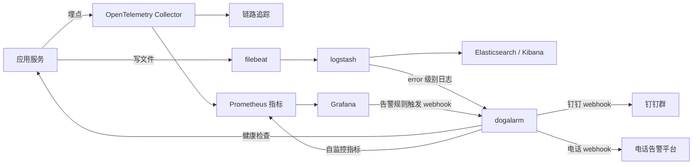
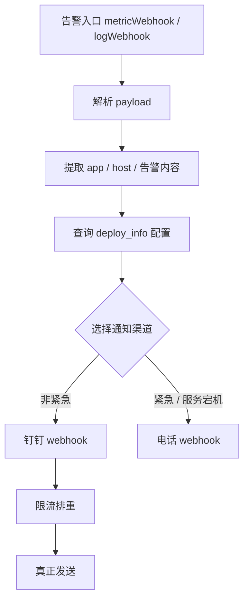
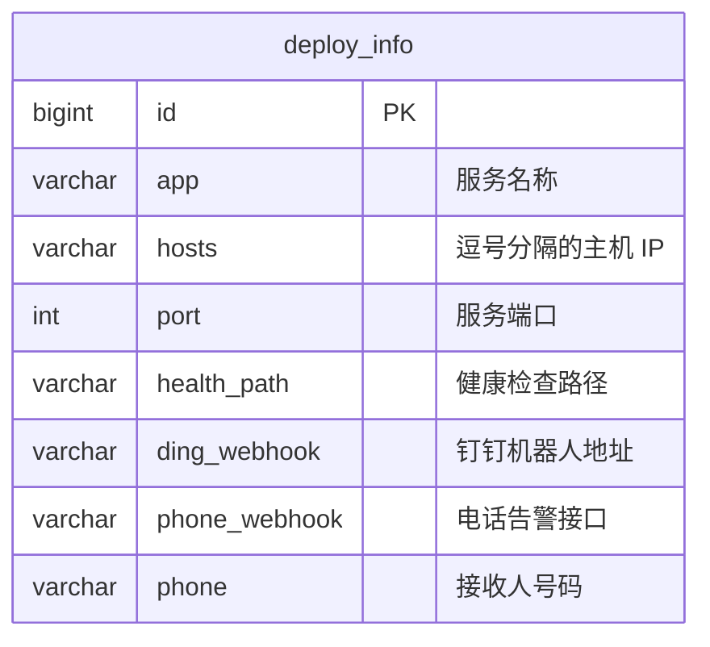

# 93. Go APM 监控系统实战: 自研告警服务需求分析与表结构设计

## 纲要

- 为什么中小团队适合自研告警服务，而不是直接引入大而全的开源告警组件
- dogalarm 在整套 APM 体系中的位置：链路追踪、指标、日志三类数据的统一告警出口
- 三类告警来源：Grafana 指标告警、Logstash 错误日志告警、服务保活探测告警
- 两类通知渠道的分工：钉钉告警（非紧急）与电话告警（需立即处理）
- `deploy_info` 单表承载服务部署信息、健康检查配置与告警通知人配置
- dogalarm 自身的自监控：丢弃告警计数、服务存活状态

## 为什么不直接用现成的告警组件

市面上的告警组件并不少，功能也足够丰富，但真正落地时往往会遇到两个问题：一是功能冗余，大部分能力在中小团队根本用不上；二是规则定制成本高，想加一条"某个服务的告警只通知某几个人"这类业务化规则，需要先吃透组件的文档和配置模型。

告警这件事的核心诉求其实很朴素：把前面几章采集到的链路追踪、指标、日志中的异常情况，用最低延迟、最少噪音的方式触达到应该处理它的人。这条链路的中间环节越少，出问题时的排查路径就越短。自研一个告警服务的收益正在于此——代码量不大，但规则完全可控，任何一个"我们团队特有的告警习惯"都能直接在代码里落地。



## dogalarm 的架构与职责

dogalarm 是自研告警服务的名字，它对外只暴露两类 HTTP 接口，对内承担三件事。

对外接口：

- `metricWebhook`：接收 Grafana 告警规则触发的回调，payload 是 Grafana 的告警 JSON。
- `logWebhook`：接收 Logstash 转发的 error 级别日志，payload 是日志 JSON。

对内职责：

- 告警路由：按 `app`（服务名）维度查配置，找到该服务应该通知谁、用哪种渠道。
- 告警治理：限流、排重、屏蔽期，避免告警风暴和重复轰炸。
- 服务保活：定时对配置中的服务做健康检查，失败重试后仍不可用则触发告警，甚至尝试自动重启。



## 通知渠道的选择策略

| 渠道 | 适用场景 | 特点 |
| --- | --- | --- |
| 钉钉告警 | 异常但不需要立刻处理，例如偶发错误日志、指标抖动 | 免费，但有调用频率限制（每个机器人每分钟 20 条） |
| 电话告警 | 严重影响用户、需要立即介入，例如服务宕机、核心指标跌零 | 按次计费，需要企业资质，且必须做屏蔽期控制 |

课程里的默认约定是一个简单可解释的规则：指标告警和保活告警走电话，error 日志告警走钉钉。真实生产环境中更灵活的做法是在告警规则里显式声明期望的渠道，甚至可以在配置里增加"电话告警版本"字段，用来切换不同的电话通道供应商——这正是自研告警服务相比大而全组件的优势：改几行配置就能换通道。

## deploy_info 表结构设计

整个 dogalarm 只用一张表 `deploy_info`。它同时描述了三件事：服务部署在哪、怎么探活、告警通知给谁。

| 字段 | 类型 | 含义 |
| --- | --- | --- |
| `id` | bigint | 主键 |
| `app` | varchar | 服务名称，告警路由的维度 |
| `hosts` | varchar | 部署主机 IP，多个以逗号分隔 |
| `port` | int | 服务端口 |
| `health_path` | varchar | 健康检查接口路径，如 `/hello` |
| `ding_webhook` | varchar | 钉钉机器人 webhook 地址 |
| `phone_webhook` | varchar | 电话告警平台接口地址 |
| `phone` | varchar | 电话告警接收人号码 |

几个设计上的取舍值得说明：

- 告警通知规则放在 `app` 维度。同一家公司里不同服务往往由不同小组负责，用 `app` 作为配置粒度，天然对应"这个服务出问题该找谁"。
- `hosts` 用逗号分隔而不是建从表。服务数量有限、IP 变更频率低，单字段换取更简单的查询代码是划算的。
- `phone` 从 `phone_webhook` 中独立出来。部分电话告警平台把接收人配置放在平台侧，webhook 里不含号码；而有些平台要求在请求体里显式传号码。两个字段分开，切换供应商时改配置即可，不用改代码。

健康检查的 URL 由这三部分拼出来：

```
http://{host}:{port}{health_path}
```

dogalarm 遍历 `hosts` 拆分出的每一个 IP，逐个发起探测。



## dogalarm 的自监控

告警服务自己不能是黑盒，否则它挂了没人知道。dogalarm 需要暴露两类自定义指标，接入 Prometheus 后用 Grafana 展示：

- 丢弃告警数（Counter）：因为限流排重被丢掉的告警次数，维度为 `app`、`host`、`通知类型`。用 `rate()` 观察过去五分钟的丢弃速率，可以反向评估告警是否过于密集。
- 服务存活状态（Gauge）：每个 `app` + `host` 的健康状态，`1` 表示存活，`0` 表示宕机。

## Demo 示例

> 以下 SQL 与 Go 结构体根据讲稿逻辑补充，可直接执行/编译。

### 运行说明

1. 在 MySQL 中执行建表语句，库名为 `dogalarm`。
2. 插入一条待监控服务的配置。
3. Go 结构体用于在代码中承接查询结果，可直接 `go build`。

### 代码

```sql
CREATE DATABASE IF NOT EXISTS dogalarm DEFAULT CHARSET utf8mb4;

USE dogalarm;

CREATE TABLE IF NOT EXISTS deploy_info (
    id           BIGINT UNSIGNED NOT NULL AUTO_INCREMENT COMMENT '主键',
    app          VARCHAR(64)  NOT NULL DEFAULT '' COMMENT '服务名称',
    hosts        VARCHAR(255) NOT NULL DEFAULT '' COMMENT '部署主机 IP，多个以逗号分隔',
    port         INT          NOT NULL DEFAULT 0  COMMENT '服务端口',
    health_path  VARCHAR(128) NOT NULL DEFAULT '/hello' COMMENT '健康检查接口路径',
    ding_webhook VARCHAR(512) NOT NULL DEFAULT '' COMMENT '钉钉机器人 webhook',
    phone_webhook VARCHAR(512) NOT NULL DEFAULT '' COMMENT '电话告警接口',
    phone        VARCHAR(32)  NOT NULL DEFAULT '' COMMENT '电话告警接收人',
    PRIMARY KEY (id),
    UNIQUE KEY uk_app (app)
) ENGINE = InnoDB DEFAULT CHARSET = utf8mb4 COMMENT = '服务部署与告警通知配置';

INSERT INTO deploy_info (app, hosts, port, health_path, ding_webhook, phone_webhook, phone)
VALUES ('orderservice', '192.168.1.10,192.168.1.11', 8080, '/hello',
        'https://oapi.dingtalk.com/robot/send?access_token=xxx',
        'https://vendor.example.com/voice/notify', '13800000000');
```

```go
package model

import (
	"strconv"
	"strings"
)

// DeployInfo 对应 deploy_info 表，承载服务部署信息与告警通知配置。
type DeployInfo struct {
	ID           int64  `db:"id"`
	App          string `db:"app"`           // 服务名称，告警路由维度
	Hosts        string `db:"hosts"`         // 逗号分隔的部署主机 IP
	Port         int    `db:"port"`          // 服务端口
	HealthPath   string `db:"health_path"`   // 健康检查路径
	DingWebhook  string `db:"ding_webhook"`  // 钉钉机器人 webhook
	PhoneWebhook string `db:"phone_webhook"` // 电话告警接口
	Phone        string `db:"phone"`         // 电话告警接收人
}

// HostList 拆分 hosts 字段，得到该服务部署的所有主机 IP。
func (d DeployInfo) HostList() []string {
	if d.Hosts == "" {
		return nil
	}
	hosts := make([]string, 0, 4)
	start := 0
	for i := 0; i <= len(d.Hosts); i++ {
		if i == len(d.Hosts) || d.Hosts[i] == ',' {
			if h := trimSpace(d.Hosts[start:i]); h != "" {
				hosts = append(hosts, h)
			}
			start = i + 1
		}
	}
	return hosts
}

// HealthURL 拼装某个主机上的健康检查地址。
func (d DeployInfo) HealthURL(host string) string {
	return "http://" + host + ":" + itoa(d.Port) + d.HealthPath
}

func trimSpace(s string) string {
	b := []byte(s)
	i, j := 0, len(b)-1
	for i <= j && b[i] == ' ' {
		i++
	}
	for j >= i && b[j] == ' ' {
		j--
	}
	return string(b[i : j+1])
}
```

### 代码说明

- `DeployInfo` 一个结构体覆盖部署信息、探活配置与通知配置，避免多表 join。
- `HostList` 负责把 `hosts` 字段拆成 IP 列表，保活探测时逐台探测。
- `HealthURL` 统一拼装健康检查地址，保证探测逻辑与配置解析解耦。

### 技术点总结

- 告警服务的核心价值是统一出口，把治理逻辑（限流、排重、路由）收敛在一处。
- 单表设计足以支撑中小规模场景，配置粒度选在 `app` 维度最贴合团队协作方式。
- 告警服务本身必须被监控，否则会出现"告警系统挂了但没人告警"的盲区。

