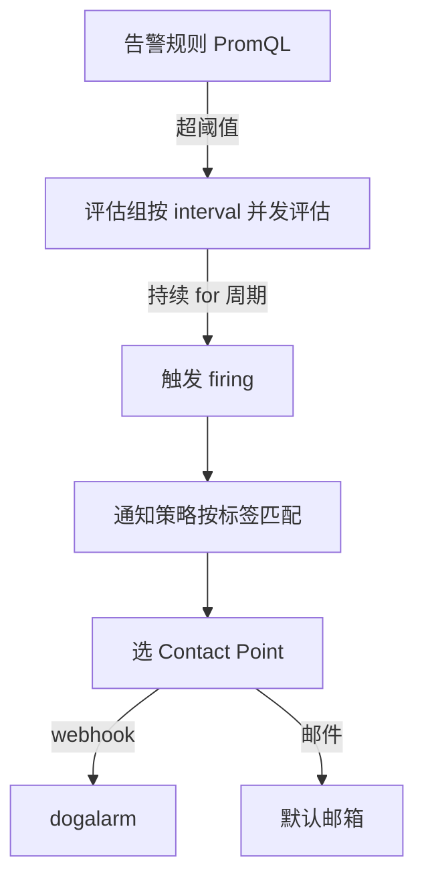

# 95. Go APM 监控系统实战: Grafana 告警规则与通知原理

## 纲要

- 三大组成：告警规则（PromQL 与阈值比较）、联系方式（Contact Point：邮件 / webhook）、通知策略（Notification Policy：按标签匹配）
- 标签路由：告警规则打标签 → 通知策略按标签匹配 → 选出对应的 Contact Point
- 评估组与间隔：每个告警规则归属一个 group，group 有 evaluation interval，组内规则并发评估
- 挂起周期（for / pending）：持续超阈值一段时间才真正通知，过滤偶发抖动
- 无数据处理：`No Data` 默认按 `error` 触发告警，可改 `OK` 避免无数据时误报
- 课程约定：所有规则统一打 `dogAPM=1`，全部发往自研 dogalarm，由 dogalarm 做限流排重与渠道选择
- 实战示例：以 QPS 面板为例建规则（原始序列 → reduce max → 阈值），group=APMServer 30s，for=1m

## 素材索引



## 告警的三要素

在 Grafana 的 Alerting 模块里，配置告警要理解三个概念：

1. **告警规则（Alert Rules）**：决定「对哪些指标、用什么 PromQL、跟什么阈值比较」。PromQL 查询输出一个值，与设定的阈值比较，超过就对该维度（app 或 host）告警。
2. **联系方式（Contact Points）**：决定「告警怎么发出去」。默认是邮件，还支持 webhook 等方式——webhook 能把告警 JSON 发往你指定的接口，这正是接入自研 dogalarm 的入口。
3. **通知策略（Notification Policies）**：决定「哪条告警发往哪个 Contact Point」。它靠**标签（labels）**匹配：创建规则时打的标签，会与策略里的标签条件匹配，命中后路由到对应的 Contact Point。

## 标签路由是核心

通知策略的匹配本质是标签匹配。例如给 `app1`、`app2` 打上「同部门」的标签，再在 Contact Point 里配该部门的钉钉群，就能把这两个服务的告警专门发到对应钉钉群。

但本课程不按 app 维度在 Grafana 侧拆分——我们把「不同项目关联的具体通知人」放在自研告警系统里维护，这样便于在统一出口做限流、排重、屏蔽期，也能把日志告警一并收口。因此约定：**所有 Grafana 告警规则统一打标签 `dogAPM=1`**，通过一条通知策略发往 dogalarm 的 webhook，后续的渠道选择与路由全在 dogalarm 代码里完成。

## 评估组、间隔与挂起周期

告警规则不会每分每秒都跑，ES 把它归入一个**评估组（evaluation group）**，组内有 `evaluation interval`（如 30s），到时间才并发评估组内所有规则。

即便评估时超过了阈值，也不一定立刻通知。Grafana 提供 **for（挂起周期 / pending period）**：指标触发阈值后，规则先进入 `pending` 状态，只有持续处于该状态达到 for 设定（如 1m），才真正变为 `firing` 并通知。这能过滤掉偶发的瞬时抖动——如果服务在 for 周期内自行恢复，就不会打扰开发者。

## 无数据与屏蔽恢复通知

- **No Data 处理**：PromQL 查不到数据时，默认按 `error` 触发告警。若不想「无数据」也告警，可改为 `OK`。
- **屏蔽恢复通知**：Contact Point 的 Notification Settings 里可勾选，告警恢复（resolved）时不向接收方发通知。生产上往往只在「触发」时主动通知，恢复无需打扰。

## 实战：以 QPS 面板建告警规则

从已有的监控面板进入 `Edit → Alert`，Grafana 会自动把面板的 PromQL 填充进来。规则由三段表达式组成：

- **A（原始序列）**：面板原有 PromQL，输出按 app 维度的多个时间序列；
- **B（reduce）**：把时间序列聚合为一个值，可选 last / min / max / avg / sum。看「过去 5 分钟 QPS 是否超阈值」，选 `max`；
- **C（threshold）**：与阈值比较，本例演示设为 0。

配置项：评估组 `APMServer`，间隔 30s；`for` 1m。标签加 `dogAPM=1`。保存后规则状态先变 `pending`，满 1m 变 `firing`；再配一个 webhook 类型的 Contact Point（地址指向 dogalarm 的 `metricWebhook`，端口 8084），并用通知策略把 `dogAPM=1` 路由过去，告警即发往 dogalarm。

## Demo 示例

> 以下 Go 代码根据讲稿逻辑补充，模拟 Grafana 通知策略的标签匹配路由，可直接 `go run` 验证「带 `dogAPM=1` 的告警被路由到 dogalarm」。

### 运行说明

1. `go run` 演示：定义告警标签与策略标签，调用 `MatchPolicy` 判断命中。
2. 命中后即对应「Grafana 把告警发往该 Contact Point（dogalarm webhook）」的行为。

### 代码

```go
// routerouter/route.go —— 根据讲稿逻辑补充（仅依赖标准库，可直接 go run）
package main

import "fmt"

// ContactPoint 对应 Grafana 的 Contact Point，含路由所需的标签条件。
type ContactPoint struct {
	Name   string
	Labels map[string]string
}

// MatchPolicy 模拟 Notification Policy 的标签匹配：
// 告警标签必须包含策略要求的全部标签且值一致，才算命中。
func MatchPolicy(alertLabels, policyLabels map[string]string) bool {
	for k, v := range policyLabels {
		if alertLabels[k] != v {
			return false
		}
	}
	return true
}

func main() {
	// 告警自带的标签（来自告警规则的 labels）
	alert := map[string]string{"dogAPM": "1", "severity": "critical", "app": "orderservice"}

	// 通知策略要求 dogAPM=1，命中后路由到 dogalarm webhook
	dogalarmPolicy := map[string]string{"dogAPM": "1"}
	cp := ContactPoint{Name: "dogalarm-webhook", Labels: dogalarmPolicy}

	if MatchPolicy(alert, cp.Labels) {
		fmt.Printf("告警 %s 路由到 Contact Point: %s\n", alert["app"], cp.Name)
	}
}
```

### 代码说明

- `MatchPolicy` 实现的就是 Grafana 通知策略的标签匹配语义：策略标签是「子集」，告警标签是「全集」。
- 课程里所有规则统一打 `dogAPM=1`，因此一条策略即可把它们全部收口到 dogalarm。
- 真正的渠道细分（电话 / 钉钉）放在 dogalarm 内完成，Grafana 侧保持简单。

### 技术点总结

- 告警 = 规则(PromQL+阈值) + Contact Point + Notification Policy(标签匹配)
- for 周期过滤偶发抖动，No Data 可改 OK 防误报
- 标签路由是核心：课程统一打 `dogAPM=1`，全量收口到自研 dogalarm
- 渠道选择下沉到 dogalarm，Grafana 侧只负责「触发并发送」

