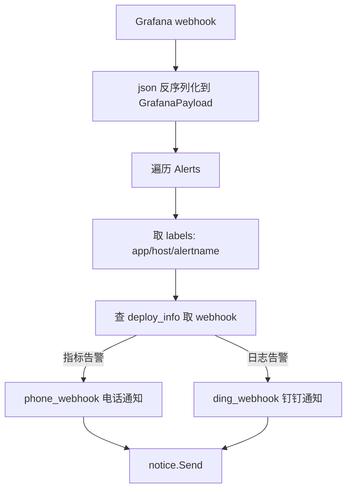

# 96. Go APM 监控系统实战: 实现 Grafana 指标告警 Webhook 接口

## 纲要

- 目标：把前述 Grafana webhook 格式解析成结构体，提取所需字段并发往对应 app 的通知人
- 定义 payload 结构体（model 包）：`Status`、`Alerts[]`、`Labels/CommonLabels`（map[string]string）、`Annotations`
- 状态常量：`firing`（告警触发）/ `resolved`（已恢复）；被静默（silenced）时还会带 `suppressed` 标记
- 解析：JSON 反序列化到结构体，失败打日志；遍历 `Alerts` 逐条处理
- 提取维度：从 `Labels` 中取 `app`（服务名）、`host`（主机）、`alertname`（告警名），`values` 含阈值与当前值
- 查表路由：用 `app` 查 `deploy_info` 得钉钉 / 电话 webhook；本课程约定指标告警走 `phone_webhook`（电话）
- 通知层：`notice` 包定义 `MediaType` 常量与统一 `Send` 方法，底层用 `http.Client`（可自定义重试）

## 素材索引



## 把 webhook 格式转成结构体

Grafana 触发告警后，向 Contact Point 配置的 webhook 地址 POST 一段 JSON。第一步是把这段 JSON 还原成 Go 结构体，放在 `model` 包里承载。对照 Grafana 实际发送的字段：

- `receiver`：命中的 Contact Point 名称；
- `status`：告警状态（`firing` / `resolved` 等）；
- `alerts`：本次触发的告警数组，每条含 `labels`、`annotations`、`startsAt` 等；
- `commonLabels` / `commonAnnotations`：所有告警共有的标签，同样用 `map[string]string` 接收，方便提取 `alertname`；
- `groupLabels`：分组标签。

注意结构体字段的 JSON tag 必须与 Grafana 发送的大小写完全一致，否则解析不到。

## 状态码与解析流程

`status` 表示告警规则当前状态，定义成常量避免硬编码出错：Grafana webhook 实际只会下发 `firing`（正在告警）与 `resolved`（已恢复，规则恢复正常时也会回调同一个接口）；被静默规则命中的告警会附带 `suppressed` 标记。

处理流程：

1. 用 `json.Unmarshal` 把请求体反序列化到 `GrafanaPayload`；解析失败打印错误日志并返回。
2. 解析成功后遍历 `alerts` 数组，对每一条告警：
 - 从 `labels` 取 `app`（服务名）、`host`（主机）、`alertname`（告警名）；
 - 拼接告警正文，包含服务名、主机、告警名，以及 `values`（含设定的阈值与当前触发值），让接收人清楚超了多少；
 - 用 `app` 去 `deploy_info` 表查该服务的部署信息，得到 `ding_webhook` 与 `phone_webhook`。

## 查表与渠道路由

拿到 `deploy_info` 后，就能确定通知谁、用哪个渠道。本课程约定：**指标告警统一走 `phone_webhook`（电话告警）**，后续日志告警则走 `ding_webhook`（钉钉）。具体生产环境中，可以更灵活——在告警规则里显式声明期望渠道，不必在代码里写死。

## 通知层封装

`notice` 包承接所有通知相关逻辑。先定义媒体类型常量，再提供一个统一的 `Send` 方法，由上层 API 调用。底层最终通过 `http.Client` 发起 webhook 请求，client 可自定义重试规则与失败日志——这部分底层实现放到后续展开，本节先把上层统一调用定好。

## Demo 示例

> 以下 Go 代码根据讲稿逻辑补充，演示 Grafana webhook 的 payload 定义与解析路由逻辑。仅依赖标准库（`encoding/json`），可直接 `go run` 验证字段提取。

### 运行说明

1. 把 `GrafanaPayload` 放到 `model` 包，`HandleMetricAlert` 作为 `metricWebhook` 的处理函数。
2. 用 Postman 向 `:8084/metricWebhook` 发一条 Grafana 告警 JSON，观察提取出的 app/host/alertname 与路由结果。

### 代码

```go
// model/grafana.go —— 根据讲稿逻辑补充（payload 结构体，仅依赖标准库）
package model

// Grafana 告警 webhook 状态码常量。Grafana 实际只会下发 firing / resolved，
// 被静默规则命中时附带 suppressed 标记。
const (
	StatusFiring   = "firing"
	StatusResolved = "resolved"
)

// GrafanaPayload 对应 Grafana 发往 webhook 的告警 JSON。
type GrafanaPayload struct {
	Receiver       string            `json:"receiver"`
	Status         string            `json:"status"`
	Alerts         []Alert           `json:"alerts"`
	GroupLabels    map[string]string `json:"groupLabels"`
	CommonLabels   map[string]string `json:"commonLabels"`
	CommonAnnotations map[string]string `json:"commonAnnotations"`
}

// Alert 单条告警，labels 含 app/host/alertname 等路由维度。
type Alert struct {
	Status       string            `json:"status"`
	Labels       map[string]string `json:"labels"`
	Annotations  map[string]string `json:"annotations"`
	StartsAt     string            `json:"startsAt"`
	EndsAt       string            `json:"endsAt"`
}
```

```go
// api/metric.go —— 根据讲稿逻辑补充（解析 + 查表 + 路由示意）
package api

import (
	"encoding/json"
	"fmt"
	"io"
	"net/http"

	"your/module/dogalarm/model"
	"your/module/dogalarm/notice"
)

// HandleMetricAlert 处理 Grafana 指标告警 webhook。
func HandleMetricAlert(w http.ResponseWriter, r *http.Request) {
	body, _ := io.ReadAll(r.Body)

	var p model.GrafanaPayload
	if err := json.Unmarshal(body, &p); err != nil {
		fmt.Println("解析 Grafana 告警失败:", err)
		_, _ = w.Write([]byte("parse error"))
		return
	}

	for _, a := range p.Alerts {
		app := a.Labels["app"]
		host := a.Labels["host"]
		alertName := a.Labels["alertname"]

		msg := fmt.Sprintf("服务=%s 主机=%s 告警=%s 值=%v", app, host, alertName, a.Labels["value"])
		fmt.Println("收到指标告警:", msg)

		// 查 deploy_info 得到通知方式；指标告警默认走电话
		info := queryDeployInfo(app) // info.PhoneWebhook != "" {
			notice.Send(info.PhoneWebhook, msg)
		}
	}
	_, _ = w.Write([]byte("ok"))
}

// queryDeployInfo 按 app 查部署与通知配置（实现o 表）。
func queryDeployInfo(app string) model.DeployInfo { return model.DeployInfo{} }
```

### 代码说明

- `GrafanaPayload.Alerts` 是数组，需逐条处理；`Labels` 用 `map[string]string` 通用接收，提取 `app/host/alertname` 即可。
- `status` 用常量代替字符串，避免拼写错误导致路由分支失效。
- 指标告警默认走 `phone_webhook`（电话），渠道规则可下沉到告警规则或 `notice` 层灵活配置。
- `notice.Send` 是统一出口，底层重试 / 失败日志在后续补齐。

### 技术点总结

- Grafana webhook 先反序列化为结构体，再遍历 alerts 提取 app/host/alertname
- status 三态用常量管理，区分 firing / resolved 避免误处理恢复通知
- 用 app 查 deploy_info 得到 webhook，指标告警走电话、日志告警走钉钉
- notice 包统一 Send 出口，重试与失败策略可独立扩展

